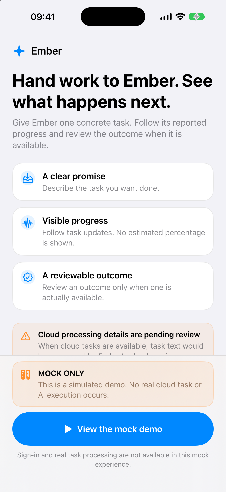
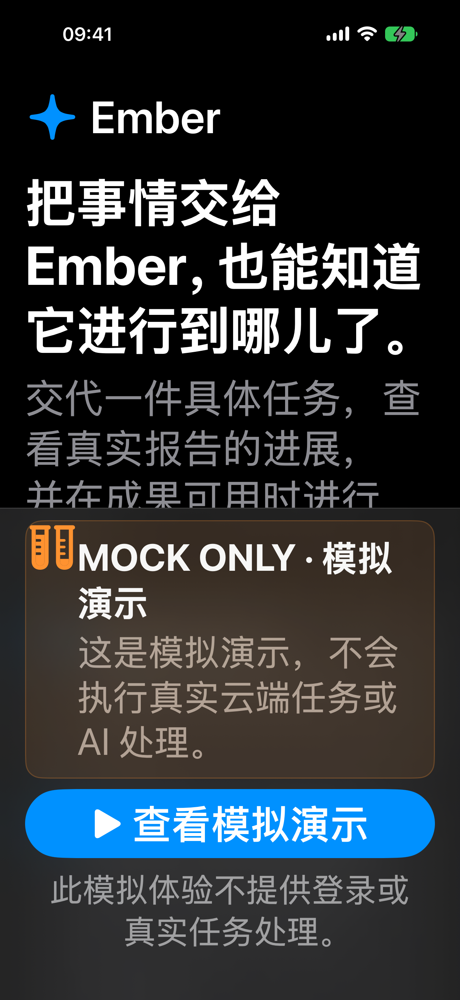
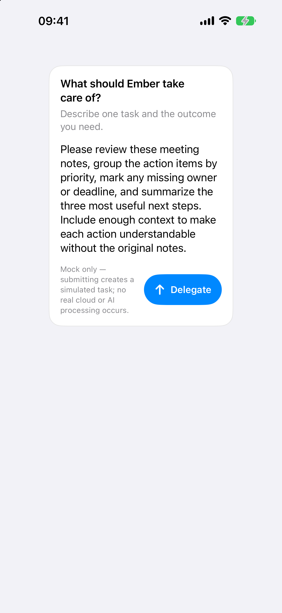
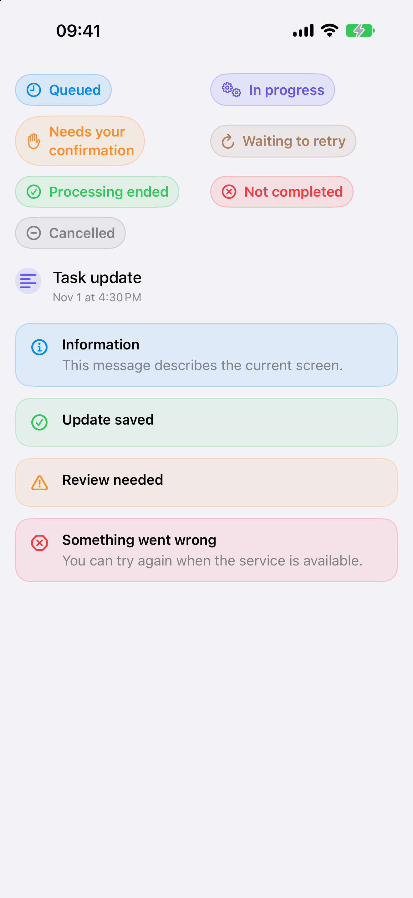
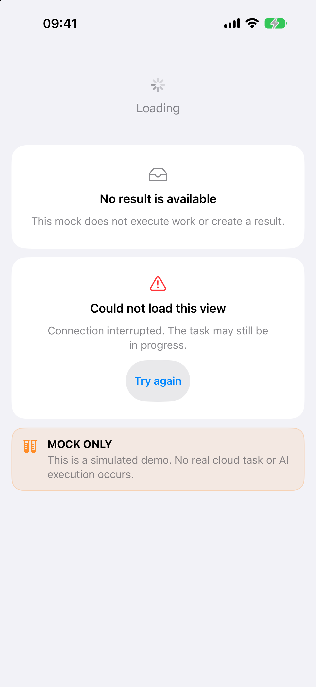

# PR #47 · Round 2 visual evidence

These unedited PNG captures were rendered from the PR's SwiftUI views and components on an iPhone 17 Pro Max simulator running iOS 27.0. Because the production app root remains outside this lane, a temporary local evidence host displayed the components; its app-root and UI-test changes were restored and are not part of the PR.

## Screenshots

English onboarding, light appearance:



Simplified Chinese onboarding, dark appearance, Accessibility 3 text size:



Long Composer input in a 320-point-wide layout:



Task statuses, activity, and notice tones:



Loading, empty, error, and Mock Only surfaces:



The captured strings resolve in English and Simplified Chinese, with no raw localization keys visible. The narrow Composer's submit label stays on one line. At Accessibility 3, onboarding content continues below the viewport and is intended to scroll. The `MOCK ONLY` banner, demo button, and sign-in note are placed in a bottom safe-area inset; the screenshots show this footer at rest.

The simulator test suite and scroll interaction were **not run in Round 2**, following Jia's request. An earlier temporary scroll probe failed to locate the combined banner accessibility element and produced no valid result bundle, so it is not counted as evidence. VoiceOver was **not run**.

## Xcode verification

Generic Simulator SDK build on the Round 2 source: **passed**.

```sh
xcodebuild -project apps/ios/Ember.xcodeproj -scheme Ember -destination 'generic/platform=iOS Simulator' CODE_SIGNING_ALLOWED=NO build
```

The 15 passed / 0 failed / 0 skipped result cited in Round 1 belongs to the previously reviewed head `4a50b158fed11eea7f5a657c781789edc03505bc`; it does not validate this revision. Issue #50 is pending, and no Round 2 test result is claimed.
