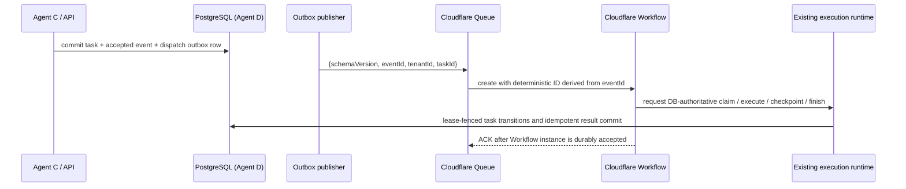

# Cloudflare Queues + Workflows PoC

Status: isolated local PoC, no Cloudflare account resources created and no remote deployment. The source lives in `packages/cloudflare-queues-poc`. It uses Cloudflare's local Workers runtime for Queue and Workflow semantics; its KV-backed execution port is a test double and is not an Ember persistence adapter.

## Result

**Recommendation: adopt the Cloudflare-first dispatch/orchestration boundary as the target architecture, with Free as the low-cost starting tier and Workers Paid as the first scale step when measured usage exceeds Free limits. Gate production rollout on PostgreSQL connectivity, durable outbox design, measured quotas, and prior billing/deployment approval.** Keep the execution port provider-neutral so an AWS or other best-fit worker/queue remains possible if workload, economics, or service constraints call for it. PostgreSQL remains authoritative throughout; no business contract or database rewrite is proposed. This local PoC does not prove production account eligibility, live quotas, PostgreSQL connectivity, or service interoperability.

Queue delivery and Workflow step execution are at-least-once boundaries. Neither can become a second Ember task state machine. PostgreSQL must remain authoritative for tenant ownership, task/run state, lease epoch, heartbeat, cancellation, retry schedule, checkpoints, result publication, and task events.

## Proposed boundary



The message is a wake-up hint, not a lease grant. Keep it under 1 KB and never include task input, prompts, tokens, sandbox credentials, or result text. Validate its closed schema, then ask the execution boundary to re-read the task by `(tenant_id, task_id)` and claim it in PostgreSQL. A queue ACK means only that a Workflow instance exists; it does not mean the Ember Task succeeded.

The existing repository does not have a transactional dispatch outbox. `PostgresTaskRepository.create()` currently commits the Task and its `accepted` row in `task_events`; it does not record a broker publication cursor. For a production bridge, insert an outbox row in that same transaction and publish it with a stable `eventId`, or add equivalent durable dispatch tracking. Do not publish directly after task commit and assume the call result is certain: a crash after Queue acceptance but before recording publication creates an expected duplicate. Queue delivery is at-least-once, and Workflow IDs remain occupied only through the Workflow instance retention period.

### Agent C / API handoff

- Producer input/output is `TaskDispatchEnvelope`: `{ schemaVersion: 1, eventId, tenantId, taskId }`.
- The producer runs from a committed outbox row; it must not copy API request bodies or task input to the broker.
- Keep B1 HTTP, DTO, auth, idempotency, and Unknown ACK behavior unchanged. The API does not report Queue publication as task acceptance; PostgreSQL acceptance remains the receipt.
- The PoC's `POST /_poc/dispatch` route only exists for local testing. `workers_dev` and preview URLs are disabled in the Wrangler config.

### Agent D / PostgreSQL handoff

- Keep `tasks`, `runs`, `task_events`, checkpoints, artifacts, and budget/idempotency rows authoritative. Queue/Workflow state is not a replacement for any of these.
- Provide a narrow execution port to re-read and claim a current DB-owned Run, heartbeat, check cancellation, commit a checkpoint/result under the current `(tenantId, taskId, runId, attempt, leaseEpoch)`, and finish. Every write must remain fenced transactionally in PostgreSQL.
- A Queue message may be stale, foreign, duplicate, delayed, or expired. Never treat its `tenantId`, `taskId`, or `eventId` as verified authorization or execution state.
- The PoC deliberately does not assume Hyperdrive is Free or that the current `pg` / transaction path works in Workers. Resolve that separately with Agent D; there is no fallback to D1.
- Agent D's managed PostgreSQL comparison now includes Neon alongside Supabase. This PoC preserves the PostgreSQL contract and does not choose or migrate the database provider.

## Failure semantics and non-equivalence

| Concern                   | Ember PostgreSQL worker                                                                                             | Queues / Workflows Free                                                                                                           | Adapter rule                                                                                                                                                                                           |
| ------------------------- | ------------------------------------------------------------------------------------------------------------------- | --------------------------------------------------------------------------------------------------------------------------------- | ------------------------------------------------------------------------------------------------------------------------------------------------------------------------------------------------------ |
| Claim and concurrency     | `PostgresLeaseQueue` claims under row locks and persists the current Run, worker, attempt, lease expiry, and epoch. | Workflow concurrency only limits active instances; it does not own an Ember Task.                                                 | DB claim is authoritative. Platform concurrency is capacity control only.                                                                                                                              |
| Stale worker protection   | Heartbeat/finish/result writes check Task, Run, expiry, and `leaseEpoch` after row locks.                           | Workflow ID uniqueness prevents duplicate instance creation for a retention window; it does not fence an old callback or sandbox. | Require DB `leaseEpoch` fencing on every effect and finish.                                                                                                                                            |
| Checkpoint and result     | PostgreSQL checkpoint/result paths bind the write to the current lease and idempotency key.                         | Workflow step state commits separately from PostgreSQL; an external side effect can happen before the step is durably recorded.   | Use stable operation IDs and existing DB checkpoint/result transactions. Do not mark a step complete before the DB commit returns.                                                                     |
| Retry/backoff             | Task attempt count, max attempts, deadline, `next_run_at`, and bounded exponential retry are in PostgreSQL.         | Queue retries default to 3 and can route to a DLQ; Workflow step retries are separate.                                            | Only the PostgreSQL Task state machine chooses Ember attempts/backoff. Queue retries retry trigger acceptance; Workflow retries retry an idempotent adapter call. Do not count these as Task attempts. |
| Crash recovery            | Reaper observes expired leases and converges the Run/Task; a later claim gets a higher epoch.                       | Queues redeliver; Workflows resume/retry steps. The platform does not know which DB commit was made.                              | Re-read PG state after every restart; stale grants fail closed.                                                                                                                                        |
| Cancellation              | `cancel_requested_at`, cooperative abort, and lease-fenced finish converge cancellation in PostgreSQL.              | Terminating a Workflow does not prove an external operation or sandbox stopped, nor does it atomically cancel the PG Task.        | DB cancellation wins; check it before work and before publication. Terminate only as a best-effort signal.                                                                                             |
| Dead letter               | Terminal Task state/event is recorded in PG.                                                                        | DLQ is a transport record after the configured delivery retry ceiling.                                                            | DLQ is an operational alert/replay source, never a Task terminal-state store. Reconcile with PG before replay.                                                                                         |
| Tenant isolation          | Repositories and composite FKs scope all Task/Run writes by tenant; worker context is DB-derived.                   | Queue payload is just JSON and is not identity proof.                                                                             | Resolve task owner and active lease from PG; a foreign or unknown envelope must cause zero effects.                                                                                                    |
| Retention and unknown ACK | PG state/events outlive a queue delivery and can reconcile the client/server unknown outcome.                       | Free Queue retention is 24 hours; Workflow completed/errored state retention is 3 days.                                           | Keep the durable outbox and PG idempotency beyond platform retention. Reconciliation must be able to republish from PG.                                                                                |

Cloudflare documents Queues as at-least-once. A repeated event should derive the same Workflow instance ID from the stable outbox event ID. `createBatch` reports an existing instance with code `10405`; that is safe to ACK only after the envelope has already been validated and the event ID is database-generated and immutable. A retryable error creating an instance must retry the Queue message. The PoC implements that mapping.

## Eligibility, quotas, and cost as usage grows

Official docs reviewed on 2026-11-07 (current pricing/limits pages last updated between 2026-04-21 and 2026-11-04):

| Product         | Workers Free                                                                                                                                                                                                                                                          | Workers Paid scale path                                                                                                                                                                                                                                                                                                                                |
| --------------- | --------------------------------------------------------------------------------------------------------------------------------------------------------------------------------------------------------------------------------------------------------------------- | ------------------------------------------------------------------------------------------------------------------------------------------------------------------------------------------------------------------------------------------------------------------------------------------------------------------------------------------------------ |
| Workers runtime | 100,000 requests/day shared quota; 10 ms CPU/invocation; 128 MB memory; 50 external subrequests and 1,000 Cloudflare service subrequests per invocation.                                                                                                              | $5/month minimum per account; 10M requests/month and 30M CPU-ms/month included, then $0.30/million requests and $0.02/million CPU-ms. Default 30s CPU/invocation, configurable up to 5 minutes (Queue consumers up to 15 minutes).                                                                                                                     |
| Queues          | Available on Free; 10,000 standard operations/day; 10,000 queues/account; fixed 24 h retention. Message 128 KB max; up to 100 retries; 5,000 messages/s/queue; 25 GB backlog/queue; up to 250 concurrent push consumers.                                              | 1M standard operations/month included, then $0.40/million; 4-day default retention configurable up to 14 days. Paid queue-count default is 10,000; additional queues cost $0.10/month each.                                                                                                                                                            |
| Workflows       | 3,000 steps/day; 100 active concurrent instances; 100,000 executions/day shared with Workers requests; 100 new instances/s; 100,000 queued instances; 1 GB-month storage; 100 MB persisted state/instance; 3-day retention; 10 ms CPU/step; unlimited step wall time. | 500,000 steps/month included, then $0.80/100,000; 1 GB-month storage included, then $0.20/GB-month. Requests/CPU share Workers Paid quotas above. Limits rise to 50,000 active instances, 300 new instances/s/account (100/workflow), 2M queued, 1 GB state/instance, 10,000 steps/workflow by default, and 7-day retention (configurable to 30 days). |

Example low-volume month (30 days): 100 Tasks/day, one ≤64 KB dispatch message/Task, one Queue delivery per Task, five Workflow steps/Task, one Workflow instance/Task, and aggregate retained Workflow state below 1 GB-month. This stays within Free Queue operations and Workflow step, request, concurrency, and storage allowances; expected Cloudflare product charge is $0, excluding PostgreSQL, model API, and sandbox resources.

| Meter                                  |                                                                    Estimate |           Included | Estimated monthly charge |
| -------------------------------------- | --------------------------------------------------------------------------: | -----------------: | -----------------------: |
| Queue operations                       |                                                  300/day; 9,000 per 30 days |         10,000/day |                       $0 |
| Workflow steps                         |                                                 500/day; 15,000 per 30 days |          3,000/day |                       $0 |
| Worker requests + Workflow instances   | <300/day, including one dispatch request and one Workflow instance per Task | 100,000/day shared |                       $0 |
| Workflow state                         |                                                         Assumed <1 GB-month |         1 GB-month |                       $0 |
| Queue count                            |                                                                           1 |             10,000 |                       $0 |
| **Total incremental Cloudflare usage** |                                                                             |                    |             **$0/month** |

Illustrative paid scale point: 10,000 Tasks/day, five main Workflow steps/Task, one ≤64 KB successful Queue delivery/Task, one dispatch request and Workflow instance/Task, 10-message Queue consumer batches, state below 1 GB-month, and total Worker CPU below 30M CPU-ms/month. This is beyond Free's daily Queue/step allowances but fits the paid included request, CPU, Queue-operation, and storage allowances. Workflows produce 1.5M billed steps/month: (1.5M − 0.5M) / 0.1M × $0.80 = $8.00. With the $5 account minimum, estimated Cloudflare total is **about $13/month**; the estimate excludes Postgres, logs after applicable plan changes, retry CPU, task-specific external APIs, and sandboxes. Measure real CPU, retained state, retries, request counts, and queue operations before choosing a paid tier. Approval is required before enabling paid billing or creating billable resources.

Queue usage counts one write, one read, and one delete for a typical successful message under 64 KB; each retry adds a read and writing to a DLQ adds a write. Workflow retries are excluded from billed step count but still add execution time. Actual charges may change with task payload size, batch size, failure rate, retention, and platform pricing.

## Reproduce locally

Requires Node.js 24 and pnpm 12 (the versions in the repository root). The test uses Cloudflare's local `workerd`/Miniflare runtime; no Cloudflare login or deploy command is needed.

```sh
pnpm install --filter @ember/cloudflare-queues-poc...
pnpm --filter @ember/cloudflare-queues-poc test
pnpm --filter @ember/cloudflare-queues-poc typecheck
```

The suite exercises: local Queue producer → consumer → Workflow creation and duplicate ACK; a simulated crash after a deterministic side effect; a forced Workflow-step timeout/retry; cross-tenant and cancelled-task fail-closed paths; retry delay bounds; and exhaustion into the configured local DLQ. These tests validate Cloudflare runtime wiring and the proposed envelope only. The KV fake does not prove PostgreSQL lease fencing, atomic checkpoint/outbox writes, Hyperdrive compatibility, real account quotas, or production crash recovery.

## Official sources

- [Cloudflare Workers pricing](https://developers.cloudflare.com/workers/platform/pricing/)
- [Cloudflare Queues pricing](https://developers.cloudflare.com/queues/platform/pricing/)
- [Cloudflare Queues limits](https://developers.cloudflare.com/queues/platform/limits/)
- [Queue delivery guarantees](https://developers.cloudflare.com/queues/reference/delivery-guarantees/)
- [Queue retries and DLQs](https://developers.cloudflare.com/queues/configuration/batching-retries/)
- [Cloudflare Workflows pricing](https://developers.cloudflare.com/workflows/reference/pricing/)
- [Cloudflare Workflows limits](https://developers.cloudflare.com/workflows/reference/limits/)
- [Workflows Workers API and duplicate instance IDs](https://developers.cloudflare.com/workflows/build/workers-api/)
- [Local Queues development](https://developers.cloudflare.com/queues/configuration/local-development/)
- [Local Workflows development](https://developers.cloudflare.com/workflows/build/local-development/)
- [Cloudflare Workers Vitest tests](https://developers.cloudflare.com/workers/testing/vitest-integration/test-apis/)
