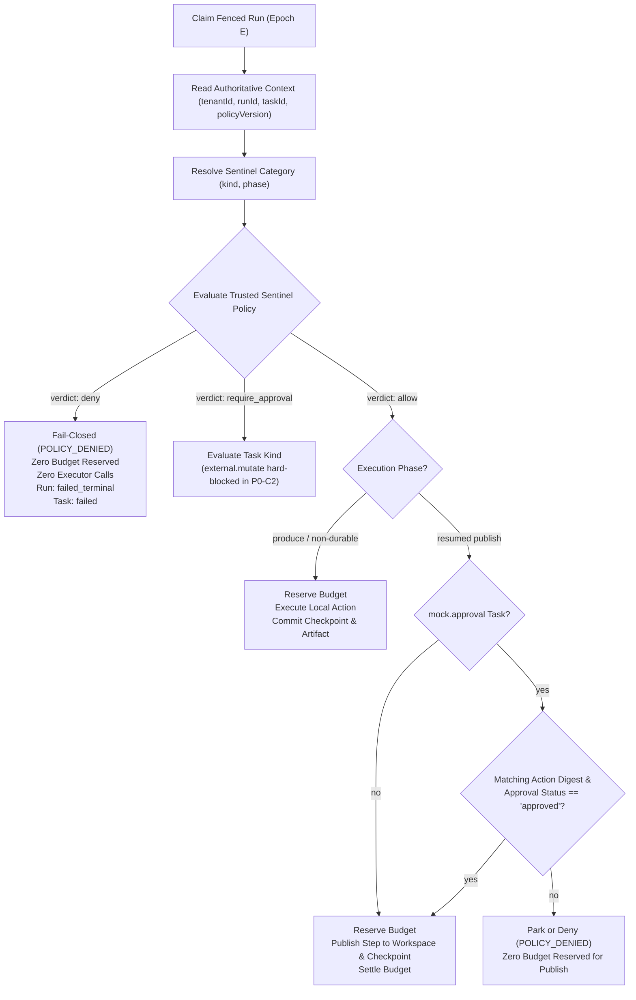

# Lane P0-C2B: Sentinel Runtime Admission Gate (v3) Specification & Evidence

> **Status:** Implementation Complete / Ready for CTO Review  
> **Date:** 2026-11-01  
> **Role:** Execution Worker & Governance Security Engineer (Agent C2B)  
> **Repository:** `https://github.com/basicv8vc/Ember`  
> **Branch:** `feature/p0c-2b-sentinel-runtime-admission`  
> **Target Branch:** `main`  
> **Coding Baseline SHA:** `3f3c55047b19a86bc2e353c7c4cb0ea8c857732a` (Latest `main`, with PR #40, PR #39 Lane A, PR #35 Lane C)  
> **Deliverable:** Sentinel Runtime Admission Gate & Composition Root Integration (`apps/worker/src/run-handler.ts`, `apps/worker/src/durable-run-handler.ts`, `apps/worker/src/index.ts`)

---

## 1. Executive Summary

Lane P0-C2B wires the **Sentinel-lite deterministic action admission gate** (`packages/execution/src/sentinel-lite.ts`) into **both** Worker execution boundaries (`apps/worker/src/run-handler.ts` and `apps/worker/src/durable-run-handler.ts`).

Every claimed task action is checked against an authoritative, trusted server-side policy **strictly before any task effects or budget reservations**:

1. **Pre-Execution Gate:** If Sentinel evaluates to `deny`, neither `budget.reserve` nor `executor.execute` is called. Exactly 0 budget units are deducted, and 0 side effects occur.
2. **Dual-Handler Parity:** Both non-durable (`createRunHandler`) and durable (`createDurableRunHandler`) handlers enforce the admission gate uniformly.
3. **Closed Action Matrix:** All supported task kinds and execution phases map deterministically to Sentinel action categories without ambiguous aliases.
4. **Deadlock-Free Approval Lifecycle:** The preparation phase (`produce` step of `mock.approval`) is classified as `mock.compute`, allowing proposal generation, checkpointing, and parking in `waiting_approval` without premature approval deadlocks. Resumed publication is classified as `mock.write`, verifying approved status and requiring explicit policy opt-in.
5. **State Machine Integrity:** Denied intents map to Run status `failed_terminal` and converge via the existing queue/committer to Task status `failed`. No non-standard domain states (e.g. `policy_denied`) are introduced.

---

## 2. Architecture & Trust Boundary

### 2.1 Governance Flowchart



### 2.2 Policy Authority & Composition Root

Policy configuration is authoritative and tenant/version-bound:

- The policy is supplied by the **trusted server-side composition root** (`apps/worker/src/config.ts` and `apps/worker/src/index.ts`), never parsed from untrusted Task input, LLM prompts, or HTTP payload bodies.
- The Worker validates the policy's tenant and policy version against the authoritative `RunExecutionContext`.
- If a policy is absent, malformed, or has a tenant/version mismatch, the admission gate **fails closed** (`DENY_INVALID_POLICY`), throwing a domain error with code `POLICY_DENIED`.

---

## 3. Closed Action Categories & Phase Mapping Matrix

Implements the exact matrix specified in Section 1.2 of the specification:

| Task Kind         | Phase                 | Sentinel Category | Governance Invariant                                                                                                        |
| :---------------- | :-------------------- | :---------------- | :-------------------------------------------------------------------------------------------------------------------------- |
| `mock.chat`       | `produce` & `publish` | `mock.compute`    | Local FakeLLM compute only; Fast Path stays zero Sandbox.                                                                   |
| `mock.compute`    | `produce` & `publish` | `mock.compute`    | Local deterministic compute only.                                                                                           |
| `mock.file`       | `produce` & `publish` | `mock.write`      | Local workspace write; requires explicit trusted opt-in to `mock.write`, never misclassified as `mock.read`.                |
| `mock.approval`   | `produce`             | `mock.compute`    | Simulated local proposal, artifact, checkpoint, and pending approval creation; no external mutation. Deadlock-free.         |
| `mock.approval`   | `publish`             | `mock.write`      | Resumed publication; requires committed matching approval (`status: 'approved'`) AND trusted `mock.write` policy allowance. |
| `external.mutate` | any                   | `external.mutate` | Evaluates to `require_approval`; blocked in P0-C2 (never dispatched).                                                       |
| `network.egress`  | any                   | `network.egress`  | Permanently denied in Round 1 (`DENY_HIGH_RISK_EGRESS`).                                                                    |
| `host.exec`       | any                   | `host.exec`       | Permanently denied in Round 1 (`DENY_HIGH_RISK_EXEC`).                                                                      |
| `credential.use`  | any                   | `credential.use`  | Permanently denied in Round 1 (`DENY_HIGH_RISK_CREDENTIAL`).                                                                |
| _Unknown Kind_    | any                   | `'unknown'`       | Evaluates to `deny` (`DENY_UNKNOWN_ACTION`).                                                                                |

The helper `resolveSentinelCategory(kind: TaskKind | string, phase: 'produce' | 'publish' = 'produce'): SentinelActionCategory | 'unknown'` is exported by `@ember/execution` and unit-tested exhaustively.

---

## 4. Dual Worker Handler Implementation

### 4.1 Non-Durable Handler (`apps/worker/src/run-handler.ts`)

In `createRunHandler`:

```typescript
const actionCategory = resolveSentinelCategory(context.kind, 'produce');
const intent: SentinelIntent = {
  tenantId: context.tenantId,
  runId: context.runId,
  taskId: context.taskId,
  actionCategory,
  policyVersion: context.policyVersion,
};

const decision = evaluateSentinelPolicy(policy, intent);
if (decision.verdict !== 'allow') {
  throw toSentinelDeniedError(decision);
}
```

Enforcement occurs before `executor.execute()`. On denial:

- `classifyFailure(error)` maps `POLICY_DENIED` to `failed_terminal`.
- Run status is reported as `failed_terminal`.
- Zero executor calls take place.

### 4.2 Durable Handler (`apps/worker/src/durable-run-handler.ts`)

In `createDurableRunHandler`, the gate is enforced via `enforceSentinelAdmission`:

1. **Produce Step:** Evaluated before `runBudgetedStep`:
   - Category is `resolveSentinelCategory(context.kind, 'produce')`.
   - On denial: `toSentinelDeniedError(decision)` is thrown before `budget.reserve()`.
   - Result: 0 budget reservations, 0 artifact stagings, 0 checkpoints written.
2. **Publish Step:** Evaluated at the start of `publishResult` before `runBudgetedStep`:
   - Category is `resolveSentinelCategory(context.kind, 'publish')`.
   - For `mock.file` and `mock.approval`, this resolves to `mock.write`.
   - If `mock.write` is disallowed, the publish step is denied immediately.
   - Any previously committed `produce` checkpoint remains intact (not rolled back or deleted).
   - Zero new budget reservations are recorded for the publish step.

### 4.3 Credential Broker Wiring in Worker Composition Root (`apps/worker/src/index.ts`)

In `apps/worker/src/index.ts`:

```typescript
const credentialRegistry = new InMemoryCredentialRegistry();
const credentialBroker = new CredentialBroker({
  registry: credentialRegistry,
  policy: SYNTHETIC_EGRESS_POLICY,
  trustedWorkerId: config.workerId,
});
```

- Passes the trusted `credentialBroker` into both `createRunHandler` and `createDurableRunHandler`.
- Operates under strict server-side policy (`SYNTHETIC_EGRESS_POLICY`) with no caller-supplied overrides.
- Validates operational worker identity consistency (`trustedWorkerId === context.workerId`).
- Keeps the worker fully operational for standard mock workloads when no simulated credential action is requested.

### 4.4 Sandbox Adapter & Sentinel-lite Interface Alignment and Execution Order

The execution lifecycle strictly enforces a 4-stage pipeline:

```text
1. Sentinel Admission Gate (evaluateSentinelPolicy)
      │
      ├── Deny ───────► Throw toSentinelDeniedError (0 Budget, 0 Sandboxes, Run: failed_terminal)
      ▼
2. Budget Reservation (budget.reserve)
      │
      ├── Exceeded ───► Throw BUDGET_EXCEEDED (0 Sandboxes, Run: failed_retryable / terminal)
      ▼
3. Sandbox Adapter Execution (SandboxAdapter.run via DeterministicExecutor)
      │
      ├── Run in transient FakeSandboxProvider session (create → waitReady → exec → stop → destroy)
      ▼
4. Checkpoint & Storage CAS Commit (checkpoints.commit / committer.commitStep)
```

- **Sentinel-first invariant:** If Sentinel denies the action category (e.g., `external.mutate`, `network.egress`, unpermitted `mock.write`), `executor.execute` / `executeApproval` is never reached. As a result, `SandboxAdapter.run` is never called, and **zero ephemeral sandboxes are created or leaked**.
- **Ephemeral Sandbox Lifecycle:** When admitted, `DeterministicExecutor` runs the compute workload through `SandboxAdapter`, ensuring full cleanup on both success and failure before storage commits.

---

## 5. Security Invariants & Guarantees

1. **Pre-Execution Invariant (0 Budget on Denial):**
   When Sentinel denies an action, `budget.reserve()` is never invoked. The `budget_operations` table receives 0 reservation rows for the denied step.
2. **Deadlock-Free Approval Preparation:**
   `mock.approval` does not require prior approval to generate its proposal. The `produce` step runs under `mock.compute`, commits the pending approval entity, and safely parks the task in `waiting_approval`.
3. **Approval Status Cannot Bypass Policy:**
   Even if a human marks an approval as `approved`, resuming publication still requires the Worker's Sentinel policy to permit `mock.write`. If the policy does not allow `mock.write`, the resumed Run fails closed.
4. **No Real Side Effects:**
   `external.mutate` is never admitted as `allow` in P0-C2. Resumed publication for `mock.approval` only commits local workspace and CAS metadata.
5. **Fail-Closed on Policy Absence/Mismatch:**
   Missing `sentinelPolicy`, tenant ID mismatch, or policy version mismatch evaluates to `deny` with reason `DENY_INVALID_POLICY`.

---

## 6. Verification Evidence

### 6.1 Test Suites Summary

| Test Suite                                | File                                                   | Tests Count   | Status |
| :---------------------------------------- | :----------------------------------------------------- | :------------ | :----- |
| Unit: Run Handler                         | `tests/unit/run-handler.test.ts`                       | 17 passed     | PASS   |
| Unit: Sentinel Lite                       | `tests/unit/sentinel-lite.test.ts`                     | 63 passed     | PASS   |
| Unit: Worker Poll Loop                    | `tests/unit/worker-poll-loop.test.ts`                  | 25 passed     | PASS   |
| Integration: Durable Worker Admission     | `tests/integration/worker-sentinel-admission.test.ts`  | 13 passed     | PASS   |
| Integration: Non-Durable Worker Admission | `tests/integration/worker-sentinel-nondurable.test.ts` | 7 passed      | PASS   |
| Chaos: Worker Fencing & Sentinel Recovery | `tests/chaos/b-t28-sentinel-worker-fencing.test.ts`    | 3 passed      | PASS   |
| Chaos: All Chaos Regression               | `tests/chaos/*.test.ts` (5 suites)                     | 27 passed     | PASS   |
| E2E: Full Regression                      | `tests/e2e/*.test.ts` (8 suites)                       | 13 passed     | PASS   |
| Product Demos                             | `pnpm demo`                                            | 4/4 scenarios | PASS   |

### 6.2 B-T28 Chaos Scenarios Verified

- **Scenario 1 (Denial on Resume):** Worker 1 commits Step 1 (`produce`), gets intercepted before publish, and is terminated via SIGKILL. Worker 2 resumes without `mock.write` permission. Worker 2 fails closed (`POLICY_DENIED`), task converges to `failed`, Step 1 checkpoint remains intact, and 0 new budget rows are reserved.
- **Scenario 2 (Allowance on Resume):** Worker 1 commits Step 1 and is SIGKILLed. Worker 2 resumes with `mock.write` permission. Worker 2 completes publish without re-running Step 1, producing exactly 2 checkpoints (`produce` attempt 1, `publish` attempt 2).
- **Scenario 3 (Approval Produce & Resume Gate):** `mock.approval` produces pending approval and parks in `waiting_approval`. Approval is approved by human operator. Worker 2 resumes with default policy (`allowMockWrite: false`). Admission gate blocks publish despite human approval; task transitions to `failed` with 0 publish budget charged.

---

## 7. Rollback Plan

All Sentinel admission changes are strictly additive and backwards-compatible with P0-B execution semantics:

1. In development and testing harnesses, trusted fixtures explicitly opt in via `allowMockWrite: true` or config env `EMBER_WORKER_SENTINEL_ALLOW_MOCK_WRITE=true`.
2. To revert to permissive execution in an emergency, set `EMBER_WORKER_SENTINEL_ALLOWED_ACTIONS=mock.read,mock.write,mock.compute`.
3. To disable Sentinel admission entirely, the gate can be bypassed by reverting handler commits while preserving database tables and contracts.
