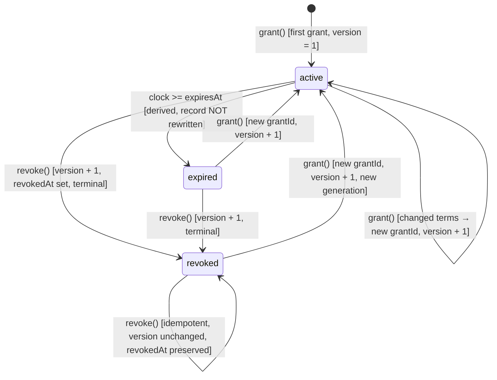
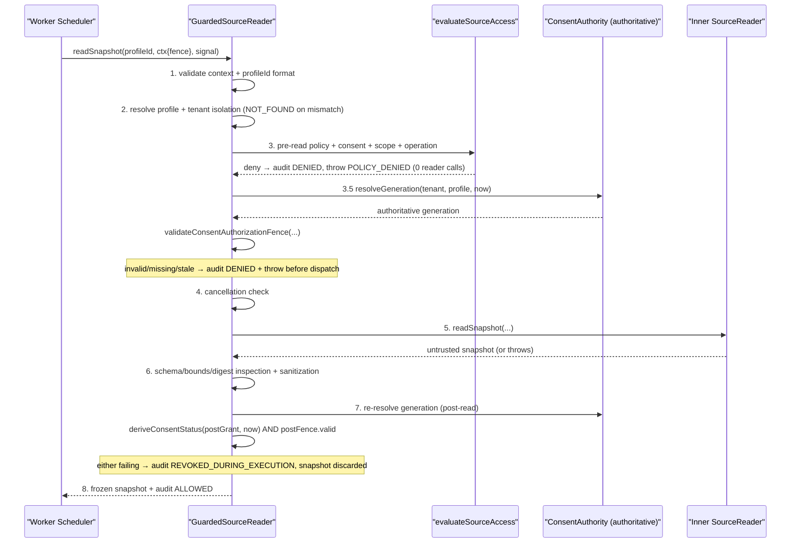

# Ember P0-C3C — Consent Contract & Security Conformance

## 1. Executive Summary

- **Agent**: Coding Agent C (`@ember/connectors` Trust Boundary Engineer)
- **Component**: `@ember/connectors` (`packages/connectors/`)
- **Git reference baseline**:
  - Base commit: `a7842f2b2d6fde09ceb27d8dae41d7c2d8ac67bb` (`main`)
  - Branch: `feature/p0c-3c-consent-security`
  - Worktree: `/Users/a1-6/Downloads/Ember-p0c3c`
  - Mode: standalone worktree, Draft PR only
- **Deliverables in this change set**:
  1. Frozen consent lifecycle semantics (`grant` / re-affirmation / `revoke` / derived expiry).
  2. Versioned **authorization fence** (`tenantId`, `sourceProfileId`, `grantId`, `grantVersion`,
     `issuedAt`, `digest`) with an authority-backed validator.
  3. `GuardedSourceReader` fence enforcement on **both** sides of the read (pre-read gate + post-read
     re-verification), fail-closed on any unverifiable input.
  4. Rewritten `FakeConsentRegistry` implementing the frozen contract as an explicitly test-only
     double.
  5. A framework-free, I/O-free **conformance kit** (`consent-conformance.ts`) with 12 cases
     (`C-01` … `C-12`) that any implementation — including Agent A's durable PostgreSQL
     repository — can run from its own package.
  6. Security/contract unit tests: `tests/unit/p0c3c-consent-contract.test.ts` (5 tests) and
     `tests/unit/p0c3c-consent-security.test.ts` (17 tests).

- **Acceptance summary**:

  | Requirement                                                                     | Status                                  |
  | ------------------------------------------------------------------------------- | --------------------------------------- |
  | Consent lifecycle frozen (states, transitions, idempotency)                     | PASS                                    |
  | Generation identity + strictly monotonic versions                               | PASS                                    |
  | Derived (non-mutating) expiry                                                   | PASS                                    |
  | Tenant isolation / uniform agnosticism                                          | PASS                                    |
  | Versioned authorization fence minted, validated, and audited                    | PASS                                    |
  | Fence enforced pre-read (reader never invoked on deny)                          | PASS                                    |
  | Fence re-enforced post-read (mid-read revoke **and** re-grant discard snapshot) | PASS                                    |
  | Fail-closed on malformed / tampered / unverifiable fences                       | PASS                                    |
  | `FakeConsentRegistry` conforms to all 12 conformance cases                      | PASS                                    |
  | Conformance kit has a negative control (mutant implementations fail)            | PASS                                    |
  | Durable PostgreSQL implementation certified by this kit                         | Handed to Agent A (port + kit provided) |
  | Real public-source / live HTTP connectors                                       | NOT IMPLEMENTED / NOT AUTHORIZED        |

---

## 2. Scope, Non-Goals, and Trust Model

### 2.1 Scope

This task freezes **authorization semantics for consent-gated source reads**. It does not add
providers, credentials, or network egress. Its single question is:

> Given a read request carrying a consent reference, may `@ember/connectors` read the source — and
> can that answer be re-proven _after_ the read completes?

### 2.2 Non-goals

- No OAuth flows, no token vault, no provider SDKs, no outbound HTTP/DNS/sockets (still enforced at
  zero, see `tests/unit/p0c3-source-zero-network.test.ts`).
- No durable persistence in this package. `FakeConsentRegistry` remains an ephemeral, process-local
  test double. Durable, cross-process consent storage is Agent A's PostgreSQL repository.
- No changes to the worker scheduler contract beyond the _optional_ `authorizationFence` field on
  `TrustedSourceAccessContext`.

### 2.3 Trust model (three distinct parties)

| Input                                                                                     | Trust level                                                                                         | How it is handled                                                                                                           |
| ----------------------------------------------------------------------------------------- | --------------------------------------------------------------------------------------------------- | --------------------------------------------------------------------------------------------------------------------------- |
| `TrustedSourceAccessContext` (tenant, commitment, task, run, lease epoch, `authorizedAt`) | Assembled by the authoritative worker scheduler; **not** attacker-controlled but still re-validated | Shape/format validation only; never used as proof of authorization                                                          |
| `authorizationFence`                                                                      | **Untrusted** worker payload                                                                        | Structurally validated, digest-checked, bound to caller tenant/profile, then compared against authoritative persisted state |
| Inner `SourceReader` + the `SourceSnapshot` it returns                                    | **Untrusted**                                                                                       | Bounds/schema/digest inspection, sanitization, exception sanitization, deep freeze                                          |
| Persisted consent state (`ConsentAuthority`)                                              | **Authoritative**                                                                                   | The only source of authorization truth                                                                                      |

### 2.4 What the fence is _not_

The fence digest is a **self-consistency checksum over a canonical JSON encoding of the fence body**
(domain-separated with `ember.consent.fence.v1`). It is **not** a MAC, **not** a signature, and
**not** proof of authorization: any caller can recompute it. It exists to make accidental or
naive tampering detectable and to give the audit trail a stable generation reference.

Authorization is established **exclusively** by looking up the current authoritative generation for
`(tenantId, sourceProfileId)` and comparing `grantId` **and** `grantVersion`.

---

## 3. Consent Lifecycle (Frozen)

### 3.1 Lineage and generations

- A **lineage** is the pair `(tenantId, sourceProfileId)`. Consent is defined per lineage, never
  globally.
- Every unit of authorization is a **generation**: the immutable pair `(grantId, version)` inside a
  lineage. A generation is **single-use for authorization**: once revoked or superseded it can never
  authorize again — even if identical terms are later granted, because the new grant carries a new
  `grantId` and a strictly greater `version`.
- Records are **immutable once issued**. `status` is a _stored_ field, but the **effective** status
  is always derived at evaluation time (see §5).

### 3.2 States



### 3.3 Transition rules (normative)

| Operation                                                                                | Precondition                       | Effect                                                                                            | Idempotent?                                                  |
| ---------------------------------------------------------------------------------------- | ---------------------------------- | ------------------------------------------------------------------------------------------------- | ------------------------------------------------------------ |
| `grant(params)` — first ever                                                             | no record                          | new `grantId`, `version = 1`, `status = active`, `revokedAt = null`                               | n/a                                                          |
| `grant(params)` — **identical** authorization terms while current generation is `active` | record present, effective `active` | **nothing changes**; the same `(grantId, version)` is returned                                    | **Yes** — repeated scheduler calls must not inflate versions |
| `grant(params)` — **different** terms, or current record `revoked` / `expired`           | record present                     | new `grantId`, `version = previous + 1`, `status = active`, `revokedAt = null`, fresh `grantedAt` | No                                                           |
| `revoke(...)` — active or expired                                                        | record present                     | `status = revoked`, `revokedAt = now`, `version = previous + 1`                                   | **Exactly once**                                             |
| `revoke(...)` — already revoked                                                          | effective `revoked`                | unchanged record returned (same `revokedAt`, same `version`)                                      | **Yes**                                                      |
| `revoke(...)` — no record                                                                | —                                  | `NOT_FOUND` (`POLICY_DENIED` at the reader perimeter, see §4.2)                                   | n/a                                                          |

**"Authorization terms"** = `allowedOperations` (order-insensitive, de-duplicated), `scopes`
(order-insensitive, de-duplicated), and `expiresAt`. Changing any of them is an explicit re-grant and
therefore mints a new generation. `grantedAt`/`grantId`/`version` are not terms.

### 3.4 Version monotonicity

- `version` is a **per-lineage, strictly increasing integer** starting at `1`.
- It increases by exactly `1` per re-grant **or** per effective revocation — never by `0` on a real
  state change, never by more than `1`, and never on an idempotent call.
- The sequence `grant → revoke → grant → revoke → …` from C-08 must be strictly increasing with each
  newly minted generation.
- A durable implementation must allocate the version **atomically** (e.g.
  `UPDATE … SET version = version + 1 … RETURNING version` or a `SELECT … FOR UPDATE` in the same
  transaction) so two concurrent re-grants cannot both observe `version = n`.

---

## 4. Authorization Fence (Frozen)

### 4.1 Shape

```ts
interface ConsentAuthorizationFence {
  readonly tenantId: string;
  readonly sourceProfileId: SourceProfileId;
  readonly grantId: string;
  readonly grantVersion: number;
  readonly issuedAt: string; // RFC 3339
  readonly digest: string; // 64 lowercase hex chars
}
```

- Minted **only** from a grant whose effective status is `active`:
  `createConsentAuthorizationFence(grant, issuedAt)` throws `INVALID_ARGUMENT` for `revoked` or
  `expired` generations — a dead generation can never be fenced.
- `digest = SHA-256(canonicalJson({ domain: 'ember.consent.fence.v1', tenantId, sourceProfileId,
grantId, grantVersion, issuedAt }))` — a **self-consistency checksum only** (§2.4).
- Fences are deeply frozen values; the minting helper is the only supported producer.

### 4.2 Authoritative generation view

```ts
interface AuthorizedConsentGeneration {
  readonly tenantId: string;
  readonly sourceProfileId: SourceProfileId;
  readonly grantId: string;
  readonly version: number;
  readonly status: ConsentStatus; // EFFECTIVE status at `now`
  readonly expiresAt: string | null;
}
```

Resolved through the `ConsentAuthority` port:

```ts
interface ConsentAuthority {
  resolveGeneration(
    tenantId: string,
    sourceProfileId: string,
    now: Date,
  ): AuthorizedConsentGeneration | null | Promise<AuthorizedConsentGeneration | null>;
}
```

`FakeConsentRegistry` implements this port and is the default authority when none is passed.
Production **must** pass the durable repository.

### 4.3 Validation order (normative)

`validateConsentAuthorizationFence({ fence, tenantId, sourceProfileId, authoritative, now })`
evaluates in this exact order and stops at the first failure:

| #   | Check                                                                                                      | Result on failure                     | Audited denial code     |
| --- | ---------------------------------------------------------------------------------------------------------- | ------------------------------------- | ----------------------- |
| 1   | Structural validity (all fields, `grantVersion` a positive integer, `issuedAt` parseable, digest = 64 hex) | `CONSENT_FENCE_MALFORMED`             | `CONSENT_FENCE_INVALID` |
| 2   | Digest recomputation over the canonical body                                                               | `CONSENT_FENCE_TAMPERED`              | `CONSENT_FENCE_INVALID` |
| 3   | `issuedAt` not in the future by more than `CONSENT_FENCE_MAX_CLOCK_SKEW_MS` (60 s)                         | `CONSENT_FENCE_MALFORMED`             | `CONSENT_FENCE_INVALID` |
| 4   | `tenantId` and `sourceProfileId` match the caller context                                                  | `CONSENT_FENCE_BINDING_MISMATCH`      | `TENANT_MISMATCH`       |
| 5   | An authoritative generation exists for the lineage                                                         | `CONSENT_NOT_FOUND`                   | `CONSENT_NOT_FOUND`     |
| 6   | Authoritative `tenantId` / `sourceProfileId` still match the fence binding                                 | `CONSENT_FENCE_BINDING_MISMATCH`      | `TENANT_MISMATCH`       |
| 7   | **If** the fence already names the current generation: effective status must be `active`                   | `CONSENT_REVOKED` / `CONSENT_EXPIRED` | same                    |
| 8   | `grantId` **and** `grantVersion` equal the current authoritative generation                                | `CONSENT_FENCE_STALE`                 | `CONSENT_FENCE_STALE`   |
| 9   | Otherwise                                                                                                  | `VALID`                               | — (read proceeds)       |

Why step 7 precedes step 8: a fence that still references the lineage's _current_ generation should
name the specific reason (`revoked` / `expired`) rather than the generic "stale". Superseded
generations (revoked **and** re-granted) correctly report `CONSENT_FENCE_STALE`.

### 4.4 Optionality and fail-closed default

`GuardedSourceReaderOptions.requireAuthorizationFence` (default **`false`**) controls only the
_absence_ of a fence:

- `false` (default, backward compatible): a read with no fence is evaluated exactly as before this
  change; a read **with** a fence is always fully validated.
- `true` (production recommendation): a read with no fence is denied with `CONSENT_FENCE_MISSING`.
- **Unverifiable fence always fails closed**: if a fence is present but no `authority` is wired, the
  result is `CONSENT_FENCE_MISSING` — the perimeter never trusts caller-supplied authorization.
- A throwing authority is treated as "no authoritative state" (`null` → `CONSENT_NOT_FOUND`); the
  thrown value is never inspected or surfaced.

---

## 5. Expiry, Clocks, and Tenant Isolation

### 5.1 Derived expiry

- `expiresAt: string | null` is the only expiry input. Status is **derived** at evaluation time:
  `revoked` if `revokedAt != null`; else `expired` if `expiresAt != null && now >= expiresAt`; else
  `active`.
- Expiry **never rewrites the stored record**: no version bump, no `status` mutation. `C-03` proves
  a grant is `active` immediately before `expiresAt` and `expired` exactly at `expiresAt`, with an
  unchanged `(grantId, version, expiresAt)`.
- Boundary rule: `now >= expiresAt` is expired (`expiresAt` is exclusive).
- A durable implementation may keep `status` as a stored column, but its **read path must derive**
  the effective status with the same predicate (or constrain the query with `expires_at > now`) so
  an elapsed grant cannot authorize anything.

### 5.2 Clock authority

- The perimeter uses a single injected `nowProvider`; the registry accepts an explicit `now` on
  every method. No consent decision reads the wall clock directly.
- `issuedAt` in a fence may lead `now` by at most `CONSENT_FENCE_MAX_CLOCK_SKEW_MS` (60 s) to absorb
  benign scheduler/replica skew; larger lead times are treated as malformed.
- Invalid clocks (`NaN`, non-`Date`) make `get` / `list` return `null` / `[]` (fail closed) and make
  mutating calls throw `INVALID_ARGUMENT`.

### 5.3 Tenant isolation (uniform agnosticism)

- Every registry lookup, revocation, and listing is **tenant-scoped**; the storage key is
  `tenantId::sourceProfileId`.
- Cross-tenant operations are indistinguishable from "does not exist": `get` → `null`,
  `list` → no entry, `revoke` → `NOT_FOUND`. No oracle reveals whether a foreign lineage exists.
- At the perimeter, a profile whose `tenantId` differs from the authenticated context is reported as
  `SOURCE_PROFILE_NOT_FOUND` (`NOT_FOUND`), never `TENANT_MISMATCH`. The explicit `TENANT_MISMATCH`
  code is reserved for fence binding violations where the fence itself names another tenant.
- `C-04` proves tenant B cannot read, list, or revoke tenant A's generation, and that both tenants
  can hold independent generations for the same `sourceProfileId`.

---

## 6. Perimeter Integration (`GuardedSourceReader`)

### 6.1 Order of checks



### 6.2 The double-check invariant

A snapshot may only leave the perimeter if, **after** the read completes:

1. the current grant's effective status is still `active` (`deriveConsentStatus`), **and**
2. the fenced generation is **still the authoritative generation** (`postFence.valid`).

Condition 2 is what makes `revoke()` immediately followed by `grant()` inside the read window safe:
status alone would be `active` again (the "resurrect under the running read" hole), but the fenced
generation is stale, so the snapshot is discarded with `REVOKED_DURING_EXECUTION`.

### 6.3 Audit trail

Every decision writes one `SourceAuditRecord` (tenant hashed with SHA-256/16 hex,
`networkCallsMade: 0`, static `denialReason` selected from `SAFE_DENIAL_DESCRIPTIONS`):

| Situation                                             | `decision` | `denialCode`                                                                |
| ----------------------------------------------------- | ---------- | --------------------------------------------------------------------------- |
| Profile missing or foreign tenant                     | `DENIED`   | `SOURCE_PROFILE_NOT_FOUND`                                                  |
| Policy/consent/scope/operation denial                 | `DENIED`   | from `SourceAccessDecision`                                                 |
| Fence missing / invalid / stale / revoked / expired   | `DENIED`   | fence denial code (§4.3)                                                    |
| Aborted before or after dispatch, or reader cancelled | `DENIED`   | `READ_ABORTED`                                                              |
| Reader threw (untrusted)                              | `DENIED`   | `POLICY_DENIED` (fixed text, no reflection)                                 |
| Snapshot failed inspection                            | `DENIED`   | inspection code (`UNTRUSTED_CONTENT_DETECTED`, `PAYLOAD_LIMIT_EXCEEDED`, …) |
| Consent lost / generation superseded mid-read         | `DENIED`   | `REVOKED_DURING_EXECUTION`                                                  |
| Success                                               | `ALLOWED`  | —                                                                           |

New static reasons added by this task:

```
CONSENT_FENCE_MISSING: 'Authorization fence missing or unverifiable'
CONSENT_FENCE_INVALID: 'Authorization fence is malformed or tampered'
CONSENT_FENCE_STALE: 'Authorization fence refers to a superseded consent generation'
```

---

## 7. Conformance Kit (`consent-conformance.ts`)

### 7.1 Design

- **No test framework, no I/O, no postgres import.** Pure TypeScript exported from
  `@ember/connectors`, so a durable repository in another package can certify itself from its own
  test suite without depending on this package's test setup.
- **Adapter port** (`ConsentConformanceAdapter`) tolerates sync or async implementations, so the same
  suite drives the in-memory fake and a real repository.
- **Deterministic**: one fixed clock (`CONSENT_CONFORMANCE_CLOCK` =
  `2026-11-01T12:00:00.000Z`), one fixed profile (`sp_ember_releases`), one fixed policy.

```ts
import { assertConsentConformance, type ConsentConformanceAdapter } from '@ember/connectors';

const adapter: ConsentConformanceAdapter = {
  name: 'PostgresConsentRepository',
  reset: () => repo.truncateForTest(),
  grant: (params, now) => repo.grant(params, now),
  get: (tenantId, profileId, now) => repo.get(tenantId, profileId, now),
  revoke: (tenantId, profileId, now) => repo.revoke(tenantId, profileId, now),
  list: (tenantId, now) => repo.list(tenantId, now),
  resolveGeneration: (tenantId, profileId, now) => repo.resolveGeneration(tenantId, profileId, now),
};

await assertConsentConformance(adapter); // throws ConsentConformanceViolation on any failure
```

`runConsentConformanceSuite(adapter)` never throws for a contract violation; it returns
`ConsentConformanceCaseResult[]` (`id`, `requirement`, `title`, `passed`, `error`) so a failing
implementation can be reported case by case.

### 7.2 Requirement matrix

| Case | Requirement id                     | Frozen requirement                                                                                                   | Certified by                                                                                    |
| ---- | ---------------------------------- | -------------------------------------------------------------------------------------------------------------------- | ----------------------------------------------------------------------------------------------- |
| C-01 | `R1-missing-grant-denies`          | A lineage with no grant is denied (fail closed)                                                                      | `get` → `null`, `resolveGeneration` → `null`, decision `CONSENT_NOT_FOUND`                      |
| C-02 | `R2-revocation-is-terminal`        | Revocation denies reads, is terminal, bumps version exactly once, repeat revoke is a no-op                           | `revoke`, `get`, `resolveGeneration`                                                            |
| C-03 | `R3-expiry-is-derived`             | Expiry derived at read time from `expiresAt`, record never re-written                                                | `get` at `expiresAt − 1ms`, at `expiresAt`, and record equality                                 |
| C-04 | `R4-tenant-isolation`              | Grants are tenant-scoped: no cross-tenant read, list, or revoke                                                      | `get`, `list`, `revoke` under tenant B                                                          |
| C-05 | `R5-scope-and-operation-binding`   | A grant for other operations or scopes does not authorize a read                                                     | `evaluateSourceAccess` with `requiredScopes: ['source.readonly']`, `operation: 'read_snapshot'` |
| C-06 | `R6-regrant-mints-new-generation`  | Re-grant after revocation mints a new `grantId` and strictly greater `version`                                       | `grant` after `revoke`                                                                          |
| C-07 | `R7-generation-fence-binding`      | A fence authorizes only for the current authoritative generation (valid / revoked / stale / tampered / cross-tenant) | `createConsentAuthorizationFence` + `validateConsentAuthorizationFence`                         |
| C-08 | `R8-version-monotonicity`          | Versions increase strictly across repeated grant/revoke cycles                                                       | 3 cycles asserting `1 < 2 < 3`                                                                  |
| C-09 | `R9-reaffirmation-is-idempotent`   | Identical terms on an active generation return the **same** generation (no version inflation)                        | `grant` twice, compare `grantId`, `version`, `grantedAt`                                        |
| C-10 | `R10-fail-closed-on-invalid-input` | Invalid input is rejected on writes (`INVALID_ARGUMENT`) and denied — never granted — on reads (`null` / `[]`)       | `grant`/`revoke` with URL profile ids, empty terms, non-`Date` clocks                           |
| C-11 | `R11-records-are-immutable`        | Returned and stored records cannot be mutated by callers                                                             | `Object.isFrozen`, mutation attempts leave stored state unchanged                               |
| C-12 | `R12-list-scope-and-determinism`   | Listing is tenant-scoped, duplicate-free, and deterministically ordered                                              | `list` under two tenants + repeated-call ordering equality                                      |

### 7.3 Negative controls

The suite is itself tested for _sensitivity_ against two deliberately broken implementations
(`tests/unit/p0c3c-consent-contract.test.ts`):

- **`NonRevokingRegistry`** (revocation is ignored) must fail `C-02`.
- **`VersionInflatingRegistry`** (every `grant` re-mints a generation) must fail `C-09`.

If either mutant passed, the kit would be proven vacuous; both are rejected with
`ConsentConformanceViolation` and the failing case ids are asserted.

---

## 8. Handoff to Agent A — Durable PostgreSQL Implementation

`FakeConsentRegistry` is a **test-only double**. Production persistence is Agent A's responsibility;
this package contributes the contract, the validator, and the certification kit.

### 8.1 Required repository surface

```ts
interface ConsentRepository extends ConsentAuthority {
  grant(params: GrantConsentParams, now: Date): Promise<ConsentGrant>;
  get(tenantId: string, sourceProfileId: string, now: Date): Promise<ConsentGrant | null>;
  revoke(tenantId: string, sourceProfileId: string, now: Date): Promise<ConsentGrant>;
  list(tenantId: string, now: Date): Promise<readonly ConsentGrant[]>;
  truncateForTest(): Promise<void>; // test-only; never exposed over HTTP
}
```

### 8.2 Suggested schema constraints

```sql
CREATE TABLE source_consent_grants (
  grant_id           uuid        PRIMARY KEY,
  tenant_id          text        NOT NULL,
  source_profile_id  text        NOT NULL,
  status             text        NOT NULL CHECK (status IN ('active', 'revoked')),
  allowed_operations text[]      NOT NULL,
  scopes             text[]      NOT NULL,
  granted_at         timestamptz NOT NULL,
  expires_at         timestamptz NULL,
  revoked_at         timestamptz NULL,
  version            integer     NOT NULL CHECK (version >= 1),
  CONSTRAINT source_consent_grants_lineage UNIQUE (tenant_id, source_profile_id),
  CONSTRAINT source_consent_grants_revoked_consistency
    CHECK ((status = 'revoked') = (revoked_at IS NOT NULL))
);
```

- `UNIQUE (tenant_id, source_profile_id)` enforces **one current generation per lineage**; history, if
  needed, belongs in an append-only `source_consent_grant_events` table.
- `version` monotonicity must be allocated inside the writing transaction:
  `UPDATE … SET version = version + 1 … RETURNING version`, or `SELECT … FOR UPDATE` before the
  write. Never `SELECT max(version) + 1` outside a transaction — two concurrent re-grants would
  collide and the loser would silently re-use a generation.
- Serialize per `(tenant_id, source_profile_id)` if grant and revoke may race.
- **Never** store a derived `expired` status: persist `expires_at` and derive on read
  (`status = 'active' AND (expires_at IS NULL OR expires_at > $now)`).

### 8.3 Certification

```ts
// agent-a/tests/integration/consent-conformance.test.ts
await assertConsentConformance(postgresAdapter);
```

Expected: all 12 cases pass. Any failure names the case id and the violated invariant; never weaken
the case to make a repository pass.

### 8.4 Scheduler obligations (Agent B)

- Call `grant()` idempotently — re-requesting identical terms on an active generation must return the
  same generation (C-09), otherwise schedulers inflate versions and invalidate every in-flight fence.
- Mint the fence at **dispatch time** from the grant just persisted; never cache or reuse a fence
  across task attempts or retries.
- Pass `requireAuthorizationFence: true` in production wiring so an unfenced worker payload cannot
  reach a reader.

---

## 9. Backward Compatibility

| Surface                                                | Change                                                                                                                 | Compatibility                                                                               |
| ------------------------------------------------------ | ---------------------------------------------------------------------------------------------------------------------- | ------------------------------------------------------------------------------------------- |
| `ConsentRegistry` (`grant`/`get`/`revoke`/`list`)      | `now` already optional; semantics tightened (derived expiry, idempotent re-affirmation, single version bump on revoke) | Source compatible. Behavioural change: repeated identical `grant` no longer bumps `version` |
| `TrustedSourceAccessContext.authorizationFence`        | New optional field                                                                                                     | Additive; existing contexts parse unchanged                                                 |
| `GuardedSourceReaderOptions.authority`                 | New optional; defaults to the configured `registry`                                                                    | Additive                                                                                    |
| `GuardedSourceReaderOptions.requireAuthorizationFence` | New optional; defaults `false`                                                                                         | Additive; default preserves all pre-existing behaviour                                      |
| `SourceDenialCode`                                     | Three new members (`CONSENT_FENCE_MISSING/INVALID/STALE`)                                                              | Additive; exhaustive `switch` statements over the union must add branches                   |
| `@ember/connectors` exports                            | `consent.js`, `consent-conformance.js` added                                                                           | Additive                                                                                    |

Pre-existing tests continue to pass unmodified, which is the intended evidence that the fence is
additive: `p0c3-source-consent-registry` (7), `p0c3-source-policy-evaluation` (11),
`p0c3-source-revocation-lifecycle`, `p0c3-source-guarded-reader*`, `p0c3-source-zero-network`, and
`p0c3-source-audit-redaction`.

---

## 10. Verification Evidence

All gates run from `/Users/a1-6/Downloads/Ember-p0c3c` on 2026-11-02.

| Gate            | Command                                                                                                                             | Result                                       |
| --------------- | ----------------------------------------------------------------------------------------------------------------------------------- | -------------------------------------------- |
| Typecheck       | `pnpm run typecheck` (`tsc -p tsconfig.json`)                                                                                       | PASS — no diagnostics                        |
| Targeted unit   | `npx vitest run --config vitest.unit.config.ts tests/unit/p0c3c-consent-security.test.ts tests/unit/p0c3c-consent-contract.test.ts` | PASS — 2 files, **22 tests**                 |
| Full unit suite | `pnpm run test:unit`                                                                                                                | PASS — **63 files / 1030 tests**, 0 failures |
| Lint            | `pnpm run lint` (`eslint .`)                                                                                                        | PASS — 0 problems                            |
| Format          | `pnpm run format:check` (`prettier --check .`)                                                                                      | PASS (after formatting 4 files)              |
| Build           | `pnpm run build`                                                                                                                    | PASS                                         |
| CI              | GitHub Actions `Verify (Node 24 LTS + PostgreSQL 17)` on PR #83                                                                     | PASS (2m41s)                                 |

### 10.1 `tests/unit/p0c3c-consent-contract.test.ts` (5 tests)

1. The frozen requirement matrix is immutable, has exactly 12 cases in `C-01`…`C-12` order, and
   assigns each requirement id exactly once.
2. `FakeConsentRegistry` is certified against all 12 cases through the adapter port.
3. Negative control: a non-revoking registry fails `C-02` (and the violation names it).
4. Negative control: a version-inflating registry fails `C-09`.
5. Every result reports `id`, `requirement`, `title`, `passed`, with `error === null` on success.

### 10.2 `tests/unit/p0c3c-consent-security.test.ts` (17 tests)

| #   | Attack / invariant                                 | Expected outcome                                                                               |
| --- | -------------------------------------------------- | ---------------------------------------------------------------------------------------------- |
| 1   | Valid fence for the current generation             | Read succeeds, audit `ALLOWED`                                                                 |
| 2   | `requireAuthorizationFence: true` with no fence    | `POLICY_DENIED` / `CONSENT_FENCE_MISSING`; reader never called                                 |
| 3   | Default wiring (fence not required) with no fence  | Legacy behaviour preserved                                                                     |
| 4   | Fence whose `grantVersion` was edited              | `CONSENT_FENCE_INVALID` (tampered); reader never called                                        |
| 5   | Fence for a revoked-then-re-granted generation     | `CONSENT_FENCE_STALE`                                                                          |
| 6   | Fence naming another tenant                        | `TENANT_MISMATCH`, uniform denial                                                              |
| 7   | Authority returns `null`                           | `CONSENT_NOT_FOUND` (indistinguishable from missing consent)                                   |
| 8   | Authority throws an error containing a token       | `CONSENT_NOT_FOUND`; token never appears in error or audit                                     |
| 9   | Consent revoked before the read                    | Denied pre-dispatch; reader not invoked                                                        |
| 10  | Consent revoked **during** the read                | `REVOKED_DURING_EXECUTION`; snapshot discarded                                                 |
| 11  | Consent expires **during** the read                | `REVOKED_DURING_EXECUTION`; snapshot discarded                                                 |
| 12  | Revoked **then re-granted** during the read        | `REVOKED_DURING_EXECUTION` — status alone would read `active`, generation staleness catches it |
| 13  | Grant lacks the required scope / operation         | `SCOPE_NOT_GRANTED` / `OPERATION_NOT_ALLOWED`                                                  |
| 14  | Reader throws a sensitive-message error            | Sanitized `POLICY_DENIED`, no reflection                                                       |
| 15  | Signal aborted before / after dispatch             | `READ_ABORTED`; reader not called when pre-aborted                                             |
| 16  | Prompt-injection payload inside a fixture snapshot | Inert: carried as data, never interpreted                                                      |
| 17  | Every scenario above                               | `networkCallsMade: 0` — no sockets, DNS, or `fetch`                                            |

---

## 11. Limitations and Security Notes

1. **The fence is not a capability.** It is a generation reference plus a checksum. Possessing a
   well-formed fence is never authorization; only the authority lookup authorizes. If cryptographic
   proof is later required, add a MAC/HMAC keyed by the worker/enclave — that is a schema change and
   must bump the digest domain string.
2. **`FakeConsentRegistry` is a test double.** Process-local, non-transactional, no durability,
   replication, or cross-process visibility. Wiring it in production means a restart wipes consent
   state (fail closed — reads deny, never allow — but still an outage).
3. **TOCTOU is narrowed, not eliminated.** Post-read re-verification shrinks the window to the
   authority's own read latency and covers revoke, re-grant, and expiry. A revoke that lands _after_
   the post-read check but _before_ the caller consumes the snapshot is outside this package's
   control; consumers must treat a snapshot as authorized at `authorizedAt`, not at consumption time.
4. **Clock trust.** Expiry and fence skew both depend on the injected clock. A skewed worker clock can
   authorize an elapsed grant until the boundary — keep schedulers NTP-synced and use one clock per
   decision.
5. **Denial uniformity is intentional.** `CONSENT_NOT_FOUND` is returned for missing, malformed, and
   foreign-tenant lineages so the perimeter is not an existence oracle. Do not "improve" the message.
6. **Real connectors remain out of scope.** No provider adapters, credentials, or egress are added by
   this task; the zero-network guarantee is enforced and tested.
