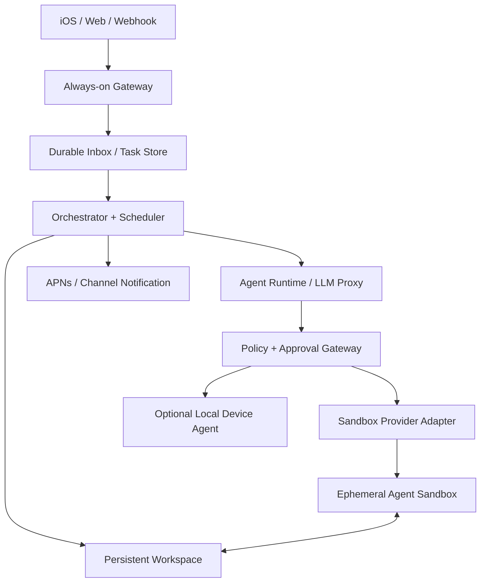
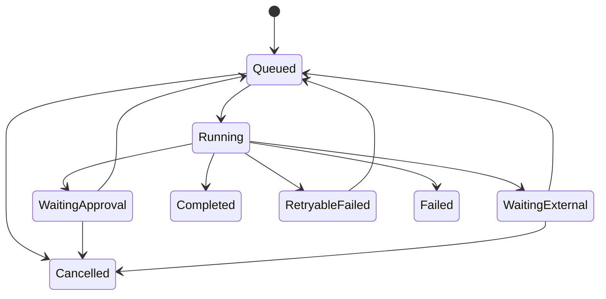
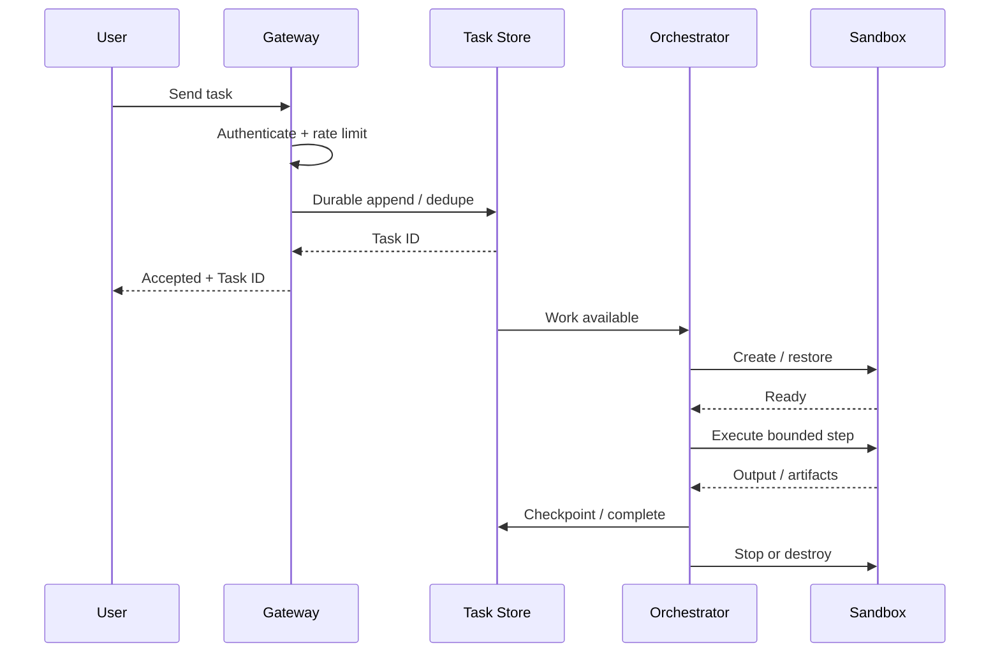

# Personal Agent Platform — Architecture RFC v0.1

> **状态**：Draft / 待技术评审  
> **日期**：2026-10-27  
> **范围**：架构与 PoC，不代表生产环境技术选型已批准  
> **目标读者**：产品负责人、架构师、Backend / Infra / Security / iOS 工程师、Coding Agent  
> **设计主张**：Always-on Agent + Persistent Workspace + Ephemeral Sandbox + Optional Local Device

## 0. Executive Summary

本项目旨在打造面向普通用户的 Personal AI Agent：用户只需安装 iOS App 或通过支持的消息渠道发出指令，即可拥有**始终可访问、可记忆、可定时执行任务**的个人 Agent。用户的 Mac/PC 不需要 24 小时开机，亦无须学习 OpenClaw、Docker 或虚拟机部署；高级用户可以配置自有模型 API Key（BYOK）。

核心架构假设（**H1，待证伪**）：

> **1,000 个逻辑上 24/7 在线的 Personal Agent，无需对应 1,000 个 24/7 运行的完整 VM。** 将 Agent 身份、持久状态与按需隔离计算解耦，可以在维持消息接收、任务调度与恢复能力的同时，显著降低运行成本。

本 RFC 提议：

1. 采用**Always-on Control Plane** 接收消息、维护任务、调度执行和权限审批；“Always-on”指用户持续可寻址、服务持续可用，并非每用户始终运行一个进程。
2. 采用**Persistent Agent Workspace** 保存记忆、文件、配置、执行日志与 Checkpoint；数据的权威副本不依赖某个 Sandbox 的临时磁盘。
3. 采用**Agent Sandbox** 作为 Execution Plane 的稳定抽象；它可由 Firecracker microVM、容器或其他满足安全要求的底层方案实现，**不将 Cloudflare、E2B 或 Fly.io 写死在业务代码中**。
4. 将 **LLM / Tool Orchestrator** 与不可信代码执行分离。普通模型调用和轻量编排可由服务端任务执行器承担；Shell、浏览器、生成代码、用户 Skills 等进入沙箱；高风险动作由独立 Policy / Approval Gateway 授权。
5. 将 macOS / Windows Local Device Agent 定位为可选执行节点。设备离线时，云端 Agent 仍正常接收消息；需要本地权限的任务排队等待或明确失败，不得越权转到云端。

**当前没有决定生产云厂商。** 首轮 PoC 重点比较 Cloudflare Sandboxes、E2B；Fly Machines 作为持久化 VM 基线和回退选择。所有成本、冷启动与恢复能力必须通过同一套 Benchmark 取得。

---

## 1. 背景与问题定义

### 1.1 用户痛点

- 纯本地 Agent 依赖用户的电脑持续在线；关机后无法完成定时任务，也无法可靠接收手机指令。
- 自行部署 OpenClaw / MCP / Docker、配置 API Key、网络通道、OAuth 和更新，对普通用户门槛高。
- “每用户永久 1 台 VM”虽然简单，但大量闲置 CPU / RAM 使免费和低价订阅不可持续。
- Agent 执行由模型生成的代码、读取网页或安装 Skills，会引入越权操作、Prompt Injection、跨租户访问及密钥泄露风险。
- 单纯让 Sandbox 休眠，会丢失临时文件、正在运行的进程，甚至浏览器登录态；必须区分**执行状态**与**持久业务状态**。

### 1.2 产品目标

| 目标       | 用户承诺                               | 系统实现含义                                    |
| ---------- | -------------------------------------- | ----------------------------------------------- |
| Always-on  | 随时发消息、安排任务，关闭手机也能完成 | 高可用入口 + 持久事件队列 + 调度器              |
| Personal   | 一个连续的身份、记忆、文件和 Skills    | Stable Agent ID + Workspace                     |
| Capable    | 浏览器、代码、连接器、长期任务         | 隔离 Sandbox + 工具网关                         |
| Secure     | 用户可控制数据与操作权限               | Tenant Isolation + Secrets Isolation + Approval |
| Affordable | 普通用户不承担全天候重型计算费用       | Elastic Compute + 预算限制 + 计量               |
| Accessible | 不强迫用户自己安装基础设施             | 托管默认路径；BYOK 和本地连接为高级选项         |

### 1.3 非目标（v0.1 / PoC）

- 不开发完整 iOS UI、支付系统、应用市场或 Skills Store。
- 不承诺任意 Linux 进程、WebSocket、非官方聊天客户端可以免费持续运行。
- 不承诺完整复制 Meta Muse 的安全体系或 Confidential VM。
- 不将“Sandbox snapshot”当成应用业务数据的唯一持久化手段。
- 不在 PoC 中部署高风险真实邮件发送、购买、转账或删除第三方数据的自动化。
- 不验证大模型能力上限；架构实验首轮使用 Mock LLM，之后对选定场景加入真实 API。

---

## 2. 术语与关键架构决策

### 2.1 术语

| 术语               | 定义                                                                 | 生命周期           |
| ------------------ | -------------------------------------------------------------------- | ------------------ |
| Tenant             | 安全与计费隔离单元，初期通常为单个用户                               | 长期               |
| Personal Agent     | 用户的逻辑 Agent；身份、配置、记忆及任务集合                         | 长期               |
| Agent Runtime      | 模型推理、工具选择和任务编排的执行逻辑；**不要求是常驻 OS 进程**     | 随任务执行，可恢复 |
| Workspace          | 版本化文件、记忆、Skills 清单、配置和 Checkpoint 的权威状态          | 持久               |
| Sandbox            | 对不可信代码和工具提供受控 CPU、内存、磁盘、网络及进程执行能力的环境 | 按需               |
| microVM            | Sandbox 可选的底层强隔离技术，不等于 Sandbox API                     | 按需               |
| Local Device Agent | 用户自主安装、按权限提供本机能力的可选执行节点                       | 设备在线期间       |
| Task               | 用户期望完成的一项业务工作                                           | 持久               |
| Run / Attempt      | Task 某一次执行尝试；与 Task 分离，便于重试与审计                    | 短期               |

### 2.2 决策状态（ADR）

| ADR     | 决策                                        | 状态         | 原因                           |
| ------- | ------------------------------------------- | ------------ | ------------------------------ |
| ADR-001 | Agent ID 与 Sandbox ID 分离                 | **Accepted** | Sandbox 可销毁，Agent 必须持续 |
| ADR-002 | 将 Workspace 作为持久状态权威来源           | **Accepted** | 不依赖单个 VM 根文件系统       |
| ADR-003 | Agent Sandbox 作为 Execution Plane 标准接口 | **Accepted** | 允许替换不同厂商与底层隔离技术 |
| ADR-004 | 永久在线控制平面；重型执行按需              | **Accepted** | 满足可用性与成本目标           |
| ADR-005 | 不可信 Agent 不直接持有长期凭证             | **Accepted** | 减少提示注入导致的秘密泄漏     |
| ADR-006 | 先使用托管控制平面，生产服务商待定          | **Proposed** | 降低 Indie 运维负担            |
| ADR-007 | Cloudflare / E2B / Fly.io 的具体执行平台    | **Open**     | 需 Benchmark 数据              |
| ADR-008 | Workspace 快照、分层镜像、包缓存策略        | **Open**     | 需性能与状态恢复实验           |
| ADR-009 | 免费共享资源与 Dedicated Always-on 档位     | **Proposed** | 处理长期进程用户的需求         |

---

## 3. 逻辑系统架构



**信任边界**：

1. **External Boundary**：iOS / 社交渠道请求必须认证、校验来源和限流；Webhook 签名与用户身份映射独立验证。
2. **Control Boundary**：Gateway、Task Store、Orchestrator、Policy、Vault 为可信控制面；可使用托管 Serverless，不要求用户进程 24/7 常驻。
3. **Execution Boundary**：Sandbox 是低信任环境，允许读入指定任务数据，不能访问控制面内部 API 或其他租户数据。
4. **Credential Boundary**：长期 API Key、OAuth Refresh Token、第三方敏感凭证位于 Vault / Credential Proxy；Sandbox 只获得有限的请求能力或短期、最小作用域授权。
5. **Device Boundary**：Local Device Agent 只能执行用户明确授权的本机能力；云端不能通过设备离线绕过授权。

### 3.1 Control Plane

必需职责：

- 认证、Tenant / Agent 路由、Webhook 接入、请求节流。
- 任务接收和**先持久化再确认**；快速返回 Task ID，不等待 Sandbox 冷启动。
- 定时触发、队列、重试、租户级公平调度、并发限额、配额和费用预算。
- 执行租约（lease）、心跳、沙箱创建/恢复、超时终止和取消。
- 审批、审计、任务结果通知与失败报警。
- 统一观测：每 Tenant / Task / Run / Sandbox 的事件、延迟和成本。

无任务时，不能因为 Agent 数量增加就定时唤醒全部 Agent。定时器和队列应由托管服务触发，只唤醒**有事可做**的 Agent。

### 3.2 Agent Runtime 与执行分级

| 任务类型                       | 建议执行位置                                 | 示例                        |
| ------------------------------ | -------------------------------------------- | --------------------------- |
| 轻量纯模型调用                 | Agent Runtime / LLM Proxy                    | 分类、总结、规划            |
| API Connector 调用             | 受控工具服务                                 | 日历查询、GitHub Issue 查询 |
| Python / Shell / 自定义 Skills | 隔离 Sandbox                                 | 数据分析、脚本运行          |
| Browser / Playwright           | 隔离 Sandbox                                 | 多网页交互、复杂表单        |
| 需要本机文件和 App             | 授权 Local Device Agent                      | 编辑 Mac 上的文件           |
| 长期自定义后台进程             | Dedicated Always-on Sandbox（付费/单独管理） | 自建服务、长连接            |

Agent Runtime 可以分布在多个短期步骤中；不应将“模型正在思考”与“用户 VM 必须持续计费”简单画等号。

### 3.3 Persistent Workspace

**权威数据**拆为三类：

1. **结构化状态**：Agent Profile、Memory Index、Task / Run 状态、审批、Checkpoint Metadata，使用事务数据库。
2. **大文件与 Artifacts**：用户文件、任务产物、浏览器导出、日志附件，使用租户隔离的对象存储。
3. **可选执行环境状态**：包缓存、环境镜像、浏览器 Profile、文件系统快照。版本化且可重建；不得替代业务级 Checkpoint。

工作区采用 `workspace_id` 与单调递增的 `workspace_version`。并发写入需版本校验或合并策略；P0 默认**同一 Workspace 内写操作串行化**，允许只读任务并发。

浏览器 Cookie / Session 属于敏感信息，必须加密存储、明确生命周期和删除机制。不是所有网站会话都能跨沙箱恢复，需单独纳入 Benchmark。

---

## 4. Domain Model 与数据契约

所有资源都必须绑定可信身份上下文，不能只用客户端自报的 `tenant_id` 授权。

| Entity         | 核心字段                                                       | 说明             |
| -------------- | -------------------------------------------------------------- | ---------------- |
| Tenant         | `tenant_id`, `plan`, `quotas`, `region`                        | 隔离与计费主体   |
| Agent          | `agent_id`, `tenant_id`, `policy_version`, `workspace_id`      | 可寻址的长期实体 |
| Workspace      | `workspace_id`, `tenant_id`, `version`, `manifest_uri`         | 状态权威来源     |
| InboundEvent   | `event_id`, `source`, `source_event_id`, `received_at`         | 去重和回执       |
| Task           | `task_id`, `agent_id`, `status`, `deadline`, `idempotency_key` | 用户意图         |
| Run            | `run_id`, `task_id`, `attempt`, `lease_token`, `checkpoint_id` | 一次执行尝试     |
| SandboxSession | `sandbox_id`, `run_id`, `provider`, `size`, `state`            | 临时执行环境     |
| Approval       | `approval_id`, `action_hash`, `expires_at`, `decision`         | 高风险动作授权   |
| UsageRecord    | `tenant_id`, `run_id`, `cpu_s`, `mem_gib_s`, `network_bytes`   | 计费与运营       |

### 4.1 Task 状态机



规则：

- Event / Task / Run ID 彼此不同；相同 `source_event_id` 重投不得创建第二个业务任务。
- 任务可至少一次调度。**不要承诺分布式系统天然 exactly-once**；邮件发送、付款等副作用必须有应用级幂等键、操作流水和必要的人工核对。
- Run 采用有过期时间的租约和 fencing token；过期 Run 的迟到结果不可覆盖新 Run。
- 长等待时提交 Checkpoint、释放 Sandbox；审批结果或外部事件到达后重新排队。
- 用户取消应阻止未开始的步骤；已发出的外部副作用未必可撤销，UI 必须如实显示。

### 4.2 Workspace Checkpoint

每个成功 Checkpoint 记录：

- `task_id`、`run_id`、`step_id`、`workspace_version`。
- 已完成步骤及其稳定结果引用。
- 待执行步骤、外部操作 Idempotency Key、审批状态。
- 文件 Manifest 哈希以及必要的执行配置（镜像版本、工具版本）。
- 可选 Sandbox Snapshot ID（**不能单独依赖它**）。

恢复时先加载权威 Task / Workspace 状态，再判断是否使用缓存的环境快照；快照失效则重建环境并恢复持久文件，不能将“恢复进程内存”视为通用能力。

---

## 5. Sandbox Provider Contract

业务代码仅面向内部接口；SDK 差异封装在 Adapter 内。最小 TypeScript 伪接口如下（**RFC 契约，不等同于某家真实 SDK**）：

```typescript
type SandboxCapabilities = {
  shell: boolean;
  browser: boolean;
  filesystemSnapshot: boolean;
  memoryResume: boolean;
  persistentVolume: boolean;
  networkPolicy: boolean;
};

type SandboxSpec = {
  tenantId: string; // trusted context, never raw client input
  runId: string;
  imageDigest: string;
  cpuMilli: number;
  memoryMiB: number;
  maxLifetimeSec: number;
  networkPolicyId: string;
  restoreRef?: string;
};

interface SandboxProvider {
  capabilities(): Promise<SandboxCapabilities>;
  create(spec: SandboxSpec): Promise<{ sandboxId: string }>;
  waitReady(sandboxId: string, deadlineMs: number): Promise<void>;
  exec(
    sandboxId: string,
    argv: string[],
    timeoutMs: number,
  ): Promise<{ exitCode: number; stdoutRef: string; stderrRef: string }>;
  putFile(sandboxId: string, path: string, artifactRef: string): Promise<void>;
  getFile(sandboxId: string, path: string): Promise<{ artifactRef: string }>;
  snapshot?(sandboxId: string): Promise<{ restoreRef: string }>;
  stop(sandboxId: string): Promise<void>;
  destroy(sandboxId: string): Promise<void>;
  usage(sandboxId: string): Promise<{
    cpuSeconds: number;
    memoryGiBSeconds: number;
    egressBytes: number;
  }>;
}
```

接口原则：

- Provider 能力必须显式发现；`snapshot`、`memoryResume` 等是**可选能力**，不应以名字相同推断行为相同。
- `create` 返回不代表 Ready；独立测量资源分配、Shell Ready、Browser Ready。
- Sandbox 没有长期 Vault Secret，也不能反向调用管理接口。
- 提供 `maxLifetimeSec`、CPU / RAM / Disk / Egress 配额和 Stop / Kill 兜底。
- Provider 错误统一分类（配额、容量不足、超时、启动失败、用户代码失败、策略拒绝），避免把基础设施故障误报为 Agent 失败。
- 数据恢复需独立于 Provider；`snapshot` 仅是加速路径。

### 5.1 PoC 候选

| 候选                             | 值得验证的特征                                                        | 主要风险 / 待测                                 |
| -------------------------------- | --------------------------------------------------------------------- | ----------------------------------------------- |
| Cloudflare Sandboxes（当前 1.x） | 与 Workers / Durable Objects 集成；Firecracker 容器沙箱；按需生命周期 | Snapshot 语义、容量配额、POSIX 需求、地区与计费 |
| E2B                              | Agent 沙箱 API、Firecracker、暂停/恢复/快照                           | 长期持久化成本、配额、网络策略与跨供应商迁移    |
| Fly Machines                     | 可控 VM + Volume、持久进程基线                                        | 每用户资源管理、冷启动、费用、运维复杂度        |
| Vercel / Modal（后续）           | 沙箱隔离与执行能力的替代候选                                          | 生命周期、成本、兼容性                          |

**选择标准**是 Benchmark 加权结果，不是品牌偏好。建议先实现 Cloudflare 与 E2B 的最小 Adapter；Fly 用于需要持久 POSIX Volume / 常驻进程的对照。

---

## 6. 关键流程

### 6.1 请求进入与沙箱执行



核心保证：Gateway 只有在事件已持久化后才回复“已接收”。推送通知和实时流可以提示任务进展，但不是任务状态的权威来源。

### 6.2 定时任务

Scheduler 只保存未来触发点；时间到达时写入 Queue，按 Task ID 唤醒对应 Agent。不能通过每秒扫描 1,000 个 Agent 进程来模拟在线。

### 6.3 人工审批

Agent 生成结构化 Action Proposal → Policy Gateway 校验风险 → 持久化待审批记录 → Sandbox 可释放 → 用户批准特定 `action_hash`、限定有效期 → 重新排队执行。批准权限不能笼统扩展到未来所有类似操作。

### 6.4 本地设备调用（P1，非 P0）

Mac Companion 经用户显式配对，采用设备身份、短期凭证及最小权限能力清单。云端请求只能调用预批准工具；设备离线时进入 `WaitingExternal` 并通知用户。默认禁止未经授权的远程任意 Shell。

---

## 7. 安全、隐私与可靠性要求

### 7.1 最小威胁模型

| 威胁                        | 潜在后果                                  | P0 控制措施                                          |
| --------------------------- | ----------------------------------------- | ---------------------------------------------------- |
| Prompt Injection            | 外部网页诱导 Agent 泄漏数据或执行危险动作 | 工具审批、敏感动作策略、出站限制                     |
| 跨租户数据访问              | 用户 A 读取用户 B 文件或任务              | Tenant ID 服务端绑定、对象存储授权、沙箱隔离负向测试 |
| Sandbox Escape              | 执行代码攻击宿主机或控制面                | VM 级隔离候选、无特权、禁宿主挂载、严格网络 ACL      |
| 长期凭证泄漏                | API Key / OAuth Token 被恶意代码获取      | 独立 Vault / Credential Proxy、日志脱敏              |
| 重复投递 / 重试             | 重复发邮件、重复调用外部写 API            | Event 去重、幂等键、操作流水                         |
| 资源耗尽 / Denial-of-Wallet | 极端任务导致高额费用                      | Tenant 配额、最大生命周期、并发限制、预算熔断        |
| 快照数据污染                | 恢复到过期或恶意状态                      | 快照签名、Manifest 校验、版本钉死、重新执行校验      |
| Mac 端设备离线或失陷        | 本地数据风险、任务不可达                  | 显式权限、设备撤销、状态可见、停止跨设备绕路         |

### 7.2 安全基线

- 所有外部工具调用由 **Policy Gateway** 判断，不接受由 LLM 自己声明的已批准状态。
- 模型提供商 Key 和 OAuth Token 加密存储；Sandbox 不接收通用长期 Key。第三方登录 Cookie、Browser Profile 同样按敏感凭证管理。
- 禁止默认直接访问云元数据地址、内网地址、数据库端口、Sandbox 管理 API；按需配置出站代理和域名策略。
- 日志默认不记录密钥、完整 Prompt 或浏览器 Cookie；敏感 Payload 采用摘要/引用和访问审计。
- 每用户提供撤销连接、停止任务、导出数据、删除账户及清理关联 Workspace 的路径。
- 供应商管理 API 仅由 Control Plane 使用，密钥不出现在 Agent 的可见工具输出中。
- 生产版需要供应链审计、镜像签名、依赖版本锁定、漏洞扫描及应急吊销流程。

### 7.3 可靠性

- Queue 至少一次投递；消费方必须设计幂等。
- 单 Task 有租约、重试次数上限、指数退避和 Dead Letter 状态。
- 对涉及外部副作用的“成功”采用**可核对操作结果**，不能仅依赖 LLM 的口头确认。
- 任务可恢复粒度为业务步骤，而不只是 Linux 进程内存。
- 对平台故障、容量配额耗尽、对象存储中断提供明确可见状态和失败通知。

---

## 8. 性能、成本模型与 SLO

### 8.1 负载模型

令：

- `N`：逻辑 Agent 数；
- `r`：每用户每天平均任务数；
- `d`：任务平均执行分钟数；
- `t`：任务完成后的额外 Sandbox 保活分钟数。

在任务时间均匀分布、同用户的保活窗口不重叠的**粗略模型**下：

```text
平均忙碌执行环境数 ≈ N × r × d / 1440
平均计费运行环境数 ≈ N × r × (d + t) / 1440
```

基准场景 `N=1000, r=4, d=2min, t=10min`：

- 忙碌并发约 **5.6**；
- 加上 10 分钟保活的运行中环境约 **33.3**；
- 理论运行环境数 / 在线 Agent 数约 **3.33%**。

该结果**不等于实际容量或账单**。真实系统必须考虑工作日/早晚高峰、任务长尾、浏览器 RAM、失败重试、供应商最低计费单位、启动队列、地理区域和存储。

### 8.2 完整成本

```text
COGS =
  Sandbox CPU + RAM + runtime disk
  + Persistent Storage + Snapshots + Backups
  + Gateway / Queue / Workflow / DB
  + Network egress
  + Security / Logging / Monitoring
  + LLM inference (if platform pays)
  + Vendor minimum fees / retained capacity
```

关注两类指标：

- `Cost per Active Agent / month`（含没有执行任务但占用的持久状态）。
- `Cost per Successful Task`（必须把失败重试也计入；比单次 `exec` 成本更有商业意义）。

BYOK 可以把模型推理账单交由用户支付，但**不等于平台没有安全、计算、网络或存储成本**。

### 8.3 PoC 的实验目标（不是厂商保证）

| 指标                     | 初步目标              | 测量方式                        |
| ------------------------ | --------------------- | ------------------------------- |
| 逻辑 Agent 数            | 1,000                 | 不启动 1,000 个常驻进程         |
| 请求持久化成功率         | ≥ 99.99%（模拟目标）  | 故障注入 + Event 审计           |
| API “已接收” P95         | ≤ 1 秒                | Durable write 完成后回执        |
| Sandbox Ready P95        | ≤ 10 秒               | Create → Shell Ready            |
| Browser Ready P95        | ≤ 20 秒               | Create → Playwright 页面可操作  |
| 定时任务开始偏差 P95     | ≤ 60 秒               | 定时器触发至队列中开始执行      |
| 业务 Checkpoint 恢复     | 测试用例 100% 通过    | 强杀 Sandbox，恢复已完成步骤    |
| 跨 Tenant 访问           | 负向测试 0 次越权成功 | 文件、状态、密钥、沙箱访问      |
| 平均运行 Sandbox / Agent | 基准负载 ≤ 5%         | 24h 任务仿真，记录实例秒数      |
| 峰值扩容                 | 目标待 Benchmark 定标 | 同时到达 100 / 200 / 1,000 请求 |
| 可用性与数据恢复 RPO/RTO | PoC 测后确定          | 控制面宕机、队列重试、存储故障  |

系统应同时输出 P50 / P95 / P99；冷启动时间、LLM 延迟、任务排队时间和任务完成时间不得混为一个指标。

---

## 9. Benchmark 设计

### 9.1 工作负载矩阵

| Profile       | 任务频率与类型                   | 用途                   |
| ------------- | -------------------------------- | ---------------------- |
| Light         | 1 次/天，30 秒 Mock 任务         | 验证空闲成本           |
| Typical       | 4 次/天，每次 2 分钟             | 核心经济性模型         |
| Heavy         | 12 次/天，每次 10 分钟           | 配额与长尾资源         |
| Browser       | Playwright 登录态/导航/截图/提取 | 浏览器可用与状态连续性 |
| Code          | Python 安装依赖、执行、保存结果  | 环境恢复成本           |
| Cron Burst    | 1,000 个任务集中在早上 8 点      | 排队、公平性、扩容     |
| Human-in-loop | 等待批准 6 小时后恢复            | 长期状态不占用 Sandbox |
| Fault         | VM 被杀、网络中断、重复 Webhook  | 恢复、幂等与审计       |
| Isolation     | A 试图访问 B 的数据及 Secret     | 安全负向测试           |

### 9.2 分阶段放量与限额

1. **模拟 1,000 个 Agent**：先不运行真实 LLM / Browser，检查状态、身份、Webhook、调度。
2. **真实 10 → 50 → 100 个并发 Sandbox**：逐级放量，每步设预算与停机阈值；不要一次创建 1,000 个高配置实例。
3. **峰值注入**：对 1,000 事件同时到达进行排队与降级测试，允许排队但不能丢消息或破坏租户公平性。
4. **24–72 小时稳定性实验**：收集账单、启动分布、队列增长、重试次数、检查点恢复与故障事件。
5. **Provider A/B**：统一镜像、CPU/RAM、数据量、浏览器版本、区域和测试脚本，比较真实计费。

预算保护：PoC 必须具有全局最大并发、每租户最大并发、每 Sandbox TTL、每天预算和手动 Kill Switch。**未经明确额度批准，不进行产生明显云资源费用的大规模实测。**

### 9.3 结果产物

- `benchmark-results.csv`：逐 Run 记录环境规格、区域、Start/Ready/Stop 时间、CPU/RAM、重试、成功状态、估计/实际成本。
- `benchmark-report.md`：P50/P95/P99、失败原因、成本/任务、可恢复性、供应商限制。
- `security-test-report.md`：跨租户访问、恶意代码、凭证保护与权限审批的测试证据。
- `ADR-007-provider-selection.md`：明确 Go / No-Go 与选型理由。

---

## 10. P0 实施计划与退出条件

| 里程碑                 | 建议周期 | 主要交付物                                           |
| ---------------------- | -------- | ---------------------------------------------------- |
| P0-A：Architecture RFC | 1–2 天   | 本 RFC、术语、接口和风险评审                         |
| P0-B：最小闭环         | 3–5 天   | Gateway → Durable Task → Sandbox → Artifact → Resume |
| P0-C：Provider A/B     | 3–4 天   | Cloudflare / E2B 同条件测量                          |
| P0-D：1,000-Agent 负载 | 3–5 天   | 逻辑在线、真实分级并发、成本与故障报告               |
| P0-E：Go / No-Go       | 1 天     | 选型 ADR、后续预算、P1 范围                          |

**PoC 最小闭环验收**：

1. 创建两个 Agent A / B，具有不同 Tenant ID 和 Workspace。
2. A 的请求写入 Durable Inbox，立即获得 Task ID；关闭客户端不影响后台执行。
3. Orchestrator 唤醒 A 的 Sandbox，运行脚本和浏览器任务，产生 Artifact。
4. 保存 Workspace / Checkpoint，完全销毁 Sandbox。
5. 下次请求创建新的 Sandbox，恢复前次文件与任务进度。
6. A 的 Sandbox 无法通过文件 API、Sandbox API、网络路径或 Vault 获取 B 的任何资源。
7. 模拟中途 Crash，恢复后不重复已经确认的有副作用步骤。
8. 同一套业务流程至少可以在两个不同 Provider Adapter 上运行。
9. 汇总实测启动时间、资源占用、成本、失败率和恢复表现。

### Go / No-Go

**Go**：基本闭环、状态恢复和租户隔离安全测试全部通过；常见任务冷启动达到合理交互体验；按需执行的总成本在典型负载下显著低于等规格 24/7 独占 VM；供应商限制可承受。

**Conditional Go**：技术成立但浏览器状态或冷启动不理想，可改用 Warm Pool / 浏览器专用档位 / 持久化 VM 作为局部优化，重新测算经济性。

**No-Go / 重新设计**：跨租户越权、无法控制费用、关键数据在销毁后无法可靠恢复、队列丢失导致任务不可恢复；此类问题不应通过“先上线再修”接受。

---

## 11. 尚未决定的问题（Open Questions）

| 问题                                           | 当前判断                                       | 负责实验 |
| ---------------------------------------------- | ---------------------------------------------- | -------- |
| Agent Runtime 是短期 Worker 还是驻留 Sandbox？ | 默认轻量编排在控制面；危险工具在 Sandbox       | P0-B     |
| 每用户一个 Sandbox 还是每任务一个？            | Agent ID 独立于 Sandbox；先按单 Run 隔离       | P0-B/C   |
| 浏览器 Profile / Cookie 如何安全恢复？         | 加密 + 过期策略 + 恢复测试                     | P0-C     |
| 用户安装的系统软件如何保存？                   | 镜像 / 依赖锁 / Snapshot / Volume A/B          | P0-C     |
| Provider 选 Cloudflare、E2B 还是 Fly？         | 不定；Benchmark 决定                           | P0-C/D   |
| 真实峰值超过租户预算怎么办？                   | 排队、限流、优先级、提示用户                   | P0-D     |
| Agent 长期在线需要持续发起监控吗？             | 用事件/Webhook/Alarm；少量长连接另设 Dedicated | P0-D     |
| BYOK 是唯一模式吗？                            | 不建议；普通用户应有无需申请 Key 的托管模式    | P1 产品  |
| 中国大陆与全球数据驻留如何设计？               | 需按地区和供应商可用性单独验证                 | P1       |
| 订阅、Apple IAP、外部模型费用如何处理？        | 属产品/合规专题，未做结论                      | P1       |
| Mac/Windows Companion 何时引入？               | P1；不阻塞云端架构 PoC                         | P1       |

---

## 12. 参考资料（官方原始文档；访问日期 2026-10-27）

1. Cloudflare, **Choose a sandbox environment** — https://developers.cloudflare.com/sandbox/concepts/
2. Cloudflare, **Sandbox lifetime** — https://developers.cloudflare.com/sandbox/concepts/lifetime/
3. Cloudflare, **Save and restore a sandbox with snapshots** — https://developers.cloudflare.com/sandbox/files/save-and-restore-a-workspace/
4. Cloudflare, **Sandbox security** — https://developers.cloudflare.com/sandbox/concepts/security/
5. Cloudflare, **Queues delivery guarantees** — https://developers.cloudflare.com/queues/reference/delivery-guarantees/
6. Cloudflare, **Workflows** — https://developers.cloudflare.com/workflows/
7. Cloudflare, **Containers pricing** — https://developers.cloudflare.com/containers/platform/pricing/
8. E2B, **Security and isolation** — https://e2b.dev/security
9. Fly.io, **Machines / Resource pricing** — https://fly.io/docs/about/pricing/
10. AWS, **Well-Architected SaaS Lens: General design principles** — https://docs.aws.amazon.com/wellarchitected/latest/saas-lens/general-design-principles.html
11. Meta AI Research, **How We Built Safety Into Muse** — https://research.meta.ai/blog/security-and-safety-for-ai-agents-our-approach-with-muse

> 本文中的价格模型、SLO 与执行语义属于**项目假设和设计目标**；供应商文档的能力声明不是本项目已经完成的实测。版本 v0.1 用于工程评审与 PoC 设计，不能直接视作生产上线安全认证。
