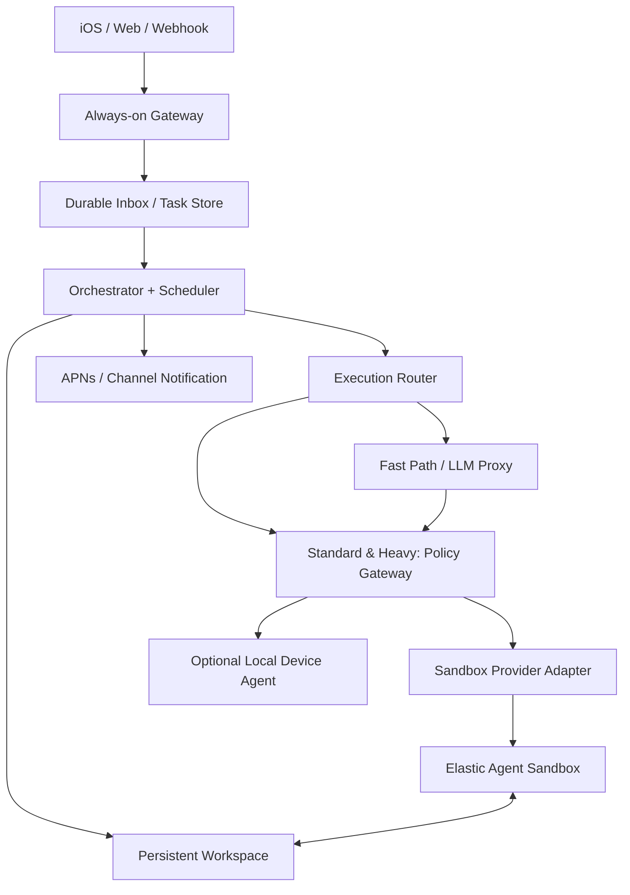
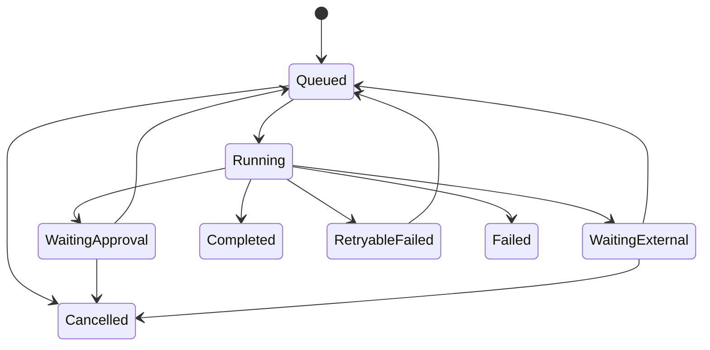
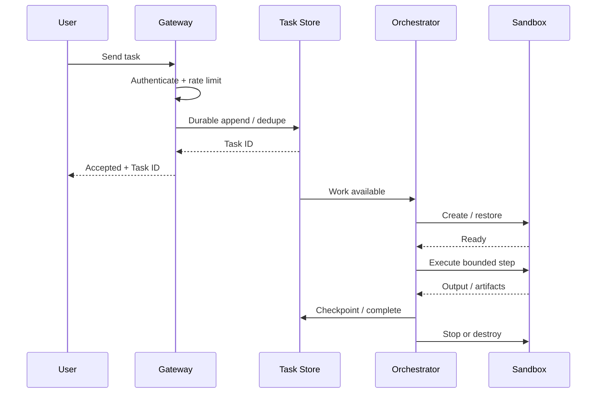

# Personal Agent Platform — Architecture RFC v0.2

> **状态**：Draft / Architecture + Product SLO Review  
> **日期**：2026-10-27  
> **前序版本**：RFC v0.1（保留为独立历史基线）  
> **范围**：架构与 PoC，不代表生产环境技术选型已批准  
> **目标读者**：产品负责人、架构师、Backend / Infra / Security / iOS 工程师、Coding Agent  
> **设计主张**：Always-on Agent + Persistent Workspace + Elastic Sandbox + Optional Local Device  
> **新增主张**：Experience-first、Cost-aware、Security-by-default；Fast / Standard / Heavy Execution Router

## 0. Executive Summary

本项目旨在打造面向普通用户的 Personal AI Agent：用户只需安装 iOS App 或通过支持的消息渠道发出指令，即可拥有**始终可访问、可记忆、可定时执行任务**的个人 Agent。用户的 Mac/PC 不需要 24 小时开机，亦无须学习 OpenClaw、Docker 或虚拟机部署；高级用户可以配置自有模型 API Key（BYOK）。

核心架构假设（均**待 PoC 验证**）：

> **H1 — Elasticity**：1,000 个逻辑上 24/7 在线的 Personal Agent，不需要 1,000 个 24/7 运行的 VM。
>
> **H2 — Experience**：用户收到可靠的即时确认、真实进度与流式反馈时，无需等待 Sandbox 冷启动才感觉到 Agent 已经开始工作；冷启动仍须满足任务级性能目标。
>
> **H3 — Unit Economics**：在满足体验和安全硬门槛后，按需计算 + 独立持久 Workspace 的每成功任务成本，能够显著低于每用户全天候独占 VM 的基线。

本 RFC 提议：

1. 采用**Always-on Control Plane** 接收消息、维护任务、调度执行和权限审批；“Always-on”指用户持续可寻址、服务持续可用，并非每用户始终运行一个进程。
2. 采用**Persistent Agent Workspace** 保存记忆、文件、配置、执行日志与 Checkpoint；数据的权威副本不依赖某个 Sandbox 的临时磁盘。
3. 采用**Agent Sandbox** 作为 Execution Plane 的稳定抽象；它可由 Firecracker microVM、容器或其他满足安全要求的底层方案实现，**不将 Cloudflare、E2B、Daytona、Boat 或 Fly.io 写死在业务代码中**。
4. 将 **LLM / Tool Orchestrator** 与不可信代码执行分离。普通模型调用和轻量编排可由服务端任务执行器承担；Shell、浏览器、生成代码、用户 Skills 等进入沙箱；高风险动作由独立 Policy / Approval Gateway 授权。
5. 将 macOS / Windows Local Device Agent 定位为可选执行节点。设备离线时，云端 Agent 仍正常接收消息；需要本地权限的任务排队等待或明确失败，不得越权转到云端。
6. 引入 **Execution Router**，根据任务实际能力与安全需求选择 Fast / Standard / Heavy Path；无 Shell / Browser 需求的交互不必启动 Sandbox。
7. 将 **UX Gate + Security Gate + Cost Gate** 明确为选型与 Go / No-Go 的联合硬门槛，以区域化端到端延迟和真实成本衡量平台，不以单一云厂商的启动宣传数据做决策。

**当前没有决定生产云厂商。** 首轮 PoC 将 **Cloudflare Sandboxes、E2B、Daytona、Boat** 纳入候选池；先进行四家低成本 Smoke Test，再选择两家进入深入 Adapter / Benchmark。Fly Machines 作为自主管理持久化 VM 的基线和回退选择。所有成本、冷启动与恢复能力必须通过同一套 Benchmark 取得。

**v0.2 相对 v0.1 的核心变化**：用户侧延迟预算、任务分级路由、动态保活策略、网络区域规划、完整平台 COGS 模型、可复现 Latency–Cost Benchmark、上线硬门槛；v0.1 的 Agent / Workspace / Sandbox 解耦与安全边界保持不变。

---

## 1. 背景与问题定义

### 1.1 用户痛点

- 纯本地 Agent 依赖用户的电脑持续在线；关机后无法完成定时任务，也无法可靠接收手机指令。
- 自行部署 OpenClaw / MCP / Docker、配置 API Key、网络通道、OAuth 和更新，对普通用户门槛高。
- “每用户永久 1 台 VM”虽然简单，但大量闲置 CPU / RAM 使免费和低价订阅不可持续。
- Agent 执行由模型生成的代码、读取网页或安装 Skills，会引入越权操作、Prompt Injection、跨租户访问及密钥泄露风险。
- 单纯让 Sandbox 休眠，会丢失临时文件、正在运行的进程，甚至浏览器登录态；必须区分**执行状态**与**持久业务状态**。

### 1.2 产品目标

| 目标       | 用户承诺                               | 系统实现含义                                    |
| ---------- | -------------------------------------- | ----------------------------------------------- |
| Always-on  | 随时发消息、安排任务，关闭手机也能完成 | 高可用入口 + 持久事件队列 + 调度器              |
| Personal   | 一个连续的身份、记忆、文件和 Skills    | Stable Agent ID + Workspace                     |
| Capable    | 浏览器、代码、连接器、长期任务         | 隔离 Sandbox + 工具网关                         |
| Secure     | 用户可控制数据与操作权限               | Tenant Isolation + Secrets Isolation + Approval |
| Affordable | 普通用户不承担全天候重型计算费用       | Elastic Compute + 预算限制 + 计量               |
| Accessible | 不强迫用户自己安装基础设施             | 托管默认路径；BYOK 和本地连接为高级选项         |

### 1.3 非目标（v0.2 / PoC）

- 不开发完整 iOS UI、支付系统、应用市场或 Skills Store。
- 不承诺任意 Linux 进程、WebSocket、非官方聊天客户端可以免费持续运行。
- 不承诺完整复制 Meta Muse 的安全体系或 Confidential VM。
- 不将“Sandbox snapshot”当成应用业务数据的唯一持久化手段。
- 不在 PoC 中部署高风险真实邮件发送、购买、转账或删除第三方数据的自动化。
- 不验证大模型能力上限；架构实验首轮使用 Mock LLM，之后对选定场景加入真实 API。
- 不在 PoC 阶段承诺所有模型、地区、蜂窝网络条件都能满足统一的首 Token 延迟目标。
- 不为了美化平均延迟而隐藏排队、失败重试、Sandbox 恢复和用户实际支付的模型费用。

### 1.4 产品不变量（Product Invariants）

1. **Always reachable**：Agent 对用户始终可寻址；任务接收成功后，即使客户端关闭也能追踪、继续或明确失败。
2. **No fake progress**：客户端区分已接收、正在排队、规划中、准备工具、执行中、等待授权和已完成；不得以固定文案冒充真实执行。
3. **Fast by default**：普通聊天/摘要不走重型代码环境；工具使用只有在完成任务所需时才付出启动成本。
4. **Privacy and safety first**：降低冷启动不能以跨 Tenant 复用未清理的 Workspace、共享 Cookie 或暴露长期密钥为代价。
5. **Predictable spending**：每个 Tenant、Run 和 Provider 有费用上限、执行 TTL、失败重试上限、拒绝/排队策略与可审计账目。
6. **Graceful degradation**：达到容量/预算限制时，保留任务并告知排队原因；不静默丢任务，也不自动绕过用户审批。

---

## 2. 术语与关键架构决策

### 2.1 术语

| 术语               | 定义                                                                 | 生命周期           |
| ------------------ | -------------------------------------------------------------------- | ------------------ |
| Tenant             | 安全与计费隔离单元，初期通常为单个用户                               | 长期               |
| Personal Agent     | 用户的逻辑 Agent；身份、配置、记忆及任务集合                         | 长期               |
| Agent Runtime      | 模型推理、工具选择和任务编排的执行逻辑；**不要求是常驻 OS 进程**     | 随任务执行，可恢复 |
| Workspace          | 版本化文件、记忆、Skills 清单、配置和 Checkpoint 的权威状态          | 持久               |
| Sandbox            | 对不可信代码和工具提供受控 CPU、内存、磁盘、网络及进程执行能力的环境 | 按需               |
| microVM            | Sandbox 可选的底层强隔离技术，不等于 Sandbox API                     | 按需               |
| Local Device Agent | 用户自主安装、按权限提供本机能力的可选执行节点                       | 设备在线期间       |
| Task               | 用户期望完成的一项业务工作                                           | 持久               |
| Run / Attempt      | Task 某一次执行尝试；与 Task 分离，便于重试与审计                    | 短期               |
| Execution Route    | Fast / Standard / Heavy 的内部执行策略，决定是否需要 Sandbox         | 每 Run             |
| Warm Pool          | 预先启动的同配置备用 Sandbox；属于付费容量而非免费能力               | 动态               |
| UX SLO             | 用户可感知的响应/进度/任务完成延迟目标，按地区和任务分类             | 版本化             |
| COGS               | 提供服务的全口径直接成本，按用户、任务和订阅追踪                     | 持续               |

### 2.2 决策状态（ADR）

| ADR     | 决策                                                                | 状态         | 原因                              |
| ------- | ------------------------------------------------------------------- | ------------ | --------------------------------- |
| ADR-001 | Agent ID 与 Sandbox ID 分离                                         | **Accepted** | Sandbox 可销毁，Agent 必须持续    |
| ADR-002 | 将 Workspace 作为持久状态权威来源                                   | **Accepted** | 不依赖单个 VM 根文件系统          |
| ADR-003 | Agent Sandbox 作为 Execution Plane 标准接口                         | **Accepted** | 允许替换不同厂商与底层隔离技术    |
| ADR-004 | 永久在线控制平面；重型执行按需                                      | **Accepted** | 满足可用性与成本目标              |
| ADR-005 | 不可信 Agent 不直接持有长期凭证                                     | **Accepted** | 减少提示注入导致的秘密泄漏        |
| ADR-006 | 先使用托管控制平面，生产服务商待定                                  | **Proposed** | 降低 Indie 运维负担               |
| ADR-007 | Cloudflare / E2B / Daytona / Boat 的执行平台选型，Fly.io 为 VM 基线 | **Open**     | 需 Smoke Test 与同条件 Benchmark  |
| ADR-008 | Workspace 快照、分层镜像、包缓存策略                                | **Open**     | 需性能与状态恢复实验              |
| ADR-009 | 免费共享资源与 Dedicated Always-on 档位                             | **Proposed** | 处理长期进程用户的需求            |
| ADR-010 | 采用 Fast / Standard / Heavy Execution Router                       | **Proposed** | 低成本请求避免无谓的 Sandbox 启动 |
| ADR-011 | UX / Security / Cost 设为联合准入门槛                               | **Proposed** | 避免单维度最优导致产品失败        |
| ADR-012 | 自适应 Sandbox 复用 + 小规模 Warm Pool，禁默认全用户常驻            | **Proposed** | 按命中收益决定保活开销            |
| ADR-013 | 按关键市场测区域端到端延迟，地域选型待测                            | **Proposed** | 避免只看 Provider 本地启动性能    |
| ADR-014 | 所有任务有逐级预算、背压、取消与降级路径                            | **Proposed** | 性能异常不导致不可控成本          |

---

## 3. 逻辑系统架构



**信任边界**：

1. **External Boundary**：iOS / 社交渠道请求必须认证、校验来源和限流；Webhook 签名与用户身份映射独立验证。
2. **Control Boundary**：Gateway、Task Store、Orchestrator、Policy、Vault 为可信控制面；可使用托管 Serverless，不要求用户进程 24/7 常驻。
3. **Execution Boundary**：Sandbox 是低信任环境，允许读入指定任务数据，不能访问控制面内部 API 或其他租户数据。
4. **Credential Boundary**：长期 API Key、OAuth Refresh Token、第三方敏感凭证位于 Vault / Credential Proxy；Sandbox 只获得有限的请求能力或短期、最小作用域授权。
5. **Device Boundary**：Local Device Agent 只能执行用户明确授权的本机能力；云端不能通过设备离线绕过授权。

### 3.1 Control Plane

必需职责：

- 认证、Tenant / Agent 路由、Webhook 接入、请求节流。
- 任务接收和**先持久化再确认**；快速返回 Task ID，不等待 Sandbox 冷启动。
- 定时触发、队列、重试、租户级公平调度、并发限额、配额和费用预算。
- 执行租约（lease）、心跳、沙箱创建/恢复、超时终止和取消。
- 审批、审计、任务结果通知与失败报警。
- 统一观测：每 Tenant / Task / Run / Sandbox 的事件、延迟和成本。

无任务时，不能因为 Agent 数量增加就定时唤醒全部 Agent。定时器和队列应由托管服务触发，只唤醒**有事可做**的 Agent。

### 3.2 Agent Runtime 与执行分级

| 任务类型                       | 建议执行位置                                 | 示例                        |
| ------------------------------ | -------------------------------------------- | --------------------------- |
| 轻量纯模型调用                 | Agent Runtime / LLM Proxy                    | 分类、总结、规划            |
| API Connector 调用             | 受控工具服务                                 | 日历查询、GitHub Issue 查询 |
| Python / Shell / 自定义 Skills | 隔离 Sandbox                                 | 数据分析、脚本运行          |
| Browser / Playwright           | 隔离 Sandbox                                 | 多网页交互、复杂表单        |
| 需要本机文件和 App             | 授权 Local Device Agent                      | 编辑 Mac 上的文件           |
| 长期自定义后台进程             | Dedicated Always-on Sandbox（付费/单独管理） | 自建服务、长连接            |

Agent Runtime 可以分布在多个短期步骤中；不应将“模型正在思考”与“用户 VM 必须持续计费”简单画等号。

### 3.3 Persistent Workspace

**权威数据**拆为三类：

1. **结构化状态**：Agent Profile、Memory Index、Task / Run 状态、审批、Checkpoint Metadata，使用事务数据库。
2. **大文件与 Artifacts**：用户文件、任务产物、浏览器导出、日志附件，使用租户隔离的对象存储。
3. **可选执行环境状态**：包缓存、环境镜像、浏览器 Profile、文件系统快照。版本化且可重建；不得替代业务级 Checkpoint。

工作区采用 `workspace_id` 与单调递增的 `workspace_version`。并发写入需版本校验或合并策略；P0 默认**同一 Workspace 内写操作串行化**，允许只读任务并发。

浏览器 Cookie / Session 属于敏感信息，必须加密存储、明确生命周期和删除机制。不是所有网站会话都能跨沙箱恢复，需单独纳入 Benchmark。

### 3.4 Execution Router：三条执行路径

| Path         | 适用范围                                       | 资源路径                                              | 用户交互方式                           |
| ------------ | ---------------------------------------------- | ----------------------------------------------------- | -------------------------------------- |
| **Fast**     | 问答、摘要、检索已授权记忆、纯模型规划         | Gateway → Agent Runtime / LLM Proxy；**不启 Sandbox** | 立即确认，尽早流式输出                 |
| **Standard** | 代码解释/执行、文件转换、轻量 Git / Skills     | Queue → Policy → On-demand Sandbox                    | 立即确认 + 真实准备/执行进度，支持取消 |
| **Heavy**    | Playwright/Browser、长任务、复杂依赖、长时编译 | Queue → Policy → 独立或按需恢复的 Sandbox             | 明示排队与预估状态，后台任务可离线完成 |

Router 的输入包括经验证的身份上下文、任务能力需求、用户明确授权、模型/Tool API 所需地域、Workspace 数据驻留、当前预算与 Provider 容量。**初始 Route 由确定性规则和 Tool Policy 约束，而非让 LLM 自由声明“我属于 Fast Path”。** 当 Fast Path 后续需要 Shell/Browser 时，先进行策略和费用检查，再升级到 Standard/Heavy；任何访问第三方具有副作用 API 的操作都经过 Policy / Approval Gateway。

**控制面返回与执行解耦**：

1. Gateway 验证身份与幂等键，将事件持久化后立即返回 `task_id` 和 `accepted_at`。
2. 客户端通过事件流（WebSocket/SSE 等，由平台实现决定）订阅进度；断连后可以用 `task_id` 重新取回事件。
3. Fast Path 可直接启动 LLM Streaming；Standard/Heavy 可并行进行安全规划、Workspace Manifest 预取、Sandbox 预配。
4. 队列、Provisioning、Tool Running、Waiting Approval 等状态必须由真实系统事件驱动，不制造虚假的“正在执行”提示。
5. App 在后台不可依赖长时 TCP 保活；任务完成后通过 APNs / 合规消息渠道通知，用户重新进入时按持久状态恢复。

避免 Fast Path 成为绕过安全的侧门：Prompt Injection、Tenant 数据访问、模型/工具费用、Connector scopes、数据脱敏对三条路径均适用。

### 3.5 Sandbox Lifecycle：先弹性，再决定保活

默认策略为 **按需要创建，任务结束后归档产物与 Checkpoint；短保活和预热为可测的优化**：

- `cold`：从可信基础镜像创建，适合低频、隔离要求高的任务。
- `restored`：从镜像/Workspace/已验证的 Snapshot 恢复，适合用户依赖和大文件场景。
- `warm`：用户单次会话内有限时复用；默认只允许**同 Tenant** 复用，并清理临时授权和未授权文件。
- `pool`：少量标准化、**未装载任何用户数据/长期凭证**的通用 Warm Sandbox；claim 后绑定 Tenant，退出后销毁/重置，不直接跨用户继续使用。
- `dedicated`：确实需要常驻进程的付费独占计划，单独配额，不计入免费 Elastic 假设。

不得仅以“刚刚执行过”确定 TTL。设计可配置策略：`idle_ttl_sec`、`min_reuse_probability`、`pool_max_instances`、`pool_cost_budget`。PoC 比较 `0 / 60 / 300 / 600 秒`保活；默认值待实测，不先锁定 10 分钟。

自适应策略的原则：只有预测在保活窗口内再次请求的**节省启动耗时/费用**大于**新增闲置费用和暴露风险**，才延长生命周期。短保活应按 Tenant 串行化任务、避免跨任务数据污染；恢复时不能信任进程内存对外部副作用是否已提交。

### 3.6 Regional Routing 与网络预算

一次请求可能经过四种不同地域：**User → Gateway → Sandbox → LLM Provider / Third-party Tool**。Sandbox 接近 Gateway 不代表 Sandbox 接近模型或用户访问的网站。

- P0 用 APAC（至少新加坡/东京）、美洲、欧洲模拟客户端和测试端点；具体地区以供应商实际可选 Region 和目标市场为准。
- 分别测量客户端到入口 RTT、入口处理、队列等待、Sandbox 连接、模型首 Token、第三方网站/API RTT；不把所有延迟合并成“冷启动”。
- Workspace 与加密凭证按 Tenant 数据驻留策略指定主要 Region；跨 Region 访问和副本迁移必须先通过隐私、用户授权和供应商可用性审查。
- 对 BYOK 模型端点允许按用户配置，不能保证第三方 API 的吞吐、配额或网络链路；应展示按模型/区域分层的性能统计。
- 中国大陆服务、跨境传输、专线/加速等先列为独立合规与可用性调研；不在 v0.2 擅自承诺覆盖。

---

## 4. Domain Model 与数据契约

所有资源都必须绑定可信身份上下文，不能只用客户端自报的 `tenant_id` 授权。

| Entity         | 核心字段                                                       | 说明                  |
| -------------- | -------------------------------------------------------------- | --------------------- |
| Tenant         | `tenant_id`, `plan`, `quotas`, `region`                        | 隔离与计费主体        |
| Agent          | `agent_id`, `tenant_id`, `policy_version`, `workspace_id`      | 可寻址的长期实体      |
| Workspace      | `workspace_id`, `tenant_id`, `version`, `manifest_uri`         | 状态权威来源          |
| InboundEvent   | `event_id`, `source`, `source_event_id`, `received_at`         | 去重和回执            |
| Task           | `task_id`, `agent_id`, `status`, `deadline`, `idempotency_key` | 用户意图              |
| Run            | `run_id`, `task_id`, `attempt`, `lease_token`, `checkpoint_id` | 一次执行尝试          |
| SandboxSession | `sandbox_id`, `run_id`, `provider`, `size`, `state`            | 临时执行环境          |
| Approval       | `approval_id`, `action_hash`, `expires_at`, `decision`         | 高风险动作授权        |
| UsageRecord    | `tenant_id`, `run_id`, `cpu_s`, `mem_gib_s`, `network_bytes`   | 计费与运营            |
| RouteDecision  | `run_id`, `path`, `reason`, `policy_version`, `changed_at`     | 可审计的路由及升级    |
| TaskEvent      | `task_id`, `sequence`, `phase`, `occurred_at`, `trace_id`      | 重连后重放真实进度    |
| BudgetLedger   | `tenant_id`, `run_id`, `reserved_usd`, `actual_usd`, `period`  | 估计/实际费用与硬限额 |

### 4.1 Task 状态机



规则：

- Event / Task / Run ID 彼此不同；相同 `source_event_id` 重投不得创建第二个业务任务。
- 任务可至少一次调度。**不要承诺分布式系统天然 exactly-once**；邮件发送、付款等副作用必须有应用级幂等键、操作流水和必要的人工核对。
- Run 采用有过期时间的租约和 fencing token；过期 Run 的迟到结果不可覆盖新 Run。
- 长等待时提交 Checkpoint、释放 Sandbox；审批结果或外部事件到达后重新排队。
- 用户取消应阻止未开始的步骤；已发出的外部副作用未必可撤销，UI 必须如实显示。

### 4.2 Workspace Checkpoint

每个成功 Checkpoint 记录：

- `task_id`、`run_id`、`step_id`、`workspace_version`。
- 已完成步骤及其稳定结果引用。
- 待执行步骤、外部操作 Idempotency Key、审批状态。
- 文件 Manifest 哈希以及必要的执行配置（镜像版本、工具版本）。
- 可选 Sandbox Snapshot ID（**不能单独依赖它**）。

恢复时先加载权威 Task / Workspace 状态，再判断是否使用缓存的环境快照；快照失效则重建环境并恢复持久文件，不能将“恢复进程内存”视为通用能力。

---

## 5. Sandbox Provider Contract

业务代码仅面向内部接口；SDK 差异封装在 Adapter 内。最小 TypeScript 伪接口如下（**RFC 契约，不等同于某家真实 SDK**）：

```typescript
type SandboxCapabilities = {
  shell: boolean;
  browser: boolean;
  filesystemSnapshot: boolean;
  memoryResume: boolean;
  diskSurvivesStop: boolean;
  forkFromSnapshot: boolean;
  persistentVolume: boolean;
  networkPolicy: boolean;
};

type SandboxSpec = {
  tenantId: string; // trusted context, never raw client input
  runId: string;
  imageDigest: string;
  cpuMilli: number;
  memoryMiB: number;
  maxLifetimeSec: number;
  networkPolicyId: string;
  restoreRef?: string;
};

interface SandboxProvider {
  capabilities(): Promise<SandboxCapabilities>;
  create(spec: SandboxSpec): Promise<{ sandboxId: string }>;
  waitReady(sandboxId: string, deadlineMs: number): Promise<void>;
  exec(
    sandboxId: string,
    argv: string[],
    timeoutMs: number,
  ): Promise<{ exitCode: number; stdoutRef: string; stderrRef: string }>;
  putFile(sandboxId: string, path: string, artifactRef: string): Promise<void>;
  getFile(sandboxId: string, path: string): Promise<{ artifactRef: string }>;
  snapshot?(sandboxId: string): Promise<{ restoreRef: string }>;
  resume?(sandboxId: string): Promise<void>; // only when provider retains same sandbox identity
  stop(sandboxId: string): Promise<void>;
  destroy(sandboxId: string): Promise<void>;
  usage(sandboxId: string): Promise<{
    cpuSeconds: number;
    memoryGiBSeconds: number;
    egressBytes: number;
  }>;
}
```

接口原则：

- Provider 能力必须显式发现；`snapshot`、`memoryResume` 等是**可选能力**，不应以名字相同推断行为相同。
- `stop` 不承诺磁盘一定保留；有的供应商只能从独立的 `restoreRef` 新建，有的可以在原 Sandbox ID 上 `resume`。还需记录状态保留期限、后台进程是否恢复、自动停止和删除的实际语义。
- `create` 返回不代表 Ready；独立测量资源分配、Shell Ready、Browser Ready。
- Sandbox 没有长期 Vault Secret，也不能反向调用管理接口。
- 提供 `maxLifetimeSec`、CPU / RAM / Disk / Egress 配额和 Stop / Kill 兜底。
- Provider 错误统一分类（配额、容量不足、超时、启动失败、用户代码失败、策略拒绝），避免把基础设施故障误报为 Agent 失败。
- 数据恢复需独立于 Provider；`snapshot` 仅是加速路径。

### 5.1 PoC 候选（2026-10-27 文档核对）

| 候选                   | 值得验证的特征                                                                          | 主要风险 / 待测                                                                                                      |
| ---------------------- | --------------------------------------------------------------------------------------- | -------------------------------------------------------------------------------------------------------------------- |
| Cloudflare Sandboxes   | Workers / Durable Objects 原生接入；按需启动与休眠；microVM 隔离                        | 休眠时临时文件系统语义、独立 Workspace 恢复开销、配额、区域与组合账单                                                |
| E2B                    | 面向 Agent 的 SDK 与隔离执行；作为短任务成熟度对照                                      | 生命周期/快照和文件保留方式、最大时长、并发配额、启动与按任务计费                                                    |
| Daytona                | 可选容器/VM 类型；停止后保留文件；快照、Volume、SDK 和可管理生命周期                    | **v0.226 正式文档与 v2 Alpha 的生命周期、存储和计费语义不同**；须固定 SDK/API 版本与 Sandbox 类型、验证安全隔离      |
| Boat（boat.dev）       | 每个 Sandbox 是独立 Linux VM；停止后磁盘快照、恢复、fork、SSH/桌面/浏览器；按运行秒计费 | 默认自动停止 1 小时；停止后磁盘通常仅保留 **14 天**；API starts/min/day 限额、区域、商业成熟度与供应商营销数据需核验 |
| Fly Machines           | 自主管理的 VM + Volume、持久进程基线/回退                                               | 启动、资源管理、费用、运维复杂度                                                                                     |
| Vercel / Modal（后续） | 第二阶段可替换候选                                                                      | 生命周期、隔离、成本、兼容性                                                                                         |

注意：**Full VM / microVM / Container 指底层隔离模型，不直接决定业务数据是否持久。** Daytona 的 stop/start、pause/resume、archive 依 Sandbox 类型及 API 版本而异；Boat 的 stop/resume 可恢复文件系统，但通常**不恢复正在运行的进程内存**。无论哪家厂商，持久 Workspace 和 Task Checkpoint 仍由平台独立管理。

Boat 自己的 [Boat vs Cloudflare](https://boat.dev/compare/boat-vs-cloudflare-sandbox) 对比页提供了评估线索，但属于**竞争厂商撰写的材料**；其性能和“便宜几倍”的计算不得直接视为公允结论。应以各家的官方计费维度加上**相同应用层任务的实际账单**为准。

### 5.2 两阶段筛选策略（Indie 友好）

**Phase A — 四家 Smoke Test**：单一固定脚本分别完成创建、Shell Ready、文件写入、关闭、等待、再次唤醒/重建、核验文件、销毁；记录每家官方计划门槛、最低费用、地区和账户配额。每家只运行极少量实例，不跑压力测试。

**Phase B — 两家深测**：根据 Phase A 数据选最合适的两个 Provider 实现生产形态的 Adapter，并跑 Browser、依赖安装、状态恢复、并发、故障、安全负向测试。若 Persistent VM 型（Boat/Daytona）与 Ephemeral 型（Cloudflare/E2B）行为不同，优先各选一个，以验证架构是否真的 Provider-independent。

**选择标准**是实测而不是品牌偏好；不要在四个 Provider 上同时投入完整工程量。Fly Machines 保持备用基线。

---

## 6. 关键流程

### 6.1 请求进入与沙箱执行



核心保证：Gateway 只有在事件已持久化后才回复“已接收”。推送通知和实时流可以提示任务进展，但不是任务状态的权威来源。

### 6.2 定时任务

Scheduler 只保存未来触发点；时间到达时写入 Queue，按 Task ID 唤醒对应 Agent。不能通过每秒扫描 1,000 个 Agent 进程来模拟在线。

### 6.3 人工审批

Agent 生成结构化 Action Proposal → Policy Gateway 校验风险 → 持久化待审批记录 → Sandbox 可释放 → 用户批准特定 `action_hash`、限定有效期 → 重新排队执行。批准权限不能笼统扩展到未来所有类似操作。

### 6.4 本地设备调用（P1，非 P0）

Mac Companion 经用户显式配对，采用设备身份、短期凭证及最小权限能力清单。云端请求只能调用预批准工具；设备离线时进入 `WaitingExternal` 并通知用户。默认禁止未经授权的远程任意 Shell。

---

## 7. 安全、隐私与可靠性要求

### 7.1 最小威胁模型

| 威胁                        | 潜在后果                                  | P0 控制措施                                          |
| --------------------------- | ----------------------------------------- | ---------------------------------------------------- |
| Prompt Injection            | 外部网页诱导 Agent 泄漏数据或执行危险动作 | 工具审批、敏感动作策略、出站限制                     |
| 跨租户数据访问              | 用户 A 读取用户 B 文件或任务              | Tenant ID 服务端绑定、对象存储授权、沙箱隔离负向测试 |
| Sandbox Escape              | 执行代码攻击宿主机或控制面                | VM 级隔离候选、无特权、禁宿主挂载、严格网络 ACL      |
| 长期凭证泄漏                | API Key / OAuth Token 被恶意代码获取      | 独立 Vault / Credential Proxy、日志脱敏              |
| 重复投递 / 重试             | 重复发邮件、重复调用外部写 API            | Event 去重、幂等键、操作流水                         |
| 资源耗尽 / Denial-of-Wallet | 极端任务导致高额费用                      | Tenant 配额、最大生命周期、并发限制、预算熔断        |
| 快照数据污染                | 恢复到过期或恶意状态                      | 快照签名、Manifest 校验、版本钉死、重新执行校验      |
| Mac 端设备离线或失陷        | 本地数据风险、任务不可达                  | 显式权限、设备撤销、状态可见、停止跨设备绕路         |

### 7.2 安全基线

- 所有外部工具调用由 **Policy Gateway** 判断，不接受由 LLM 自己声明的已批准状态。
- 模型提供商 Key 和 OAuth Token 加密存储；Sandbox 不接收通用长期 Key。第三方登录 Cookie、Browser Profile 同样按敏感凭证管理。
- 禁止默认直接访问云元数据地址、内网地址、数据库端口、Sandbox 管理 API；按需配置出站代理和域名策略。
- 日志默认不记录密钥、完整 Prompt 或浏览器 Cookie；敏感 Payload 采用摘要/引用和访问审计。
- 每用户提供撤销连接、停止任务、导出数据、删除账户及清理关联 Workspace 的路径。
- 供应商管理 API 仅由 Control Plane 使用，密钥不出现在 Agent 的可见工具输出中。
- 生产版需要供应链审计、镜像签名、依赖版本锁定、漏洞扫描及应急吊销流程。

### 7.3 可靠性

- Queue 至少一次投递；消费方必须设计幂等。
- 单 Task 有租约、重试次数上限、指数退避和 Dead Letter 状态。
- 对涉及外部副作用的“成功”采用**可核对操作结果**，不能仅依赖 LLM 的口头确认。
- 任务可恢复粒度为业务步骤，而不只是 Linux 进程内存。
- 对平台故障、容量配额耗尽、对象存储中断提供明确可见状态和失败通知。

---

## 8. 性能、成本模型与 SLO

### 8.1 负载模型

令：

- `N`：逻辑 Agent 数；
- `r`：每用户每天平均任务数；
- `d`：任务平均执行分钟数；
- `t`：任务完成后的额外 Sandbox 保活分钟数。

在任务时间均匀分布、同用户的保活窗口不重叠的**粗略模型**下：

```text
平均忙碌执行环境数 ≈ N × r × d / 1440
平均计费运行环境数 ≈ N × r × (d + t) / 1440
```

基准场景 `N=1000, r=4, d=2min`：

| 额外保活 `t` | 平均运行 Sandbox 数 | 占 1,000 逻辑 Agent 比例 |
| ------------ | ------------------: | -----------------------: |
| 0 分钟       |                 5.6 |                    0.56% |
| 1 分钟       |                 8.3 |                    0.83% |
| 5 分钟       |                19.4 |                    1.94% |
| 10 分钟      |                33.3 |                    3.33% |

该模型忽略同一用户多次任务的窗口重叠、保活命中复用以及峰值集中，因此**不是实际容量或账单预测**。要使用任务到达分布、用户活跃会话、实例类型、账单维度和真实生命周期事件做离散事件仿真。特别注意保活 10 分钟可能在简化模型下将计费运行环境时间扩大到纯执行的 **6 倍**，不能只凭较低的 Sandbox 单价判断总成本。

### 8.2 完整成本

```text
COGS =
  Sandbox CPU + RAM + runtime disk
  + Persistent Storage + Snapshots + Backups
  + Gateway / Queue / Workflow / DB
  + Network egress
  + Security / Logging / Monitoring
  + LLM inference (if platform pays)
  + Vendor minimum fees / retained capacity
  + Sandbox create/resume/fork surcharges or rate-limit upgrades
  + Stopped-sandbox disk / archived snapshot retention
```

关注两类指标：

- `Cost per Active Agent / month`（含没有执行任务但占用的持久状态）。
- `Cost per Successful Task`（必须把失败重试也计入；比单次 `exec` 成本更有商业意义）。

**费用口径必须区分**：

1. **Platform COGS**：平台承担的直接服务成本，包含失败、重试、idle、日志、数据保留与安全网关。
2. **User Total Cost**：用户对平台的实付金额 + BYOK 直接支付给模型供应商的费用；BYOK 不等于用户觉得便宜。
3. **Net Revenue / Gross Margin**：净确认收入扣除可归属于服务交付的 COGS 后的毛利率。支付渠道费用、税和退款的处理方式须在商业模型中统一明确。

`Cost per Successful Task = 统计期间可归属的全部任务交付 COGS / 成功完成任务数`。**分母只包含成功任务，分子包含失败、重试、缓存和未成功交付的计算费用**；固定共享资源按预先固定的分摊规则分配，不允许在厂商对比时任意排除。

`Infrastructure COGS per MAU = （同期间 Control Plane + Sandbox + Storage + Network + Observability + 安全服务直接成本）/ MAU`；必须另报没有任务的长期 Agent 数、活跃 Agent 数及订阅付费用户数，避免用 MAU 隐藏低频用户的持久化成本。

在尚未决定订阅价格、目标使用分布和托管模型费用之前，**不凭空指定每用户绝对成本上限或保证某个毛利率**。PoC 输出在多种订阅净收入假设下的敏感性分析，并给出是否存在可持续利润空间的结论。

新增两项 Provider-independent 约束：`Starts per 1,000 Agent-day` 和 `Cost per Recovered Workspace`。如果 1,000 个用户平均每天各做 4 个任务，最坏的“每任务创建一个 Sandbox”模型意味着 **4,000 次启动/天**（不含重试），可能先触达厂商的启动速率/日配额，而非 CPU 总量限制。应同时测试按任务启动与短期复用两种策略，评估启动额度、跨任务污染风险及每用户公平性。

厂商定价比较必须说明 CPU 是“预留时长”还是“实际活跃用量”、磁盘停止后是否计费、按小时还是按秒计量、启动超额费、月费/席位费与 Snapshot 保留费用。不要直接比较不同计费语义下的标价 `$ / VM-hour`。

BYOK 可以把模型推理账单交由用户支付，但**不等于平台没有安全、计算、网络或存储成本**。

### 8.3 UX SLO 与可靠性验收（P0 _proposed_, not vendor guarantees）

| 用户/系统可观察指标               | 建议 P95 目标                 | 测量边界 / 适用条件                                                        |
| --------------------------------- | ----------------------------- | -------------------------------------------------------------------------- |
| 接收确认（Client → Durable Ack）  | **≤ 1 秒**                    | 指定测试地区和网络条件，确认已完成持久化，不只是网关收到                   |
| Gateway 服务端入库时延            | **≤ 300 ms**                  | 排除客户端 RTT，但包含身份验证与 Durable Inbox Commit                      |
| 首个真实执行状态显示              | **≤ 1 秒**                    | App 发送请求到显示真实 `Accepted / Queued / Planning`；不得伪造运行状态    |
| Fast Path 首个有意义内容          | **≤ 2 秒（目标）**            | 选定模型/端点、正常配额、指定地区；BYOK/第三方模型结果分组报表，不承诺普适 |
| Sandbox Shell Ready（冷）         | **≤ 10 秒**                   | Create / Restore Request → 第一条 Shell 命令成功                           |
| Browser Ready（冷）               | **≤ 20 秒**                   | Request → Playwright 页面可操作；单独记录浏览器安装和 Profile 恢复         |
| 队列派发延迟（常态）              | **≤ 3 秒（目标）**            | Task Runnable → Run 获得执行租约；突发和预算限制另报                       |
| 定时任务派发偏差                  | **≤ 60 秒**                   | 计划时刻 → Runnable 状态进入队列（非任务完成）                             |
| 前台任务进度连续性                | **不出现无原因的长时间静默**  | 至少展示排队/执行/等待原因；进度事件重连后可恢复                           |
| Agent 逻辑在线规模                | **1,000**                     | 不部署 1,000 个常驻用户进程                                                |
| 状态恢复与租户隔离                | **所有确定性测试通过**        | 强杀、重复投递、跨租户文件/密钥访问；零未授权成功                          |
| 平均运行 Sandbox / Agent          | **基准负载 ≤ 5%（实验目标）** | 按运行秒/Agent-day 计算，含 Warm Pool 与失败重试                           |
| 峰值扩容 / 排队公平性             | **待实测设 SLA**              | 100/200/1,000 突发事件，允许排队但不允许丢任务                             |
| 真实生产 Availability / RPO / RTO | **Open**                      | P0 只能测试故障注入，不把短期测试宣传为 99.99% SLA                         |

**量化方法**：采集 P50/P95/P99、样本量、失败率、超时率和置信区间；区分冷/热、Fast/Standard/Heavy、Region、网络类型、模型、Provider、配置档位。记录用户侧 `end_to_end` 原始样本；**不能将各阶段 P95 简单相加当作端到端 P95**。

### 8.4 端到端延迟预算（Latency Budget）

为每条 Run 记录以下时间戳或 Trace Span：

| Span                    | 起止点                        | 主要优化杠杆                      |
| ----------------------- | ----------------------------- | --------------------------------- |
| `client.network`        | 客户端发起 → Gateway 到达     | 入口地域、TLS/连接复用、移动网络  |
| `gateway.persist`       | Gateway 验证 → Durable Ack    | 认证缓存、数据库索引、区域        |
| `queue.wait`            | Runnable → Worker 获取租约    | 并发、优先级、背压                |
| `router.decide`         | Router 接到任务 → 选定 Path   | 路由规则、本地缓存                |
| `sandbox.provision`     | Create / Resume → Shell Ready | Snapshot、镜像、Warm Pool、Region |
| `browser.ready`         | Browser 启动 → 页面可操作     | 基础镜像、Profile、浏览器初始化   |
| `llm.first_token`       | 向模型发请求 → 首 Token       | Provider RTT、模型负载、提示缓存  |
| `tool.exec`             | 工具发起 → 工具返回           | 网络、软件依赖、沙箱资源          |
| `client.first_feedback` | 用户提交 → 首个真实可见事件   | 事件推送、App 渲染、移动网络      |
| `task.complete`         | 用户提交 → 持久化最终结果     | 全链路、重试、用户授权等待        |

**首响应优化不能拖慢后台执行**：Ack/Streaming 和 Sandbox Provisioning 分开并行，但若任务必须获得额外授权或数据加载后才能执行，事件应如实告知。持续任务无需保持用户手机/Browser 连接。App 体验（启动、滚动、渲染、重连）另由 iOS P1 验收，不能全部归罪于 Sandbox。

### 8.5 成本预算与自适应容量

| 控制层级    | 必需约束                                           | 超限时行为                                          |
| ----------- | -------------------------------------------------- | --------------------------------------------------- |
| 每 Run      | 最大执行秒数、CPU/RAM 配置、模型调用预算、重试上限 | Cancel / Pause / 显示升级或审批                     |
| 每 Tenant   | 同时运行数、日/月基础设施预算、第三方 API 限额     | 入队、限流、提示可用时间或手动授权                  |
| 每 Plan     | 免费档/付费档的资源池、Snapshot 保留、订阅权益     | 拒绝超额常驻，不暗中透支                            |
| 每 Provider | 每分钟/天启动额度、区域资源配额、总计费阈值        | 切换经验证的候选或触发降级；不跨越数据驻留/安全边界 |
| 全平台      | 日总支出、Warm Pool 最大容量、紧急 Kill Switch     | 保护性降级，保留请求和已有 Checkpoint               |

**弹性策略评估矩阵**：

| 策略                    | 潜在体验收益            | 主要成本/安全代价                             |
| ----------------------- | ----------------------- | --------------------------------------------- |
| Every Run Cold          | 隔离简单、闲置占用低    | 启动次数、重复装载依赖                        |
| Same-tenant Short Reuse | 连续会话更快            | 额外运行分钟、状态污染防护                    |
| Generic Warm Pool       | 第一次 Shell Ready 更快 | 预付闲置容量、区域/镜像碎片化、池内安全清理   |
| Persistent Stopped VM   | 保留依赖和文件方便      | 停止后存储费用、Snapshot/保留期限、恢复可靠性 |
| Dedicated Always-on     | 支持长期进程、连接      | 持续计费；需专用定价与硬限额                  |

PoC 所有策略都必须回答：**每缩短 1 秒 P95 用户等待时间，增加多少平台 COGS？** 这不是要将用户体验简单货币化，而是提供可审计的 Latency–Cost 权衡曲线。

---

## 9. Benchmark 设计

### 9.1 工作负载矩阵

| Profile           | 任务频率与类型                                 | 用途                                 |
| ----------------- | ---------------------------------------------- | ------------------------------------ |
| Light             | 1 次/天，30 秒 Mock 任务                       | 验证空闲成本                         |
| Typical           | 4 次/天，每次 2 分钟                           | 核心经济性模型                       |
| Heavy             | 12 次/天，每次 10 分钟                         | 配额与长尾资源                       |
| Browser           | Playwright 登录态/导航/截图/提取               | 浏览器可用与状态连续性               |
| Code              | Python 安装依赖、执行、保存结果                | 环境恢复成本                         |
| Cron Burst        | 1,000 个任务集中在早上 8 点                    | 排队、公平性、扩容、启动速率限制     |
| Reuse vs Recreate | 4,000 次/天逻辑任务；短保活复用 vs 每次新建    | 启动配额、Idle COGS、跨任务污染风险  |
| Cold Resume       | 关机 1 h / 1 d / 15 d 后恢复同一用户环境       | 磁盘保留期限、恢复时延、数据丢失兜底 |
| Human-in-loop     | 等待批准 6 小时后恢复                          | 长期状态不占用 Sandbox               |
| Fault             | VM 被杀、网络中断、重复 Webhook                | 恢复、幂等与审计                     |
| Isolation         | A 试图访问 B 的数据及 Secret                   | 安全负向测试                         |
| Fast Stream       | Mock LLM + 一个真实受控模型，输出流和取消      | 首次真实反馈、首 Token、断线重连     |
| Mobile Network    | 不同 RTT / 丢包模拟、前后台切换                | 用户感知性能与进度恢复               |
| Region Matrix     | APAC / US / EU 的客户端、Sandbox、模型端点组合 | 端到端网络延迟与跨地域请求代价       |
| Adaptive TTL      | 0/60/300/600 秒同 Tenant 保活策略              | Warm Hit Rate、增量 COGS、P95 改善   |
| Budget Exhaustion | 预算耗尽、Provider 限流、容量不可用            | 背压、拒绝、降级、用户可见性         |

### 9.2 分阶段放量与限额

1. **模拟 1,000 个 Agent**：先不运行真实 LLM / Browser，检查状态、身份、Webhook、调度。
2. **真实 10 → 50 → 100 个并发 Sandbox**：逐级放量，每步设预算与停机阈值；不要一次创建 1,000 个高配置实例。
3. **峰值注入**：对 1,000 事件同时到达进行排队与降级测试，允许排队但不能丢消息或破坏租户公平性。
4. **24–72 小时稳定性实验**：收集账单、启动分布、队列增长、重试次数、检查点恢复与故障事件。
5. **Provider Smoke → Deep A/B**：四家先跑同条件的低成本基本生命周期测试，再挑选两家深测。记录各家实际 CPU/RAM 配型与隔离级别；无法完全同配时明确标记，不强制宣称一对一可比。
6. **账单对账**：由供应商仪表板/用量 API 对照本地日志，区分“运行计算费用”“停止后的数据保留费用”“启动额外费用”及“订阅最低消费”。
7. **Latency–Cost Pareto**：分别作 Fast/Standard/Heavy 路径的 P95 用户等待时间与 Cost per Successful Task 二维对比；不将成功率较低的候选通过“剔除失败任务”美化。
8. **Regional Replay**：至少记录新加坡/东京、美国、欧洲三个用户侧地域组的指标；流量比例在尚无用户数据时以多情景模型呈现，不虚构实际分布。

预算保护：PoC 必须具有全局最大并发、每租户最大并发、每 Sandbox TTL、每天预算和手动 Kill Switch。**未经明确额度批准，不进行产生明显云资源费用的大规模实测。**

### 9.3 实验公平性、样本与对照组

- **同任务**：固定输入文件大小、依赖锁、代码/浏览器版本、相同 LLM Provider（或 Mock）、一致的网络目标；对结果输出进行哈希校验。
- **同资源目标**：优先按可比的内存与 vCPU 配型测试；厂商只提供固定规格时如实披露，附标 CPU 类型和共享/独占语义。
- **同安全要求**：不因某家 Provider 难于配置就关闭网络隔离、审计或 Tenant 隔离来提高性能。
- **同生命周期**：完整计入 Create / Ready / Execute / Artifact Extract / Stop / Restore，以及停止后 1 天、15 天的可用性和费用。
- **同计费窗口**：以供应商实际账单为权威来源，按固定周期分配订阅最低额、启动附加费与保留状态费用；遇到优惠券或试用抵扣，另报标价情景。
- **样本**：Smoke Test 每家先跑小样本以排除明显不兼容；深测至少记录每条核心路径约 100 次成功/失败尝试供探索性 P95 估计，精确样本量以目标置信区间和试测方差确定。P99 不得用几十次样本作确定结论。
- **基线**：与“每个 Agent 24/7 独占完整 VM”、单 Provider Every Run Cold、Provider 自身可用 Resume/Warm Pool 分别对照；只比较 Sandbox 单价不算完成实验。

**首轮深测候选挑选方式**：四家先通过安全能力/成本上限/SDK 可用性的硬筛选；然后优先选择两种不同生命周期范式的供应商，避免两家完全同构导致无法验证 Router/Workspace 的厂商独立性。最终排名暂不固定。

### 9.4 结果产物

- `benchmark-results.csv`：逐 Run 记录 Route、Tenant、Client/Sandbox/Model Region、Provider、规格、所有 Trace Span、冷/热、Start/Ready/Stop、成功/重试、估计/实际费用。
- `benchmark-report.md`：按 Route/Region/Provider 分层的 P50/P95/P99、分布/失败原因、成功成本、恢复可靠性、费用账单对账与方法局限。
- `latency-cost-pareto.md`：在 UX/Security Gate 下的 Pareto 前沿、敏感性分析、保活阈值选择。
- `unit-economics.csv`：Light/Typical/Heavy 用量情景下，1K/10K/100K 逻辑 Agent 的直接成本与可能订阅净收入敏感性（仿真而非真实业务预测）。
- `security-test-report.md`：跨租户访问、恶意代码、凭证保护与权限审批的测试证据。
- `ADR-007-provider-selection.md`：明确 Go / No-Go 与选型理由。

---

## 10. P0 实施计划与退出条件

| 里程碑                          | 建议周期 | 主要交付物                                                                                    |
| ------------------------------- | -------- | --------------------------------------------------------------------------------------------- |
| P0-A：Architecture RFC          | 1–2 天   | 本 RFC、术语、接口和风险评审                                                                  |
| P0-B：最小闭环                  | 3–5 天   | Gateway → Durable Task → Router（Fast + Standard）→ Sandbox → Artifact → Resume；真实进度事件 |
| P0-C1：四家 Provider Smoke Test | 2–3 天   | Cloudflare / E2B / Daytona / Boat 生命周期、SDK、计划/配额初筛                                |
| P0-C2：两家深度 Adapter A/B     | 3–4 天   | 基于初筛选两家，完成恢复、浏览器、成本、安全对比                                              |
| P0-D：1,000-Agent 负载与成本    | 3–5 天   | 逻辑在线、真实分级并发、Regional Latency、COGS、故障报告                                      |
| P0-E：联合 Go / No-Go           | 1–2 天   | UX / Security / Cost Gate 结果、选型 ADR、P1 预算与范围                                       |

**PoC 最小闭环验收**：

1. 创建两个 Agent A / B，具有不同 Tenant ID 和 Workspace。
2. A 的请求写入 Durable Inbox，立即获得 Task ID；关闭客户端不影响后台执行。
3. Orchestrator 唤醒 A 的 Sandbox，运行脚本和浏览器任务，产生 Artifact。
4. 保存 Workspace / Checkpoint，完全销毁 Sandbox。
5. 下次请求创建新的 Sandbox，恢复前次文件与任务进度。
6. A 的 Sandbox 无法通过文件 API、Sandbox API、网络路径或 Vault 获取 B 的任何资源。
7. 模拟中途 Crash，恢复后不重复已经确认的有副作用步骤。
8. 同一套业务流程至少可以在两个不同 Provider Adapter 上运行。
9. 汇总实测启动时间、资源占用、成本、失败率和恢复表现。
10. 同一用户完成 Fast Path 普通问答不启动 Sandbox；涉及 Shell/Browser 的请求按确定性策略升级且经过 Policy Gateway。
11. iOS / 测试客户端收到 Durable Ack、真实进度、错误原因与最终结果；断线后按事件序列恢复，不重复执行。
12. 对两家深测 Provider 测量按 Region 分层的端到端延迟、同一任务真实账单、0/60/300/600 秒保活敏感性与实例启动配额。
13. 触发 Run/Tenant/Provider 预算上限，系统排队、暂停或明确拒绝；无无限重试、账单失控或安全策略绕过。

### Go / No-Go

**三道硬门槛全部通过，才允许进入 P1 外部 Beta 的 Go 讨论**：

| Gate         | 通过条件                                                                                                                          | 未通过时                                        |
| ------------ | --------------------------------------------------------------------------------------------------------------------------------- | ----------------------------------------------- |
| **Security** | 跨 Tenant 负向测试无越权成功；凭证代理、审批、隔离、日志脱敏、资源 TTL 和数据恢复安全机制经审查                                   | **No-Go**，不得用成本或性能收益抵消             |
| **UX**       | 目标 Region / 模型 / Path 的提议 P95 指标经过实测；前台不出现无故静默；后台任务状态/重连正确                                      | Conditional Go 仅限经过明确限定的场景，继续优化 |
| **Cost**     | 有真实账单对账和 Light/Typical/Heavy 模型；典型路径对独占 VM 基线有可测成本优势；预算失控测试通过；订阅假设下存在可解释的利润空间 | 不批准规模化 Beta；限定用量并重新设计           |

**Go**：闭环、三道 Gate 通过，性能与成本均有样本和误差范围，符合用户体验和预算约束；Provider 配额足以支撑计划中的试点规模。Go **不等于生产安全认证或法规合规完成**。

**Conditional Go**：安全底线已通过，但部分 Region/Browser/Heavy Path 的体验或成本未达到目标；只允许限制地域、路径、用户数和日预算的内部/受控试用，待优化后复测，不能扩大承诺。

**No-Go / 重新设计**：跨租户越权、长期凭证泄露、无法控制费用、关键数据销毁后无法恢复、持久消息丢失或审批被绕过；此类问题不能以“先上线再修”为理由接受。

---

## 11. 尚未决定的问题（Open Questions）

| 问题                                                  | 当前判断                                                     | 负责实验    |
| ----------------------------------------------------- | ------------------------------------------------------------ | ----------- |
| Agent Runtime 是短期 Worker 还是驻留 Sandbox？        | 默认轻量编排在控制面；危险工具在 Sandbox                     | P0-B        |
| 每用户一个 Sandbox 还是每任务一个？                   | Agent ID 独立于 Sandbox；先按单 Run 隔离                     | P0-B/C      |
| 浏览器 Profile / Cookie 如何安全恢复？                | 加密 + 过期策略 + 恢复测试                                   | P0-C        |
| 用户安装的系统软件如何保存？                          | 镜像 / 依赖锁 / Snapshot / Volume A/B                        | P0-C        |
| Provider 在 Cloudflare、E2B、Daytona、Boat 中如何选？ | 四家初筛、两家深测；Fly 是持久 VM 基线；Benchmark 决定       | P0-C/D      |
| 若供应商限制每日启动次数怎么办？                      | 与按需计费一同建模；评估短期复用、预热池或更高配额           | P0-C/D      |
| 真实峰值超过租户预算怎么办？                          | 排队、限流、优先级、提示用户                                 | P0-D        |
| Agent 长期在线需要持续发起监控吗？                    | 用事件/Webhook/Alarm；少量长连接另设 Dedicated               | P0-D        |
| BYOK 是唯一模式吗？                                   | 不建议；普通用户应有无需申请 Key 的托管模式                  | P1 产品     |
| 中国大陆与全球数据驻留如何设计？                      | 需按地区和供应商可用性单独验证                               | P1          |
| 订阅、Apple IAP、外部模型费用如何处理？               | 属产品/合规专题，未做结论                                    | P1          |
| Mac/Windows Companion 何时引入？                      | P1；不阻塞云端架构 PoC                                       | P1          |
| Fast Path 最终支持哪些 Connector？                    | 可读/只读连接器优先；所有有副作用操作经过 Policy Gateway     | P0-B/P1     |
| 目标首发市场与最低网络体验？                          | 必须选择目标 Region 和测试网络条件，不能只用云机同区域测延迟 | P0-A / 产品 |
| 同 Tenant Sandbox 复用多久？                          | `0 / 60 / 300 / 600 秒` A/B；记录冷启动节省与增量费用        | P0-D        |
| Warm Pool 是否属于第一版默认策略？                    | 否，先证明收益超过 Idle COGS 和安全复杂度                    | P0-C/D      |
| 订阅价格、免费额度与目标毛利？                        | 产品/财务定价决策；PoC 先跑场景敏感性和成本上限              | P0-E / 产品 |
| 如何处理 BYOK 模型超时/限流？                         | 分清模型供应商故障与平台故障，展示归因并限制重试             | P0-B/D      |

---

## 12. 参考资料（官方原始文档；访问日期 2026-10-27）

1. Cloudflare, **Choose a sandbox environment** — https://developers.cloudflare.com/sandbox/concepts/
2. Cloudflare, **Sandbox lifetime** — https://developers.cloudflare.com/sandbox/concepts/lifetime/
3. Cloudflare, **Save and restore a sandbox with snapshots** — https://developers.cloudflare.com/sandbox/files/save-and-restore-a-workspace/
4. Cloudflare, **Sandbox security** — https://developers.cloudflare.com/sandbox/concepts/security/
5. Cloudflare, **Queues delivery guarantees** — https://developers.cloudflare.com/queues/reference/delivery-guarantees/
6. Cloudflare, **Workflows** — https://developers.cloudflare.com/workflows/
7. Cloudflare, **Containers pricing** — https://developers.cloudflare.com/containers/platform/pricing/
8. E2B, **Security and isolation** — https://e2b.dev/security
9. Fly.io, **Machines / Resource pricing** — https://fly.io/docs/about/pricing/
10. AWS, **Well-Architected SaaS Lens: General design principles** — https://docs.aws.amazon.com/wellarchitected/latest/saas-lens/general-design-principles.html
11. Meta AI Research, **How We Built Safety Into Muse** — https://research.meta.ai/blog/security-and-safety-for-ai-agents-our-approach-with-muse
12. Daytona, **Sandboxes (v0.226)** — https://www.daytona.io/docs/en/sandboxes/
13. Daytona, **Persistence (v0.226)** — https://www.daytona.io/docs/en/persistence/
14. Daytona, **Billing (v0.226)** — https://www.daytona.io/docs/billing
15. Daytona, **Sandboxes (v2 Alpha; for version comparison only)** — https://www.daytona.io/docs/en/v2/sandboxes/
16. Boat, **Concepts: Sandbox / Stop / Resume** — https://docs.boat.dev/concepts
17. Boat, **Pricing and API start limits** — https://docs.boat.dev/pricing
18. Boat, **Data retention and deletion** — https://docs.boat.dev/data-retention
19. Boat, **Auto-stop and keep alive** — https://docs.boat.dev/long-running-tasks/auto-stop
20. Boat, **Boat vs Cloudflare Sandbox (vendor-authored comparison; not independent benchmark)** — https://boat.dev/compare/boat-vs-cloudflare-sandbox
21. Daytona, **Warm Pools** — https://www.daytona.io/docs/en/warm-pools/
22. Cloudflare, **Sandbox overview** — https://developers.cloudflare.com/sandbox/
23. Cloudflare, **Run code when a sandbox stops** — https://developers.cloudflare.com/sandbox/manage/run-code-when-a-sandbox-stops/
24. E2B, **Platform Overview** — https://e2b.dev/
25. Boat, **Readiness and resume speed** — https://docs.boat.dev/readiness

> 本文中的价格模型、SLO 与执行语义属于**项目假设和设计目标**；供应商文档的能力声明不是本项目已经完成的实测。版本 v0.2 用于工程评审与 PoC 设计，不能直接视作生产上线安全认证。

---

## 13. v0.2 版本变更记录与兼容性

| 维度     | v0.1                                                    | v0.2                                                              |
| -------- | ------------------------------------------------------- | ----------------------------------------------------------------- |
| 核心解耦 | Stable Agent + Persistent Workspace + Ephemeral Sandbox | **保留**，进一步明确按需与可恢复                                  |
| 任务执行 | 轻量 Orchestrator / 重型 Sandbox                        | **新增 Execution Router**：Fast / Standard / Heavy                |
| SLO      | API Ack、Shell/Browser Ready 为主                       | **新增用户侧首反馈、模型 TTFT、Regional E2E 与失效状态**          |
| 成本     | 实例秒 + 基本 COGS                                      | **新增 Idle COGS、Unit Economics、BYOK 用户全口径成本、保活策略** |
| Provider | 四家 Smoke → 两家深测                                   | **保持候选未决**，新增 Latency–Cost Pareto 与地域公平对照         |
| 验收     | 功能 / 安全 / 成本综合判断                              | **三道独立硬门槛 UX / Security / Cost**                           |

**仍然 Accepted（不变）**：ADR-001 至 ADR-005。**依然 Open/Proposed**：具体 Provider、控制平面厂商、默认 TTL、Warm Pool、定价、地区策略和真实生产 SLA。

## 14. 实现与埋点契约（P0 Minimal）

以下为内部 Trace / Usage 数据的建议形态，并非任何供应商 SDK。字段通过可信服务端填充；`cost_estimated` 和 `cost_actual` 必须明确来源、单位、币种与核对状态。

```json
{
  "trace_id": "trace_example",
  "tenant_id_hash": "opaque_derived_id",
  "task_id": "task_example",
  "run_id": "run_example",
  "route": "standard",
  "provider": "provider_adapter_name",
  "sandbox_mode": "cold",
  "client_region": "apac-synthetic",
  "sandbox_region": "provider-region",
  "llm_region": "llm-endpoint-region",
  "timestamps_ms": {
    "client_sent": 1000,
    "durable_ack": 1300,
    "first_real_progress": 1600,
    "run_runnable": 1700,
    "sandbox_ready": 5200,
    "first_token": null,
    "task_completed": 8000
  },
  "usage": {
    "sandbox_billable_seconds": 5.5,
    "sandbox_start_count": 1,
    "retries": 0,
    "cost_estimated_usd": null,
    "cost_actual_usd": null,
    "cost_reconciled": false
  },
  "outcome": "completed",
  "error_class": null
}
```

**Telemetry 约束**：

- Trace 和 Usage 事件只能包含经核准的 ID、时间戳、聚合费用及必要状态；不得记录明文模型 API Key、OAuth Token、Cookie、完整私密文档或未经用户授权的 Prompt 内容。
- 客户端时钟与服务端时钟需校准/估计偏移；跨设备时间戳不可直接相减而不标注误差。用户端到端延迟以同一客户端单调时钟为准。
- Cloud Provider 实际账单通常异步形成，`cost_actual` 允许延迟填充但必须保留核对状态；未对账记录不得假装精确。
- 取消、超时、供应商配额拒绝、审批等待、失败重试必须进入成功率、尾延迟和成本统计，不得只报成功样本。
- 存在可识别个人信息时遵守租户删除与访问权限策略，运营分析用聚合/匿名化视图。
