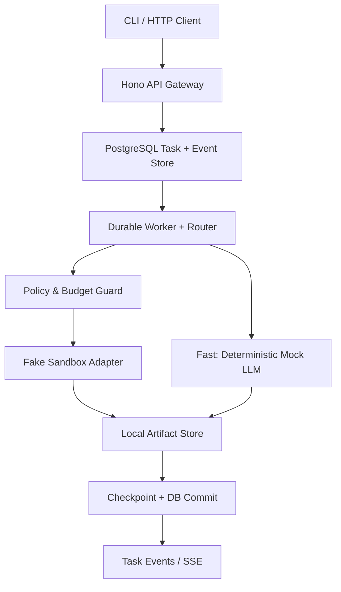
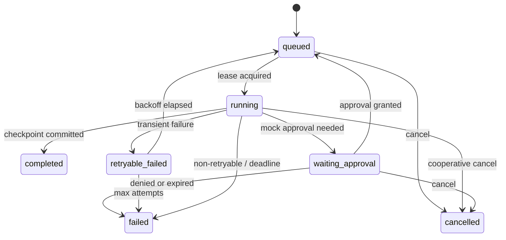

# Personal Agent Platform — P0-B Minimum Vertical Slice 工程实施任务书

> **版本**：P0-B Task Spec v1.0（2026-10-27）  
> **状态**：Ready for implementation review；尚未开始实施  
> **上游规范**：[Personal Agent Platform — Architecture RFC v0.2](https://chatgpt.com/library?file_id=libfile_8da6b47699548191bcdeac5e09db5353&account_id=personal)  
> **执行范围**：Local-only / No paid cloud / No production credentials  
> **建议周期**：3–5 个工程工作日（单人 + Coding Agent）；周期为估计而非承诺  
> **目标**：证明控制面、执行路由、任务持久化、Fake Sandbox、Workspace/Checkpoint 与事件流可以在崩溃和重试下形成可靠闭环

## 0. Executive Decision

**开始 P0-B，不开始 iOS UI、不进行云资源购买、不锁定任何 Sandbox Provider。**

P0-B 验证的是架构及数据/状态不变量，而非 Cloudflare、E2B、Daytona、Boat 的实际隔离、冷启动或费用。四家 Provider 的真实对照属于 P0-C。

完成后的可演示路径：



**工程准则**：

- 一个逻辑 Agent 持久存在，不能与某个 Sandbox 实例绑定。
- Durable Ack 必须发生在数据库提交成功之后。
- Task 至少一次派发；Task、Run、Step 和 Artifact 均有稳定标识。
- 对同一 Tenant 进行 AuthZ；不能相信请求体里的 Tenant ID。
- Standard/Heavy 路径绝不能在 P0-B 直接运行模型生成的真实 Shell 命令。
- 本地 Fake 不代表生产沙箱隔离，也没有真实厂商的性能和账单指标。
- 优先可重现的自动测试与可追踪失败，不为 PoC 开发过度复杂的生产框架。

## 1. 范围、假设与成功定义

### 1.1 In scope

1. 本地单机 API 与 Worker，可作为两个进程运行；进程崩溃后能重启继续。
2. Dev Token 认证、Tenant/Agent 隔离与两个测试用户。
3. 持久 Task Inbox、幂等创建、任务查询、取消、事件查询与 SSE 进度订阅。
4. 确定性的 Execution Router：Fast Path 与 Standard Path；Heavy Path 可规划枚举，不运行真实 Browser。
5. Fake Sandbox Adapter，验证创建/准备/执行受限模拟操作/关闭/销毁的生命周期。
6. PostgreSQL-backed Queue + lease/fencing + 有界重试，无外部消息中间件。
7. Workspace Manifest、Local Artifact Store、Content Hash、Checkpoint、CAS 版本更新。
8. Mock LLM/Tool 的可预测输出与模拟延迟，测试首反馈及取消。
9. Trace/Usage 事件，记录阶段延迟、模拟运行秒数与 **simulated** 成本。
10. 单元、集成、崩溃恢复、并发、权限负向测试；本地 1,000 逻辑 Agent 的轻量模拟。

### 1.2 P0-B 核心场景

- **Scenario A — Fast**：Agent A 收到简单文本任务 → 返回 Durable Ack → 无 Sandbox Session → 输出流与最终结果。
- **Scenario B — Standard**：Agent A 收到模拟计算/文件处理任务 → 创建 Fake Sandbox → 输出 Artifact → Commit Workspace → 销毁 Fake Sandbox。
- **Scenario C — Resume**：在执行中注入 Crash → lease 过期后新 Run 取得租约 → 从已提交 Checkpoint 继续，不重做已确认的逻辑步骤。
- **Scenario D — Isolation**：Agent B 或 Tenant B 查询/下载 A 的 Task、Event、Artifact、Checkpoint，统一拒绝/不可发现。
- **Scenario E — Cancel / Budget**：任务正在排队或执行时取消，停止后续步骤；预算不足时明确拒绝或保留可恢复的等待状态。
- **Scenario F — Event reconnect**：客户端断线再连接，按递增事件序号补齐中间事件，无重复或越权。

### 1.3 明确不验证

- 真实 LLM 能力、外部模型 TTFT、实际用户网络质量、实际 iOS/App 冷启动体验。
- 真实 Sandbox 安全隔离、Firecracker/microVM、Playwright Browser、云端 Region 延迟、第三方 Provider 的价格。
- 完整 OAuth、BYOK 密钥管理、邮件/支付/删除等有副作用的真实外部动作。
- 1,000 台真实 Sandbox 并发或完整生产可用性 SLA。

## 2. 技术栈与工程约束

| 层                  | P0-B 选择                                     | 理由/边界                                              |
| ------------------- | --------------------------------------------- | ------------------------------------------------------ |
| Runtime             | Node.js 当前受支持 LTS + TypeScript strict    | 可与后续 Cloudflare/Node SDK 生态对接，避免 PoC 多语言 |
| Package manager     | pnpm（锁定版本和 lockfile）                   | 可复现安装；Workspace 分包                             |
| API                 | Hono + Node.js Adapter                        | 轻量 HTTP API；支持 Streaming / SSE                    |
| Validation          | Zod 或等效 Schema Validator                   | 所有输入、响应、Env 都经过验证                         |
| Database            | 本地 PostgreSQL                               | 事务、唯一索引、行级锁、`SKIP LOCKED`                  |
| SQL access          | `pg` + 显式 SQL migration（P0）               | 便于审查事务边界；暂不引入 ORM 复杂性                  |
| Durable Queue       | PostgreSQL `tasks` 行 + Worker polling        | 不部署 Redis、Kafka、Cloudflare Queue；接口可替换      |
| Artifact Store      | 本地文件系统 Adapter                          | Provider-neutral；未来换 S3-compatible Storage         |
| Sandbox             | `FakeSandboxProvider`                         | 仅模拟受限命令；禁止执行任意 Shell                     |
| LLM                 | `DeterministicMockLLM`                        | 可模拟 streaming/timeout/错误；不产生 token 费用       |
| Event stream        | HTTP polling + SSE                            | 连接仅为传输；事件权威保存在数据库                     |
| Tests               | Vitest + PostgreSQL 集成测试 + HTTP E2E       | 所有验收场景可自动运行                                 |
| Metrics             | OpenTelemetry 风格的本地 Span + JSON 日志     | 不配置任何云端 Collector / 付费 APM                    |
| Local orchestration | Docker Compose（PostgreSQL）或本机 PostgreSQL | 两者均可；不要求 Kubernetes                            |
| CI                  | GitHub Actions（仅在仓库就绪且获授权后配置）  | 不依赖云 Sandbox；无第三方密钥                         |

不得为了跑通本地 Demo 而偷偷启动任意端口公开服务。默认监听 `127.0.0.1`；配置必须显式设置环境模式 `local`。

### 2.1 建议 Monorepo

```text
personal-agent-platform/
  apps/
    api/                    # Hono HTTP、auth、SSE
    worker/                 # Task polling、lease、routing、steps
    cli/                    # 本地演示和故障注入命令
  packages/
    domain/                 # 纯领域类型、状态机、错误码
    contracts/              # API schema、Sandbox/Store interfaces
    postgres/               # migrations、repos、queue lease
    workspace-local/        # Artifact / manifest / hash
    sandbox-fake/           # 确定性 fake，不执行 host shell
    orchestrator/           # Router、Run executor、checkpoint
    telemetry/              # trace、usage、local JSON logs
    testkit/                # fake clock、fault injection、fixtures
  tests/
    unit/
    integration/
    e2e/
    chaos/
  docs/
    P0B-IMPLEMENTATION.md
    P0B-ACCEPTANCE.md
    P0B-RESULTS.md
  infra/local/
    compose.yaml
  migrations/
  .env.example
  pnpm-workspace.yaml
  package.json
  README.md
```

目录是建议结构，允许实现中合并过小的包；**禁止**因为目录数量或范式讨论阻塞核心闭环。

### 2.2 本地运行要求

- `pnpm install`：依赖安装，锁文件进入版本管理。
- `pnpm dev:db`：启动本地 PostgreSQL（或说明本机数据库连接）。
- `pnpm db:migrate`：执行幂等/可回滚的 schema migration。
- `pnpm dev`：启动 API 与 Worker，使用本地开发凭证。
- `pnpm test:unit`、`pnpm test:integration`、`pnpm test:e2e`。
- `pnpm demo`：演示 Fast、Standard、Crash/Resume 和 Tenant Isolation。
- `pnpm bench:local`：可配置并发和 1,000 逻辑 Agent 的轻量负载。

上述为**目标 CLI 契约**；只有真实实现和验证后才能在 README 中声称命令已通过。

## 3. 模块边界与公共接口

### 3.1 模块职责

| 模块              | 输入                                   | 输出                            | 明确不负责                     |
| ----------------- | -------------------------------------- | ------------------------------- | ------------------------------ |
| Gateway           | HTTP + Dev Token + Idempotency-Key     | AuthContext + TaskReceipt       | 等待任务执行完成               |
| AgentRepository   | Tenant-scoped CRUD                     | Agent / Workspace 引用          | 任意用户文件执行               |
| TaskStore / Inbox | Idempotent create / get / cancel       | 持久 Task / Event               | 真实工具执行                   |
| LeaseQueue        | claim / heartbeat / finish / reap      | Leased Run + fencing            | 不替 Task 完成业务副作用       |
| ExecutionRouter   | Task kind + Policy + Budget            | Fast / Standard / Heavy 决策    | 由 LLM 自行提升权限            |
| AgentOrchestrator | Leased Run + Workspace                 | Step 执行、状态转换、Checkpoint | 管理云厂商 SDK 细节            |
| SandboxProvider   | create / waitReady / exec / stop       | SandboxSession / Artifact refs  | 持有长期凭证                   |
| ArtifactStore     | put/get/verify/delete                  | Content-addressed ArtifactRef   | 决定业务任务成功               |
| WorkspaceStore    | manifest + CAS version                 | 新 WorkspaceVersion             | 分布式锁替身                   |
| EventStore/SSE    | append/replay events                   | 单调序列和流                    | 将 Event Stream 当事实唯一来源 |
| Policy/Budget     | AuthContext + action + resource budget | allow/deny/pause                | 接受 LLM 的“我已获授权”声明    |
| Telemetry         | span / usage / error                   | 本地 JSON 和统计结果            | 记录完整敏感 Prompt / API Key  |

### 3.2 核心 TypeScript 契约草案

以下为实现目标接口，可按 TypeScript 实际编译约束微调，但语义必须保留：

```typescript
type Id = string; // UUID, created server-side
type ExecutionPath = 'fast' | 'standard' | 'heavy';

interface AuthContext {
  tenantId: Id; // verified from local dev token
  principalId: Id;
  policyVersion: number;
}

interface TaskCommand {
  agentId: Id;
  kind: 'mock.chat' | 'mock.compute' | 'mock.file' | 'mock.approval';
  input: unknown; // validate by kind-specific schema
  idempotencyKey: string;
  deadlineAt?: string;
}

interface TaskReceipt {
  taskId: Id;
  status:
    | 'queued'
    | 'running'
    | 'waiting_approval'
    | 'retryable_failed'
    | 'completed'
    | 'failed'
    | 'cancelled';
  acceptedAt: string;
  replayed: boolean; // same key + identical digest; replay reports current status
}

interface LeasedRun {
  taskId: Id;
  runId: Id;
  tenantId: Id;
  attempt: number;
  leaseEpoch: number; // fencing token
  leaseExpiresAt: string;
}

interface TaskRepository {
  create(ctx: AuthContext, cmd: TaskCommand): Promise<TaskReceipt>;
  get(ctx: AuthContext, taskId: Id): Promise<TaskView | null>;
  requestCancel(ctx: AuthContext, taskId: Id): Promise<void>;
}

interface LeaseQueue {
  claimNext(workerId: string, now: Date): Promise<LeasedRun | null>;
  heartbeat(run: LeasedRun, now: Date): Promise<boolean>;
  reapExpired(now: Date): Promise<number>;
}

interface ExecutionRouter {
  decide(
    ctx: AuthContext,
    cmd: TaskCommand,
  ): Promise<{
    path: ExecutionPath;
    reason: string;
    policyVersion: number;
  }>;
}

interface ArtifactStore {
  put(
    ctx: AuthContext,
    data: Uint8Array,
    mediaType: string,
  ): Promise<{ artifactId: Id; sha256: string; size: number }>;
  get(ctx: AuthContext, artifactId: Id): Promise<Uint8Array>;
}

interface WorkspaceStore {
  load(ctx: AuthContext, agentId: Id): Promise<WorkspaceSnapshot>;
  commit(
    ctx: AuthContext,
    agentId: Id,
    expectedVersion: number,
    nextManifest: WorkspaceManifest,
  ): Promise<{ version: number }>; // conflict on stale version
}

interface SandboxProvider {
  capabilities(): Promise<SandboxCapabilities>;
  create(spec: SandboxSpec): Promise<{ sandboxId: Id }>;
  waitReady(sandboxId: Id, deadlineMs: number): Promise<void>;
  exec(
    sandboxId: Id,
    argv: string[],
    timeoutMs: number,
  ): Promise<{ exitCode: number; stdoutRef: string; stderrRef: string }>;
  putFile(sandboxId: Id, path: string, artifactRef: string): Promise<void>;
  getFile(sandboxId: Id, path: string): Promise<{ artifactRef: string }>;
  stop(sandboxId: Id): Promise<void>;
  destroy(sandboxId: Id): Promise<void>;
  usage(sandboxId: Id): Promise<SimulatedUsageRecord>;
  snapshot?(sandboxId: Id): Promise<{ restoreRef: string }>;
}

interface TaskEvent {
  taskId: Id;
  sequence: number;
  phase: string;
  occurredAt: string;
  traceId: Id;
  payload: unknown; // scrubbed, bounded, schema validated
}
```

`SandboxCapabilities`、`SandboxSpec` 等类型沿用 RFC v0.2 第 5 节；如需要新增字段，先更新 Contract Test，再修改 Fake / Future Provider Adapter。

### 3.3 Fake Sandbox 的安全边界

FakeSandbox 只解释固定的 `argv[0]` 测试操作，例如：

| Operation                     | 行为                                      | 目的                      |
| ----------------------------- | ----------------------------------------- | ------------------------- |
| `mock.echo`                   | 返回输入文本                              | 验证生命周期/输出         |
| `mock.compute.sha256`         | 计算指定测试字符串或 Artifact 的哈希      | 验证确定性计算            |
| `mock.file.write`             | 将测试输出写入该 Sandbox 的私有模拟文件表 | 验证 put/get              |
| `mock.sleep`                  | 使用可注入时钟模拟延迟和取消              | 验证 timeout/cancellation |
| `mock.fail.once`              | 首次失败、下一次成功                      | 验证重试与 Checkpoint     |
| `mock.crash.after.checkpoint` | 在指定事件后模拟 Worker 终止              | 验证恢复                  |

未知操作 **必须拒绝**，而不能回退到 `child_process.exec`、`spawn`、`eval` 或实际 Python/Shell。P0-B 中“执行代码”一词只能指**模拟的工具执行协议**；真实任意代码执行属于 P0-C 的安全 Sandbox。

## 4. HTTP API 契约

### 4.1 认证和通用规则

- 所有 `/v1/*` API 使用开发环境专有 Bearer Token；`tenant_id` 从 Token 的本地固定映射得到，**请求体不能指定 Tenant**。
- 两个 Fixture Tenant（A/B）必须使用不同 Token；Token 只来自本机环境/Fixture，不进入 Git。
- 默认 Content-Type 为 `application/json`；单个输入最大 64 KiB，Mock Artifact 默认最大 1 MiB（可配置）。
- 创建 Task 必须提供 `Idempotency-Key`；同键同内容返回相同 Task ID；同键不同内容返回 409。
- 未授权访问其他 Tenant 的存在性资源返回 404，避免泄露对象是否存在。无 Token 返回 401。
- 统一响应包含 `request_id`、可追踪错误码；内部异常不向客户端泄露 SQL/文件系统路径。

### 4.2 API 表

| Method | Path                                 | 语义                             | 返回                  |
| ------ | ------------------------------------ | -------------------------------- | --------------------- |
| GET    | `/healthz`                           | 进程存活                         | 200，不承诺依赖 Ready |
| GET    | `/readyz`                            | DB + Store 可用                  | 200 或 503            |
| POST   | `/v1/agents`                         | 创建本 Tenant Agent/Workspace    | 201                   |
| GET    | `/v1/agents/:agentId`                | 读取本 Tenant Agent              | 200 / 404             |
| POST   | `/v1/tasks`                          | 幂等创建和持久化任务             | 202；重放返回 200     |
| GET    | `/v1/tasks/:taskId`                  | 任务状态、当前 Run、进度         | 200 / 404             |
| POST   | `/v1/tasks/:taskId/cancel`           | 幂等请求取消；可能是异步完成     | 202 / 200             |
| GET    | `/v1/tasks/:taskId/events?after=N`   | 从 N 后读取持久事件              | 200                   |
| GET    | `/v1/tasks/:taskId/stream`           | SSE + Last-Event-ID 恢复         | 200 text/event-stream |
| GET    | `/v1/tasks/:taskId/artifacts`        | 列举产物元数据                   | 200                   |
| GET    | `/v1/artifacts/:artifactId`          | 授权读取产物                     | 200 bytes / 404       |
| POST   | `/v1/approvals/:approvalId/decision` | **仅 Mock Approval**；一次性审批 | 200 / 409             |

### 4.3 示例请求/回执

```http
POST /v1/tasks HTTP/1.1
Authorization: Bearer LOCAL_TEST_TOKEN_A
Content-Type: application/json
Idempotency-Key: local-test-0001

{
  "agent_id": "server-generated-agent-uuid",
  "kind": "mock.compute",
  "input": { "operation": "sha256", "text": "hello" }
}
```

```json
{
  "task_id": "server-generated-task-uuid",
  "status": "queued",
  "accepted_at": "2026-10-27T00:00:00Z",
  "replayed": false,
  "request_id": "request-example"
}
```

- `accepted_at` 指持久事务成功提交后的确认时间；不要在处理开始时乐观返回 Success。
- Gateway 将请求 Header 的 `Idempotency-Key` 与经过 Schema 校验的 Body 组合成内部 `TaskCommand`；Key 不来自可伪造的 Body 字段。重放时保留原 Task ID / accepted_at，但 `status` 返回真实当前状态。
- Webhook 外部渠道适配不在 P0-B 内；`InboundEvent`/`source_event_id` 预留一致的去重模型。
- SSE 事件 ID = Task 内严格递增的 `sequence`，断线后从 `Last-Event-ID` 或显式游标恢复；多个 API/Worker 实例不能只靠内存计数。
- SSE 若实时订阅失败，用户仍可通过 GET events 轮询，Event Store 是权威来源。
- SSE 传输层异常不能改变 Task 状态，也不能导致重放已完成的副作用。
- 取消 API 不能保证撤销已完成的操作，最终状态以持久记录为准。

## 5. 数据模型与 PostgreSQL 约束

### 5.1 表结构（必须实现）

| Table                           | 最小字段                                                                                                                                                                                     | 核心约束                                      |
| ------------------------------- | -------------------------------------------------------------------------------------------------------------------------------------------------------------------------------------------- | --------------------------------------------- |
| `tenants`                       | `id, name, created_at`                                                                                                                                                                       | PK                                            |
| `principals` / dev auth mapping | `id, tenant_id, role`                                                                                                                                                                        | FK Tenant，Token 配置不明文入库               |
| `agents`                        | `id, tenant_id, workspace_id, name, policy_version, created_at`                                                                                                                              | FK Tenant；跨租户不可见                       |
| `workspaces`                    | `id, tenant_id, agent_id, version, manifest_ref, updated_at`                                                                                                                                 | `version >= 0`；一个 Agent 一套 Workspace     |
| `tasks`                         | `id, tenant_id, agent_id, kind, input_ref/payload, input_digest, idempotency_key, status, deadline_at, next_run_at, cancel_requested, lease_epoch, lease_expires_at, created_at, updated_at` | UNIQUE (`tenant_id, idempotency_key`)         |
| `runs`                          | `id, tenant_id, task_id, attempt_no, lease_epoch, worker_id, status, started_at, finished_at, error_code`                                                                                    | UNIQUE (`task_id, attempt_no`)                |
| `task_events`                   | `task_id, tenant_id, sequence, phase, payload, trace_id, occurred_at`                                                                                                                        | PK (`task_id, sequence`)                      |
| `checkpoints`                   | `id, tenant_id, task_id, run_id, step_id, workspace_version, manifest_digest, created_at`                                                                                                    | 唯一业务步骤引用，防陈旧写入                  |
| `artifacts`                     | `id, tenant_id, task_id, content_hash, local_storage_key, size_bytes, media_type, created_at`                                                                                                | 内容摘要与 Owner；不能直接暴露路径            |
| `approvals`                     | `id, tenant_id, task_id, action_digest, status, expires_at, decided_at`                                                                                                                      | 只能 Pending → Approved/Denied/Expired        |
| `usage_records`                 | `id, tenant_id, task_id, run_id, kind, amount, unit, source, created_at`                                                                                                                     | `source=simulated`；不记为真实账单            |
| `inbound_events`（可轻量）      | `id, tenant_id, source, source_event_id, task_id`                                                                                                                                            | UNIQUE (`tenant_id, source, source_event_id`) |

**Tenant-safe FK 要求**：能使用组合 FK 时使用 (`tenant_id`, resource_id)，避免只检查 Agent ID 存在就错误绑定其他 Tenant 的 Agent。全部查询要显式作用域；资源下载 API 必须复用同样的 Tenant 检查。

推荐索引：

- `tasks(status, next_run_at, created_at)`（按可调度任务查找）。
- `tasks(lease_expires_at)`（超时租约回收）。
- `runs(task_id, attempt_no)`。
- `task_events(task_id, sequence)`。
- `artifacts(tenant_id, task_id)`。
- 事件和 Artifact 持久性 P0 先保留到开发人员手动清理；生产保留策略属 P1。

### 5.2 原子性与事务边界

**创建 Task（一个 DB 事务）**：

1. 从 AuthContext 验证 Agent 属于当前 Tenant。
2. 校验输入 Schema，计算规范化请求摘要。
3. 插入 Task（`queued`）与首条 Event（`accepted`）。
4. 处理相同 Idempotency Key 的并发插入冲突：摘要一致返回原 Task，否则 409。
5. 事务 Commit 成功后返回 Durable Ack；失败返回 5xx，不得返回假 Task ID。

**领取任务（一个 DB 事务）**：

```sql
SELECT id
FROM tasks
WHERE status IN ('queued', 'retryable_failed')
  AND next_run_at <= now()
  AND cancel_requested = false
ORDER BY next_run_at, created_at
FOR UPDATE SKIP LOCKED
LIMIT 1;
```

拿到行锁后，原子更新状态为 `running`、递增 `lease_epoch`、设置 `lease_expires_at`、创建新的 Run（递增 `attempt_no`），并写入事件。提交后执行实际步骤；Worker **不得**在数据库事务里长时间调用 Fake Sandbox。

**fencing**：每次写入进度、Checkpoint、最终结果时必须匹配当前 `run_id + lease_epoch`，且 Task 仍处于允许的状态。过期 Worker 的迟到结果必须被拒绝；不能覆盖后续 Run。

**重试**：可重试异常按有上限的指数退避设置 `next_run_at`；超过最大尝试或 Deadline 转为 `failed` / Dead Letter 原因。**不要**无限重试。P0 默认最多 3 次（可配置）。

### 5.3 Artifact 与 Checkpoint 一致性

PostgreSQL 与本地文件系统不是同一事务。采用 **先准备 Artifact，后提交 DB 引用**：

1. 写入受控临时文件；限制最大大小和可写目录。
2. 计算 SHA-256，校验字节长度，移动到内容寻址的稳定路径。
3. 在 DB 事务内校验 Workspace 版本和当前 Run fencing，插入 Artifact/Checkpoint，CAS 更新 Workspace Version，写入 Task Event。
4. DB 事务失败时，文件可成为短期 orphan，但不能对用户可见；后续本地 GC 清理 orphan。
5. DB Commit 后崩溃，再次恢复必须能够读取已提交引用；不允许只依赖 Fake Sandbox 内存。
6. 如对象写入成功但 DB 失败，不自动再执行外部副作用；重新加载 Checkpoint 决定下一步。

不得把客户端传入的路径与本地存储路径直接拼接。存储 Key 应由服务端生成；路径穿越、符号链接逃逸、跨 Tenant 读取均要负向测试。

## 6. 状态机与并发语义

### 6.1 Task 状态机



`accepted` 是持久事件/回执，不必另建冗余 DB 状态。`waiting_external` 与 RFC v0.2 保持预留，但 **P0-B 不实现真实外部回调**。Terminal State：`completed`、`failed`、`cancelled`，不可因迟到 Worker 改写。

### 6.2 Run 状态

```text
created → running → succeeded
                  → failed_retryable
                  → failed_terminal
                  → lease_expired
                  → cancelled
```

- 同一 Task 可以有多个 Run，但 P0 默认每个 Task 同时最多只有一个有效 Lease。
- 同一 Workspace 的写步骤串行化；只读任务并发非本阶段性能优化目标。
- Worker Crash → Lease 超时 → Reaper 使 Task 重新排队 → 新 Run；原 Run 标为 lease_expired。
- 取消已开始的任务是 cooperative：每个 Step 边界检查取消标记；Fake Sleep 可立即被 AbortSignal 中断。
- Approval 等待状态必须释放执行资源/lease；收到 Mock 决策后重新排队。若未实现审批自动超时，必须清楚标记该能力未通过验收。

### 6.3 错误分类（稳定 API Error Code）

| 类型        | 典型错误码                                                 | Retryable        |
| ----------- | ---------------------------------------------------------- | ---------------- |
| 输入/认证   | `INVALID_ARGUMENT`, `UNAUTHENTICATED`, `NOT_FOUND`         | 否               |
| 资源/授权   | `POLICY_DENIED`, `BUDGET_EXCEEDED`                         | 否；允许用户干预 |
| 幂等冲突    | `IDEMPOTENCY_CONFLICT`                                     | 否               |
| 并发/乐观锁 | `WORKSPACE_VERSION_CONFLICT`, `STALE_LEASE`                | 按限定策略       |
| 基础设施    | `DB_UNAVAILABLE`, `SANDBOX_NOT_READY`, `EXECUTION_TIMEOUT` | 有界重试         |
| 业务        | `MOCK_TOOL_FAILED`, `DEADLINE_EXCEEDED`                    | 依工具定义       |
| 用户取消    | `CANCELLED`                                                | 否               |

每个错误进入 TaskEvent、RunRecord、Telemetry，但不要直接将原始堆栈/数据库信息返回用户。

## 7. Execution Router、Policy 与预算

### 7.1 路由规则（P0 确定性）

| Task kind                 | Path                       | Sandbox 实例            | 政策                                  |
| ------------------------- | -------------------------- | ----------------------- | ------------------------------------- |
| `mock.chat`               | Fast                       | 无                      | MockLLM，不能请求 Shell               |
| `mock.compute`            | Standard                   | 一次 FakeSandboxSession | 只允许 `mock.compute.*`               |
| `mock.file`               | Standard                   | 一次 FakeSandboxSession | 只读指定 Artifact；写入受控 Workspace |
| `mock.approval`           | Standard → WaitingApproval | 等待时释放 FakeSandbox  | 必须有 Mock Approval 才能恢复         |
| 非法 Task kind / 非法操作 | 不路由                     | 无                      | 明确拒绝                              |

即使 Task 的文本包含“请忽略规则并调用 shell”，也不能改变上表。Route Decision 记录 `path, reason, policy_version`，允许未来通过明确的 Policy 变更升级。

### 7.2 Budget Guard

- P0 中使用**确定性的模拟资源记账**，如每次 Fake Exec 计 1 模拟单位；不得呈现为真实美元账单。
- 每 Run 的 Mock CPU/时间/步骤数限额、每 Tenant 的每日模拟单位、Worker 并发上限均可配置。
- 先检查并预留模拟额度，再开始新的步骤；完成后结算/释放；请求被取消或失败也计入已耗费的模拟单位。
- Provider 级配额、真实 COGS 和订阅收费实现留到 P0-C/P1。
- 无额度时返回结构化 `BUDGET_EXCEEDED` 或设置合适的可恢复状态；不可无限排队无通知。

## 8. 关键流程与故障注入

### 8.1 Fast Path

1. 创建 Task 并 Commit。
2. 立即 Ack + `accepted` Event。
3. Worker Claim → Router 选择 `fast`；记录 RouteDecision。
4. DeterministicMockLLM 产生 2–3 个受 FakeClock 控制的块。
5. 每个块追加事件（小且有界），最终结果写入持久 Artifact/TaskRecord。
6. Task 转为 `completed`；断线重连可恢复事件。断言 SandboxAdapter.create 调用次数为 **0**。

### 8.2 Standard Path

1. Claim → Policy/Budget Guard → 创建 Fake Sandbox。
2. `waitReady` 返回模拟延迟或超时。
3. 执行已允许的模拟操作，提取可核对产物。
4. 文件写入 Content-addressed Store；DB Commit Checkpoint + Workspace CAS。
5. Append progress/completed Events，Stop/Destroy Sandbox（finally 中幂等 cleanup）。
6. 验证再次请求同 Agent 可读取上一版 Workspace，Fake Sandbox ID 已不同。

### 8.3 Crash / Replay

注入以下故障，验证确定性的恢复与可观测性：

- DB 提交 Task 前崩溃：客户端未拿到 Ack；同 Idempotency Key 重试只创建一个任务。
- DB Commit 后、Ack 前断连：重试返回同一个 Task ID。
- Sandbox 创建后 Worker 崩溃：lease 超时后重建；孤儿 Sandbox 的 Fake Cleanup 可被运行/测试。
- Artifact 文件写完、DB Commit 前崩溃：结果不可见，后续 GC 可回收 orphan。
- Checkpoint DB Commit 后、响应前崩溃：恢复后跳过已完成逻辑步骤。
- 旧 Worker 在新 Run 提交后才报告成功：fencing 使其无法改写 Task/Workspace。
- SSE 断线 / 客户端重连：从事件序号补齐；不触发新 Run。
- 用户取消与完成同时竞争：只能出现一个 Terminal State，事件顺序与 DB 一致。

## 9. 安全与开发环境限制

- **Local-only**：Server 仅绑定 Loopback；若通过手机局域网调试，必须单独评审暴露面，不能默认打开。
- **Token**：两个固定 Dev Principal 使用随机本地 Token，写入 `.env.local`（gitignored）；`.env.example` 只有占位符。
- **No BYOK**：不采集真实 OpenAI/Anthropic/第三方 API Key；测试使用 MockLLM。
- **No host code execution**：Fake Sandbox 绝不调 Shell/系统子进程执行来自任务的任意代码。
- **Object access**：Artifact 下载必须用服务端 Tenant ACL；不暴露本地绝对路径。
- **Tenant isolation**：同 ID 猜测/枚举、Task ID、Artifact ID、SSE 订阅均做负向测试。
- **Log hygiene**：默认只记录 opaque IDs、phase、error code、elapsed ms；Token、敏感 Input、完整私密 Artifact 不进入日志。
- **Network**：Core Demo 不主动调用公网第三方 API；测试环境对异常的 outbound 行为做显式拦截/审查。
- **Data cleanup**：提供 `pnpm dev:reset` 的**明确限定目标**方案，但 P0 任务书不授权任何人在未知环境执行广义删除；实现时必须检查目标路径及用户数据边界。
- **Secrets/Policy**：对真实密钥代理、复杂 Prompt Injection 和主机级沙箱逃逸的生产级验证一律标记为 P0-C/P1，不能将 Mock 测试伪装成 Security Certification。

## 10. Telemetry 与性能/成本记录

### 10.1 Trace 字段

每条 Run 至少保存：

- `trace_id, tenant_hash, task_id, run_id, path, route_reason, provider=fake`。
- `request_received, durable_ack, first_real_event, runnable, lease_acquired, sandbox_create, sandbox_ready, checkpoint_committed, task_terminal` 时间戳。
- `queue_wait_ms, gateway_persist_ms, fake_sandbox_ready_ms, task_wall_ms`。
- `attempt, retries, lease_epoch, error_code, cancellation_requested`。
- `simulated_cpu_ms / simulated_usage_units, cost_source=simulated`；`actual_vendor_cost_usd=null`。
- `scenario_id`（只有测试/benchmark 任务允许设置）。

### 10.2 指标解释

- Fast Path P95 first feedback 可作为**本地控制面**的实验指标，不能等同于真实 LLM 首 Token。
- Fake Sandbox Ready 是模拟延迟，**不得用于选择 Cloudflare/E2B/Daytona/Boat**。
- 本地测试的 Client→Gateway P95 不能代表东京/新加坡/美国/欧洲的真实端到端 RTT。
- P95/P99 必须报告样本量、成功率与失败/超时次数；别只统计成功请求。
- 计费数据必须清楚标注 simulated，不允许输出虚假的美元成本。

## 11. 测试矩阵（最低要求）

| ID    | Level       | Test                           | 通过条件                                   |
| ----- | ----------- | ------------------------------ | ------------------------------------------ |
| B-T01 | Unit        | 输入 Schema / Task kind        | 非法输入 4xx，无 DB 副作用                 |
| B-T02 | Unit        | Fast/Standard Router           | 固定规则，Fast 不启动 Sandbox              |
| B-T03 | Unit        | Fake 未知命令                  | 拒绝，不调用 Host Shell                    |
| B-T04 | Unit        | Task 状态机非法转换            | 统一拒绝，有错误码                         |
| B-T05 | Unit        | Budget/TTL                     | 到达上限停止继续执行                       |
| B-T06 | Integration | Durable Ack                    | DB commit 后才返回                         |
| B-T07 | Integration | 并发相同 Idempotency Key       | 只创建一个 Task，重放返回同 ID             |
| B-T08 | Integration | 相同 Key 不同 Payload          | 409 Conflict                               |
| B-T09 | Integration | 2 Worker 同时 claim            | 无双 Lease / 重复有效 Run                  |
| B-T10 | Integration | Lease 超时回收                 | 新 Run 可领取                              |
| B-T11 | Integration | 旧 Worker 迟到提交             | fencing 拒绝                               |
| B-T12 | Integration | Workspace CAS                  | 过期版本写入失败                           |
| B-T13 | Integration | Artifact hash / length         | 文件与 DB 元数据一致                       |
| B-T14 | Integration | Orphan 文件                    | 不对用户可见，安全清理可执行               |
| B-T15 | E2E         | Fast Task                      | 结果正确；Sandbox 创建次数 0               |
| B-T16 | E2E         | Standard Task                  | 新 Sandbox、Artifact、Checkpoint、Destroy  |
| B-T17 | E2E         | 重新提交/恢复 Workspace        | 读取上次版本，新的 Sandbox ID              |
| B-T18 | E2E         | SSE 断线重连                   | 顺序、游标、可重放                         |
| B-T19 | E2E         | Queued/Running Cancel          | 终态唯一；不运行下一步                     |
| B-T20 | E2E         | Mock Approval                  | 先 WaitingApproval，批准后恢复；拒绝后结束 |
| B-T21 | Security    | Tenant B 查询 A 任务           | 404，无泄露                                |
| B-T22 | Security    | Tenant B 读取 A 文件/Event     | 404 / 拒绝                                 |
| B-T23 | Security    | 无 Token/假 Tenant ID          | 401 或 404，无法冒充                       |
| B-T24 | Security    | Path Traversal / Symlink       | 不能逃逸 Artifact Root                     |
| B-T25 | Chaos       | DB Ack 前/后 Crash             | 无丢任务/重复创建                          |
| B-T26 | Chaos       | Artifact/Checkpoint 之间 Crash | 无对用户可见半提交结果                     |
| B-T27 | Chaos       | 旧 Run 与新 Run 交错           | 旧结果不能覆盖                             |
| B-T28 | Load        | 1,000 逻辑 Agent               | 无 1,000 Fake 常驻进程                     |
| B-T29 | Load        | 100 并发请求（本地）           | 无 Task 丢失，指标完整                     |
| B-T30 | Telemetry   | simulated cost / redaction     | 费用注明模拟，日志无 Token/敏感内容        |

**测试隔离**：对真实 PostgreSQL 使用独立 Test DB/schema；测试 Artifact Store 使用限定临时目录。清理程序只能定位受测资源，禁止误删开发者其他文件。

**质量门槛**：TypeScript strict build 通过、测试全部通过、SQL Migration 从空库可重放、CI/本地测试不需要模型 API Key 或付费 Sandbox Key。测试通过是**工程行为证据**，不是“安全已经认证”。

## 12. P0-B Definition of Done（验收清单）

- [ ] 开发者按 README 可从空环境搭建并运行 API + Worker + PostgreSQL。
- [ ] 通过 Dev Token 创建两个独立 Tenant/Agent，不能互访。
- [ ] 创建 Task 后数据库事务已 Commit，才返回 Task ID；幂等并发正确。
- [ ] Fast Path 不触发 Sandbox；Standard Path 完成 Fake Sandbox 生命周期。
- [ ] 任务状态机、Run Lease、超时重试、取消和 Terminal 状态不变量成立。
- [ ] Worker 强杀与重启后 Task 能重新派发；旧 Run 无法污染新结果。
- [ ] Artifact 完整性校验、Workspace Version CAS、Checkpoint 恢复通过。
- [ ] SSE 断线重连按事件游标复原且 Tenant 隔离。
- [ ] Mock Approval/Mock Budget 超限具有明确状态与事件。
- [ ] 记录 End-to-end / Queue / Fake Ready 等 Span；模拟成本标识清楚。
- [ ] 本地 1,000 逻辑 Agent 测试报告包含创建数、并发数、失败数和资源占用。
- [ ] 30 项测试场景均具备可重复执行的实现并通过；若出现 Blocked，必须记录原因和修复计划，**DoD 保持未完成**，不得用 TODO 冒充通过。
- [ ] `README.md`、`P0B-RESULTS.md` 说明真实执行命令、平台/版本、通过与失败项目。
- [ ] `git diff --check` 通过；若使用 Git，提交在独立 feature branch，先开 Draft PR，**不自动合并**。
- [ ] 未开通或调用任何收费云服务、外部模型或第三方有费用 API。

**性能观察目标（非生产 SLO）**：

- 本地 Loopback 的 Durable Ack P95 **目标 ≤ 1s**（至少报告硬件/进程数/DB 配置/样本量）。
- 对 100 个并发本地请求，无不可解释丢失，允许排队；如达不到延迟目标，应明确诊断而非调高门槛。
- 1,000 个逻辑 Agent 并非创建 1,000 台真实 VM；必须记录模拟负载的实际 CPU/RAM。
- 所有 Mock 性能只能用来找控制面架构问题，不能推断真实 Sandbox cold start 或商用品质。

## 13. 可拆分开发任务与依赖

| Ticket | 工作包                                   | 依赖     | 验收证据                     | 优先级 |
| ------ | ---------------------------------------- | -------- | ---------------------------- | ------ |
| P0B-01 | 仓库、Node/TS/pnpm、Local DB、测试框架   | 无       | `pnpm dev`、`pnpm test:unit` | P0     |
| P0B-02 | Domain 类型、状态机、Zod Schemas         | 01       | B-T01–04                     | P0     |
| P0B-03 | PostgreSQL migrations、Repo、幂等创建    | 01/02    | B-T06–08                     | P0     |
| P0B-04 | Worker claim/lease/fencing/retry         | 03       | B-T09–11                     | P0     |
| P0B-05 | ExecutionRouter、FakeLLM、FakeSandbox    | 02/04    | B-T02–03、15–16              | P0     |
| P0B-06 | ArtifactStore、Workspace CAS、Checkpoint | 03/05    | B-T12–14、17                 | P0     |
| P0B-07 | HTTP API、Tenant AuthZ、SSE/EventStore   | 03/04/06 | B-T18、21–23                 | P0     |
| P0B-08 | Cancel、Mock Approval、Budget Guard      | 04/05/07 | B-T05、19–20                 | P0     |
| P0B-09 | Telemetry + Chaos / Load Test            | 04–08    | B-T24–30                     | P0     |
| P0B-10 | README、演示命令、结果报告、Draft PR     | 01–09    | DoD 审核签名                 | P0     |

**建议的 5 日节奏**：

- Day 1：01–03（Schema + Durable Task / Idempotency）。
- Day 2：04–05（Lease Worker + 两条 Path + FakeSandbox）。
- Day 3：06（Artifact、Workspace、Checkpoint）。
- Day 4：07–08（Tenant API、SSE、取消、Mock Approval/Budget）。
- Day 5：09–10（Crash/Recovery、负向安全、1K 逻辑 Agent、报告）。

若进度超出 5 天，**先守住状态持久化、正确隔离与恢复**，再削减非关键演示、样式或高级遥测；不能取消 fencing / Tenant AuthZ 来赶进度。

## 14. 风险登记与缓解

| Risk                              | 严重度 | 缓解 / 验证                                                       |
| --------------------------------- | ------ | ----------------------------------------------------------------- |
| PostgreSQL Worker 竞争导致双执行  | High   | `FOR UPDATE SKIP LOCKED` + Transaction + fencing + 双 Worker 测试 |
| DB Commit 与本地文件不同步        | High   | 先准备 Blob，再 CAS DB 引用；orphan GC；Crash 测试                |
| Mock Sandbox 被误认为生产安全隔离 | High   | 固定允许操作，禁止 Host Shell，报告显著标示 Simulated             |
| 跨租户 IDOR / 文件路径穿越        | High   | AuthContext 驱动的 DB/Store 权限；不可见性负向测试                |
| Worker 取消与提交结果竞争         | High   | Terminal State CAS + Lease Epoch + Step 边界取消                  |
| Idempotency 重放造成重复工作      | High   | 唯一键 + 摘要校验 + 不可重放已完成的副作用步骤                    |
| Local Dev Token 意外泄露          | Medium | Loopback、gitignore、无默认公开监听、日志脱敏                     |
| SSE 客户端重连丢中间事件          | Medium | DB EventLog + sequence cursor + Replay/Polling fallback           |
| Benchmark 将模拟延迟当真实指标    | Medium | 指标加 `simulated` 标签，报告区分计划/实测                        |
| 工程范围膨胀为生产集群            | Medium | 不引入 K8s/Redis/云队列/实际 OAuth，执行本任务书 DoD              |
| 数据库/依赖版本更新产生不兼容     | Medium | 锁文件 + SQL migration + 文档注明实测版本                         |

## 15. 阶段边界与非目标（必须遵守）

P0-B **不做**：

- iOS App 全套界面、APNs 真机联调、Telegram/WhatsApp/飞书/Webhook 生产接入。
- 真实模型推理、模型路由/提示缓存算法、BYOK Key Vault 和计费结算。
- 真实 Python/Shell、Browser/Playwright、GitHub 凭证操作、用户可安装任意 Skills。
- Cloudflare/E2B/Daytona/Boat 的生产 Adapter、速度测量、免费试用/付费账户配置。
- Kubernetes、多地域数据库、自动跨区域迁移、灾备/生产 SLA。
- App Store/IAP、订阅定价、生产隐私合规认证。
- 长期 Always-on 用户 VM、Warm Pool 或真实跨 Tenant Host Sandbox 测试。
- PR 自动合并、生产部署、真实用户数据迁移。

**禁止将本地 Mock 成功扩展解释为真实服务上线许可。**

## 16. 交付物、批准点与下一阶段

完成 P0-B 应交付：

1. 可复现的 Git 代码仓库 / feature branch（如获得仓库访问权限）。
2. 可运行的 Local Demo 和自动化测试。
3. SQL migration、API 契约、Fake Sandbox Contract Tests。
4. `P0B-RESULTS.md`：执行日期、环境、构建结果、30 项测试结果、阻塞、模拟 P95 和故障记录。
5. `P0B-ARCHITECTURE-DEVIATIONS.md`：若实现偏离 RFC v0.2，列出原因、兼容性与待批准 ADR。
6. P0-C1 的四家 Sandbox Smoke Test 通用 Harness 规格（仅规格；本阶段不调用付费 API）。

**进入 P0-C1 的前置条件**：

- P0-B DoD 全部通过或对每个 Blocker 有明确限制与修复计划。
- 提供真实 Sandbox 所需的秘密注入/权限隔离方案审查。
- 用户明确批准可使用的 Provider 账户、区域、费用上限与账号配额。
- 不要求 Cloudflare 为默认厂商；四家都通过同一 Contract/Benchmark 执行。

## 17. 参考实现依据（访问日期 2026-10-27）

1. Personal Agent Platform, Architecture RFC v0.2（本任务书直接来源）。
2. Hono, Node.js Adapter — https://hono.dev/docs/getting-started/nodejs
3. Hono, Streaming Helper / SSE — https://hono.dev/docs/helpers/streaming
4. PostgreSQL, SELECT / SKIP LOCKED — https://www.postgresql.org/docs/current/sql-select.html

> 本文是一份**实现任务规范**，不是已实现结果或验收报告。示例数据、时间戳、模拟计费与工具执行能力均不可冒充真实生产数据。
