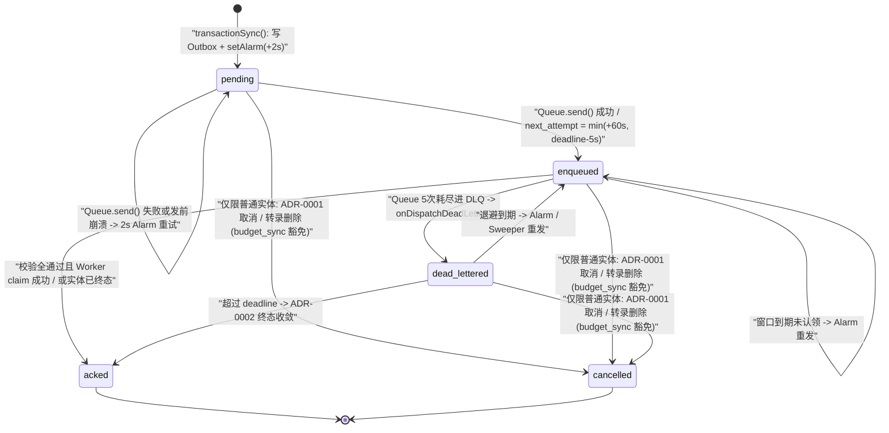
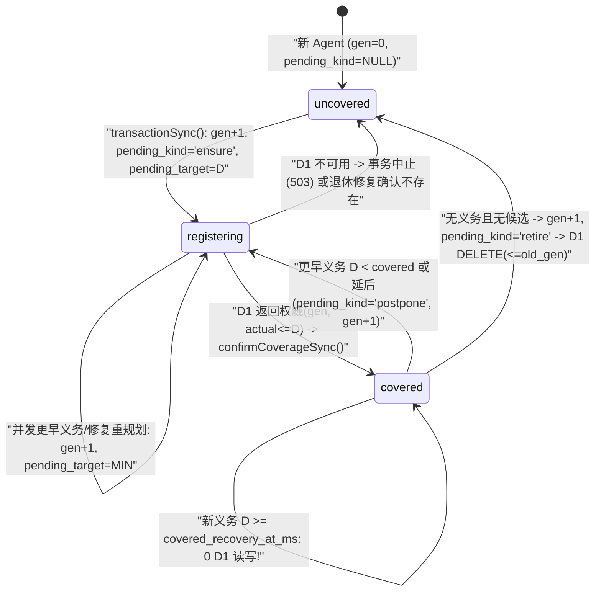
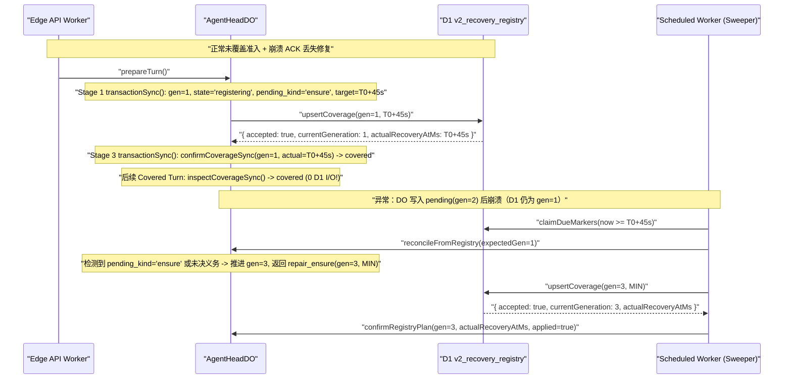

# Ember V2-M0-B — Event Runtime & Recovery Contract

- **Status:** M0 Joint Contract Revision (aligned with Architect Joint Review J1–J5 & V2-M0-A; pending final Architect/CTO sign-off)
- **Date:** 2026-11-19
- **Branch:** `feat/v2-m0-event-recovery-contract`
- **Owner:** V2 Work Package B (Event Runtime & Recovery)
- **Authoritative References:**
  - [ADR-0006 — Experience-first, Device-powered Runtime V2](../adr/0006-experience-first-device-powered-runtime-v2.md)
  - [ADR-0005 — Cloudflare-native Cloud Runtime V2](../adr/0005-cloudflare-native-runtime-v2.md)
  - [ADR-0001 — Cancellation and Retry Coordination](../adr/0001-cancellation-and-retry-coordination.md)
  - [ADR-0002 — Pre-claim Deadline Failure](../adr/0002-preclaim-deadline-failure.md)
  - [B1 Platform Contract (§6–§10, N-1–N-12)](../product/B1_PLATFORM_CONTRACT.md)
  - [V1 Architecture Baseline (§4–§10)](./v1-architecture-baseline.md)
  - [Durable Objects Migration Debt](./durable-objects-migration-debt.md)
  - Companion M0-A Contract: `docs/architecture/v2-m0-runtime-contract.md` (PR #170)

> [!IMPORTANT]
> 本文档是 **Agent A（Agent Core / Fast Path）与 Agent B（Event Runtime & Recovery）共享的权威调度、Outbox 与独立恢复契约（含共享 DDL 与联合接口 Seam）**。本文档**不授权**云资源创建、付费模型调用或生产数据迁移；依赖性 M1 编码须待 Architect/CTO 对 PR #170 + #171 + M0-D 联合冻结后启动。

---

## 1. 验收目标与核心不变量

| 验收目标                              | 协议强制不变量                                                                                                                                                                                                                                                                                                                                    | 测量/验证口径                                                                                                   |
| ------------------------------------- | ------------------------------------------------------------------------------------------------------------------------------------------------------------------------------------------------------------------------------------------------------------------------------------------------------------------------------------------------- | --------------------------------------------------------------------------------------------------------------- |
| **不丢失已接受任务**                  | **Discoverability Invariant**: 任一可提交义务 `O` 在 DO SQLite 提交前，D1 `v2_recovery_registry` 必须已确认存在 `next_recovery_at_ms <= D(O)` 且 `status IN ('armed', 'backoff', 'quarantined')` 的权威记录；未覆盖路径遇 D1 不可用必须 Fail Closed（HTTP `503 DB_UNAVAILABLE`）。                                                                | 故障注入矩阵 `FI-01..FI-16` 零丢失；客户端受保护 Outbox 保留原始 `client_submission_id` 与 `transcript_epoch`。 |
| **不重复提交任务结果**                | 唯一业务与租约权威位于 Agent A 持有的 `assistant_turns` / `tasks` / `runs`（单调安全整数 `lease_epoch <= 9007199254740991` + `active_run_id`）；Queue 投递必须先精确校验持久 `v2_dispatch_outbox`（`outbox_id`、`entity_kind`、`entity_id`、`queue_name`、`tenant_id/agent_id`、`fence_epoch === current_epoch`），拒绝所有过期/未来/不匹配信封。 | `duplicate_commit_count = 0`；重复投递与超时移交仅提交一条终态消息/结果。                                       |
| **不依赖用户重新打开 App**            | 所有已接受工作（Fast Path 断连、Durable Path 派发、内部 `budget_sync`、未来 `v2_schedules`）均由 `AgentHeadDO` 单 Alarm 与外部 D1 + Scheduled Worker 驱动闭环。                                                                                                                                                                                   | 全客户端离线故障注入下无用户流量仍完成派发与状态收敛。                                                          |
| **Alarm 重试耗尽后条件恢复目标**      | `D(O) = earliest_due_action_ms + D1_RECOVERY_GRACE_MS`（`<= 45_000 ms`），`prepareTurn` 预准入保守边界 `nowMs + 45_000`；Scheduled Worker 以 `* * * * *` 扫描到期索引。**在文档记录的负载与依赖可用条件下**，初始 + 6 次 Alarm 重试耗尽后目标 `<= 2 分钟`发现、`<= 5 分钟`恢复（为工程实测目标，非 Cron/Queue 平台 SLA 保证）。                   | `t_alarm_exhaust_to_detect_ms <= 120_000 ms`；`t_alarm_exhaust_to_recover_ms <= 300_000 ms`。                   |
| **已获得恢复覆盖的对话零同步 D1 I/O** | **Zero-Sync-IO Covered Path**: 在 `transactionSync()` 内校验 `coverage_state === 'covered' AND covered_recovery_at_ms !== null AND covered_recovery_at_ms <= D(O)`；命中则全程 0 次 D1 读写，仅靠持久化 `pending_*` 计划与两阶段世代 CAS 防止并发抹除。                                                                                           | 已覆盖轮次 `d1_reads = 0`、`d1_writes = 0`。                                                                    |
| **无全量 Agent 轮询，无空闲心跳**     | 休眠 Agent 确认无任何已接受义务（含 `budget_sync`）及可提交候选后，经两阶段退役条件删除 D1 标记并清除 DO Alarm；Cron 仅查 `idx_v2_recovery_due` 到期行。                                                                                                                                                                                          | 休眠 Agent 在 D1 占 0 行、Alarm 为 `null`、零周期唤醒。                                                         |

---

## 2. 唯一权威 Schema 与跨包 Seam（J1 联合冻结）

### 2.1 所有权矩阵（单一状态机原则）

按 Joint Review **J1** 裁决：**绝不允许存在第二套可写的 Lease 状态机**。Agent A 持有全部业务实体与租约 Fencing 权威；Agent B 是 `v2_schedules`、`v2_dispatch_outbox`、`v2_recovery_coverage` 与 D1 `v2_recovery_registry` 的**规范 DDL 唯一所有者**（Agent A 规范直接引用或字节级复用以下 DDL）。

| 存储域                                   | 规范 Owner              | 持有表 / 实体                                                                                                                                                                                                                                            | 核心职责与唯一权威边界                                                                                                                                                                                                                                                                                                                                                                                           |
| ---------------------------------------- | ----------------------- | -------------------------------------------------------------------------------------------------------------------------------------------------------------------------------------------------------------------------------------------------------- | ---------------------------------------------------------------------------------------------------------------------------------------------------------------------------------------------------------------------------------------------------------------------------------------------------------------------------------------------------------------------------------------------------------------- |
| **DO SQLite（业务、执行与租约权威）**    | **Agent A**             | `agent_head_meta`, `conversations`, `conversation_messages`, `assistant_turns`, `tasks`, `runs`, `task_events`, `task_results`, `approvals`, `model_attempts`, `agent_spend_days`, `agent_budget_incidents`, `workspace_manifests`, `artifacts`, `notes` | 唯一拥有 Turn/Task/Run 业务状态机、`TurnExecutionMode`（`'fast_interactive' \| 'durable_queue' \| 'device'`）、`lease_epoch`、`lease_owner`、`lease_expires_at_ms`、`interactive_deadline_ms`、`deadline_at_ms`、`cancel_requested_at_ms`、`provider_job_handle` 与 `model_attempts` 预算账本。**不设 `v2_execution_leases` 可写表**；B 如需只读到期视图，仅可从 A 的 `assistant_turns` / `tasks` 派生只读投影。 |
| **DO SQLite（调度、Outbox 与覆盖记录）** | **Agent B**（共享迁移） | `v2_schedules`, `v2_dispatch_outbox`, `v2_recovery_coverage`                                                                                                                                                                                             | 唯一拥有单 Alarm 时间多路复用、外部 Queue 派发、内部 `budget_sync` 中继及本地 Generation/Fencing 覆盖记录。                                                                                                                                                                                                                                                                                                      |
| **D1（全局独立恢复索引）**               | **Agent B**             | `v2_recovery_registry`                                                                                                                                                                                                                                   | 独立于 DO Alarm 故障域；**严格零业务数据**（禁止存放 Prompt、正文、结果摘要、凭据或 Token）。                                                                                                                                                                                                                                                                                                                    |
| **全局预算权威**                         | **Agent A**（依赖）     | `GlobalBudgetAuthority`（`reserveGlobal` / `authorizeSend` / `settleGlobal` / `global_halt`）                                                                                                                                                            | A 拥有全局预算授权、Grant 过期与 Halt 语义；B 仅在本地 `budget_sync` Outbox 故障/未决时负责唤醒与中继重试，**绝不**独立发起退款或绕过 Halt。                                                                                                                                                                                                                                                                     |

### 2.2 Agent B 规范共享 DDL（Canonical Shared DDL）

> [!NOTE]
> 以下四张表为 M1 共享迁移的唯一规范定义；所有时间列统一使用 UTC Epoch 毫秒整型（`INTEGER`），`generation` 与 `lease_epoch` 严格约束为 JavaScript 安全整数（`<= 9007199254740991`）。

#### (1) `v2_schedules`（DO SQLite）

```sql
CREATE TABLE IF NOT EXISTS v2_schedules (
  schedule_id       TEXT    PRIMARY KEY,
  tenant_id         TEXT    NOT NULL,
  agent_id          TEXT    NOT NULL,
  source_kind       TEXT    NOT NULL CHECK (source_kind IN ('commitment', 'reminder', 'deferred_task', 'cleanup')),
  source_id         TEXT    NOT NULL,
  schedule_kind     TEXT    NOT NULL CHECK (schedule_kind IN ('once', 'interval', 'cron_tz')),
  interval_seconds  INTEGER CHECK (interval_seconds IS NULL OR (interval_seconds BETWEEN 60 AND 2592000)),
  cron_expr         TEXT,
  timezone          TEXT    NOT NULL DEFAULT 'UTC',
  next_fire_at_ms   INTEGER NOT NULL,
  last_fired_at_ms  INTEGER,
  occurrence_seq    INTEGER NOT NULL DEFAULT 0 CHECK (occurrence_seq >= 0),
  misfire_policy    TEXT    NOT NULL DEFAULT 'coalesce_latest'
                    CHECK (misfire_policy IN ('coalesce_latest', 'fire_once', 'skip_missed')),
  status            TEXT    NOT NULL CHECK (status IN ('active', 'paused', 'completed', 'cancelled')),
  version           INTEGER NOT NULL DEFAULT 1 CHECK (version >= 1),
  created_at_ms     INTEGER NOT NULL,
  updated_at_ms     INTEGER NOT NULL
);

CREATE INDEX IF NOT EXISTS idx_v2_schedules_due
  ON v2_schedules (next_fire_at_ms, schedule_id)
  WHERE status = 'active';

CREATE UNIQUE INDEX IF NOT EXISTS idx_v2_schedules_source
  ON v2_schedules (source_kind, source_id);
```

**Timezone / DST 与 Misfire 规则：**

- **`interval`**：按固定 UTC 秒步进 `next_fire_at_ms + interval_seconds * 1000`，不受 DST 影响。
- **`cron_tz`**：通过 IANA `timezone` 墙钟计算下次触发 UTC 毫秒：
  - **Spring-forward 跳变空洞**（如 `02:30` 因 `02:00 -> 03:00` 跳过）：在跳变后首个有效墙钟时刻（`03:00`）触发一次，不静默漏日。
  - **Fall-back 重叠时段**（如 `01:30` 出现两次）：按 `last_fired_at_ms` 对应的本地日历日期去重，同一本地墙钟槽位**仅触发一次**（首次出现时），下一槽位推进至次日，不双倍触发。
- **Misfire 与故障隔离**：默认 `coalesce_latest` 对跨越多个周期的延迟仅补发 1 次当前实例并将 `next_fire_at_ms` 推进到 `> now_ms`；按 `(next_fire_at_ms ASC, schedule_id ASC)` 顺序处理，单项校验失败隔离记录，不阻断同批次其他调度。

#### (2) `v2_dispatch_outbox`（DO SQLite — 外部 Queue 与内部 `budget_sync` 共用）

```sql
CREATE TABLE IF NOT EXISTS v2_dispatch_outbox (
  outbox_id            TEXT    PRIMARY KEY,
  entity_kind          TEXT    NOT NULL CHECK (entity_kind IN ('turn', 'task', 'schedule_occurrence', 'handoff', 'budget_sync')),
  entity_id            TEXT    NOT NULL, -- turnId | taskId | occurrenceId | operationId
  queue_name           TEXT    CHECK (queue_name IS NULL OR queue_name IN ('durable_turn', 'agent_task')),
  payload_json         TEXT    NOT NULL, -- Queue 唤醒信封或 budget_sync 确定性载荷（无 Prompt/凭据）
  operation_id         TEXT,             -- budget_sync 必填：不可变操作 ID
  revision             INTEGER NOT NULL DEFAULT 0 CHECK (revision >= 0), -- 0 = 初始结算/释放；>= 1 = 迟到修正（匹配 A model_attempts.settlement_revision）
  state                TEXT    NOT NULL CHECK (state IN ('pending', 'enqueued', 'acked', 'dead_lettered', 'cancelled')),
  next_attempt_at_ms   INTEGER NOT NULL,
  last_enqueued_at_ms  INTEGER,
  publish_attempts     INTEGER NOT NULL DEFAULT 0 CHECK (publish_attempts >= 0),
  dlq_count            INTEGER NOT NULL DEFAULT 0 CHECK (dlq_count >= 0),
  fence_epoch          INTEGER NOT NULL DEFAULT 0 CHECK (fence_epoch >= 0 AND fence_epoch <= 9007199254740991),
  last_error_code      TEXT,
  created_at_ms        INTEGER NOT NULL,
  updated_at_ms        INTEGER NOT NULL,
  -- J1/J5/Final Alignment 条件约束：普通派发必须显式 `queue_name IS NOT NULL`；budget_sync 严禁进入外部通用 Queue
  CHECK (
    (entity_kind = 'budget_sync' AND queue_name IS NULL AND operation_id IS NOT NULL)
    OR
    (entity_kind IN ('turn', 'task', 'schedule_occurrence', 'handoff') AND queue_name IS NOT NULL AND queue_name IN ('durable_turn', 'agent_task'))
  )
);

CREATE INDEX IF NOT EXISTS idx_v2_outbox_due
  ON v2_dispatch_outbox (next_attempt_at_ms, outbox_id)
  WHERE state IN ('pending', 'enqueued', 'dead_lettered');

CREATE UNIQUE INDEX IF NOT EXISTS idx_v2_outbox_budget_sync_op_rev
  ON v2_dispatch_outbox (operation_id, revision)
  WHERE entity_kind = 'budget_sync';
```

**封闭 Queue 信封契约（`V2DispatchEnvelope`，仅限普通派发，绝不承载 `budget_sync` 或 Prompt/凭据）：**

```ts
export interface V2DispatchEnvelope {
  readonly schemaVersion: 2;
  readonly eventId: string; // 必须精确等于 v2_dispatch_outbox.outbox_id
  readonly tenantId: string;
  readonly agentId: string;
  readonly entityKind: 'turn' | 'task' | 'schedule_occurrence' | 'handoff';
  readonly entityId: string;
  readonly queueName: 'durable_turn' | 'agent_task';
  readonly fenceEpoch: number; // 必须精确等于持久化 outbox.fence_epoch 与业务当前 lease_epoch
}
```

#### (3) `v2_recovery_coverage`（DO SQLite — 单行覆盖与计划修复状态）

```sql
CREATE TABLE IF NOT EXISTS v2_recovery_coverage (
  id                      INTEGER PRIMARY KEY CHECK (id = 1),
  tenant_id               TEXT    NOT NULL,
  agent_id                TEXT    NOT NULL,
  generation              INTEGER NOT NULL DEFAULT 0 CHECK (generation >= 0 AND generation <= 9007199254740991),
  coverage_state          TEXT    NOT NULL DEFAULT 'uncovered'
                          CHECK (coverage_state IN ('uncovered', 'registering', 'covered')),
  covered_recovery_at_ms  INTEGER, -- 仅在 D1 实际确认覆盖时为非 NULL
  pending_kind            TEXT    CHECK (pending_kind IS NULL OR pending_kind IN ('ensure', 'postpone', 'retire')),
  pending_prev_generation INTEGER CHECK (pending_prev_generation IS NULL OR pending_prev_generation >= 0),
  pending_target_at_ms    INTEGER, -- pending_kind='retire' 时为 NULL；ensure/postpone 时为目标恢复时间
  armed_alarm_at_ms       INTEGER,
  alarm_fail_count        INTEGER NOT NULL DEFAULT 0 CHECK (alarm_fail_count >= 0),
  last_d1_sync_at_ms      INTEGER,
  updated_at_ms           INTEGER NOT NULL,
  CHECK (coverage_state <> 'covered' OR covered_recovery_at_ms IS NOT NULL),
  CHECK ((pending_kind IS NULL) OR (pending_kind = 'retire' AND pending_target_at_ms IS NULL) OR (pending_kind IN ('ensure', 'postpone') AND pending_target_at_ms IS NOT NULL))
);
```

#### (4) `v2_recovery_registry`（D1 全局独立恢复索引）

```sql
CREATE TABLE IF NOT EXISTS v2_recovery_registry (
  agent_key                 TEXT    PRIMARY KEY, -- "{tenant_id}:{agent_id}"
  tenant_id                 TEXT    NOT NULL,
  agent_id                  TEXT    NOT NULL,
  generation                INTEGER NOT NULL CHECK (generation >= 0 AND generation <= 9007199254740991),
  next_recovery_at_ms       INTEGER NOT NULL,    -- 已确认的最早需发现时间；Sweeper 退避/隔离绝不可改写或延后本列！
  retry_not_before_ms       INTEGER,             -- J3: 仅用于 Sweeper 自身 RPC 退避/降频，NULL 表示立即可扫
  status                    TEXT    NOT NULL CHECK (status IN ('armed', 'backoff', 'quarantined')),
  sweep_lease_owner         TEXT,
  sweep_lease_expires_at_ms INTEGER,
  recovery_attempts         INTEGER NOT NULL DEFAULT 0 CHECK (recovery_attempts >= 0),
  last_error_code           TEXT,
  updated_at_ms             INTEGER NOT NULL
);

-- J3: 'quarantined' 仍保留在到期扫描索引中（降低频率重试+强告警），绝不永久静默丢弃已接受工作
CREATE INDEX IF NOT EXISTS idx_v2_recovery_due
  ON v2_recovery_registry (next_recovery_at_ms, agent_key)
  WHERE status IN ('armed', 'backoff', 'quarantined');
```

### 2.3 A ↔ B 联合端口契约（Canonical Shared Interfaces）

以下端口定义在 Agent B 契约中冻结，Agent A（PR #170 §8.2）直接引用，所有同步方法均在 `AgentHeadDO` 的同一 `storage.transactionSync()` 内执行：

```ts
export type TurnExecutionMode = 'fast_interactive' | 'durable_queue' | 'device';

/** 写入 v2_dispatch_outbox(entity_kind = 'budget_sync', queue_name = NULL) 的不可变权威结算载荷（A 拥有语义，B 仅原样中继） */
export interface BudgetSyncOutboxPayload {
  readonly schemaVersion: 1;
  readonly tenantId: string;
  readonly principalId: string;
  readonly agentId: string;
  readonly utcDay: string;
  readonly globalGrantId: string;
  readonly operationId: string;
  readonly settlementRevision: number; // 0 = 初始结算/释放；>= 1 = 迟到修正（对应 outbox.revision）
  readonly state: 'settled' | 'conservative_billed' | 'unknown_billed' | 'released';
  readonly reservedMicroUsd: number;
  readonly chargeMicroUsd: number; // 累计修正后总额；Global 与本地账本按 delta = newCumulative - previouslyApplied 增量记账
  readonly observedCostMicroUsd: number | null;
  readonly overageMicroUsd: number;
  readonly openIncidentReason:
    'day_ceiling_exceeded' | 'reservation_exceeded' | 'usage_missing' | null;
}

/** Agent B 提供的外部 D1 `v2_recovery_registry` CAS 端口（返回 D1 权威实际值，绝不回显请求参数） */
export interface RecoveryRegistryPort {
  upsertCoverage(cmd: {
    readonly tenantId: string;
    readonly agentId: string;
    readonly generation: number;
    readonly recoveryAtMs: number;
    readonly nowMs: number;
  }): Promise<{
    readonly accepted: boolean;
    readonly currentGeneration: number;
    readonly actualRecoveryAtMs: number | null;
  }>;

  postponeCoverage(cmd: {
    readonly tenantId: string;
    readonly agentId: string;
    readonly expectedPrevGen: number;
    readonly newGeneration: number;
    readonly nextRecoveryAtMs: number;
    readonly nowMs: number;
  }): Promise<{
    readonly updated: boolean;
    readonly currentGeneration: number;
    readonly actualRecoveryAtMs: number | null;
  }>;

  retireCoverage(cmd: {
    readonly tenantId: string;
    readonly agentId: string;
    readonly retireUpToGen: number;
  }): Promise<{ readonly retired: boolean }>;

  /** 标准化主读接口（无别名）：D1 行不存在时返回 exists: false 与全部可空权威字段 */
  getCoverage(cmd: { readonly tenantId: string; readonly agentId: string }): Promise<{
    readonly exists: boolean;
    readonly currentGeneration: number | null;
    readonly actualRecoveryAtMs: number | null;
    readonly status: 'armed' | 'backoff' | 'quarantined' | null;
    readonly retryNotBeforeMs: number | null;
  }>;
}

/** Agent B 向 Agent A 暴露的同步准入与确认端口（运行在 A 的 transactionSync 内） */
export interface RecoveryAdmissionPort {
  inspectCoverageSync(
    requiredRecoveryAtMs: number,
    nowMs: number,
  ):
    | {
        readonly kind: 'covered';
        readonly generation: number;
        readonly coveredRecoveryAtMs: number;
      }
    | {
        readonly kind: 'register';
        readonly generation: number;
        readonly targetAtMs: number;
      };

  /**
   * 仅当 D1 权威回执匹配当前 generation/pending 计划且 actualRecoveryAtMs <= 所有已提交+候选义务的
   * earliestRequiredRecoveryMs 时返回 true；否则返回 false 并要求调用方重规划或 Fail Closed。
   */
  confirmCoverageSync(cmd: {
    readonly generation: number;
    readonly actualRecoveryAtMs: number | null;
    readonly applied: boolean;
    readonly earliestRequiredRecoveryMs: number;
    readonly nowMs: number;
  }): boolean;
}

/** Agent B 向 Agent A 暴露的 Outbox 与 Alarm 协同端口（运行在 A 的 transactionSync 内） */
export interface EventRuntimeCoordinatorPort {
  enqueueDurableOutboxSync(cmd: {
    readonly outboxId: string;
    readonly entityKind: 'turn' | 'task' | 'schedule_occurrence' | 'handoff' | 'budget_sync';
    readonly entityId: string;
    readonly queueName: 'durable_turn' | 'agent_task' | null;
    readonly payloadJson: string;
    readonly operationId?: string;
    readonly revision?: number; // 0-based: 初始=0，迟到修正>=1
    readonly fenceEpoch: number;
    readonly nextAttemptAtMs: number;
  }): void;

  /**
   * 按 ADR-0001 取消普通实体未决 Outbox；
   * J5 硬约束：严禁取消 `entity_kind = 'budget_sync'`！
   */
  cancelEntityOutboxSync(
    entityKind: 'turn' | 'task' | 'schedule_occurrence' | 'handoff',
    entityId: string,
    nowMs: number,
  ): void;

  ackOutboxSync(outboxId: string, fenceEpoch: number, nowMs: number): void;

  applyOutboxDeadLetterSync(cmd: {
    readonly outboxId: string;
    readonly fenceEpoch: number;
    readonly errorCode: string;
    readonly nextAttemptAtMs: number;
    readonly nowMs: number;
  }): boolean;

  recomputeAlarmSync(nowMs: number): number | null;
}

/** Agent A 向 Agent B 暴露的同步业务状态读/收敛端口（B 在 alarm()/reconcile/queue 的 transactionSync 内调用） */
export interface AuthoritativeBusinessPort {
  /** 返回所有已接受业务义务（Turn/Task/Schedule）及未决 budget_sync 的最早需发现时间戳 D(O)；无则 null */
  earliestRequiredDiscoveryAtMsSync(nowMs: number): number | null;

  /** 返回所有到期且需 Alarm 处理的业务动作（到期租约、Pre-claim 超时、取消/重试到期） */
  listDueBusinessActionsSync(
    nowMs: number,
    limit: number,
  ): ReadonlyArray<{
    readonly targetKind: 'turn' | 'task';
    readonly targetId: string;
    readonly actionKind: 'preclaim_deadline' | 'lease_expired' | 'cancel_converge' | 'retry_due';
    readonly deadlineAtMs: number;
  }>;

  /** 使用 A 的权威 Turn/Task/Run FSM 收敛到期业务项（绝不取消 budget_sync Outbox） */
  convergeDueBusinessItemSync(targetKind: 'turn' | 'task', targetId: string, nowMs: number): void;

  /** 返回当前业务实体的权威 targetKind/targetId、currentLeaseEpoch 与 deadlineAtMs（供 Queue 严格校验与期限计算） */
  inspectOutboxTargetSync(
    entityKind: 'turn' | 'task' | 'schedule_occurrence' | 'handoff',
    entityId: string,
  ): {
    readonly exists: boolean;
    readonly targetKind: 'turn' | 'task' | null;
    readonly targetId: string | null;
    readonly currentLeaseEpoch: number;
    readonly deadlineAtMs: number;
    readonly isTerminal: boolean;
    readonly cancelRequested: boolean;
  };

  /** 在同一 transactionSync 内将到期 schedule_occurrence 解析来源并在 A 业务表中创建受约束 Task/Turn 及 Outbox */
  materializeScheduleOccurrenceSync(scheduleId: string, occurrenceSeq: number, nowMs: number): void;
}
```

> [!NOTE]
> Durable Execution Worker 调用 Agent A 暴露的 `AgentHeadRecoveryPort.claimDurableWork({ envelope: V2DispatchEnvelope, workerId, leaseMs })`（见 M0-A §8.2），须原样传递封闭 `V2DispatchEnvelope`（覆盖 `'turn' | 'task' | 'schedule_occurrence' | 'handoff'` 全部 4 种普通持久化 `entityKind`），并在同一个 `transactionSync` 内完成 Outbox 五元组校验及底层 `(targetKind, targetId)` 解析。

---

## 3. DO Alarm + Queue 可靠派发与严格信封校验（J5）

### 3.1 单 Alarm 最早截止时间多路复用器

`AgentHeadDO` 仅维护唯一平台 Alarm，指针计算包含 A 的业务到期动作、B 的 Outbox（含 `budget_sync`）与 B 的主动 Schedule：

$$
T_{\text{alarm}} = \min\big(
  T_{\text{business\_due}},\;
  \min_{\text{outbox} \in \{\text{pending, enqueued, dead\_lettered}\}} \text{next\_attempt\_at\_ms},\;
  \min_{\text{sched} \in \{\text{active}\}} \text{next\_fire\_at\_ms}
\big)
$$

- **按需写**：仅当 `T_alarm !== v2_recovery_coverage.armed_alarm_at_ms` 时调用 `storage.setAlarm(T_alarm)`（`null` 时调用 `deleteAlarm()`）并更新 `armed_alarm_at_ms`。
- **有界批处理与隔离**：`alarm()` 单次最多处理 `10` 条到期业务项 + `10` 条到期 Schedule + `10` 条到期 Outbox（含外部 Queue 派发与内部 `budget_sync` 中继）。在 `transactionSync()` 内先推进状态并重算下一次 `T_alarm`，随后在事务外异步执行外部 `Queue.send()` 或 `GlobalBudgetAuthority.settleGlobal()`。

### 3.2 外部 Queue 消费端封闭校验（J5 强制规则）

Queue 投递（包括延迟投递、重放、乱序及 DLQ）**不具任何状态权威**。Execution Worker 收到 `V2DispatchEnvelope` 并路由至目标 `AgentHeadDO` 后，DO 必须在 `transactionSync()` 内对 `v2_dispatch_outbox` 执行**精确闭环校验**，任一字段不匹配即拒绝且**零状态变更**：

1. **按 `outbox_id` 精确查行**：`SELECT * FROM v2_dispatch_outbox WHERE outbox_id = envelope.eventId`（禁止仅按 `entity_id` 模糊查找）。
2. **禁止 `budget_sync`**：`outbox.entity_kind !== 'budget_sync'` 且 `outbox.queue_name !== null`。
3. **五元组全匹配**：
   - `envelope.tenantId === DO.tenantId && envelope.agentId === DO.agentId`
   - `outbox.entity_kind === envelope.entityKind && outbox.entity_id === envelope.entityId`
   - `outbox.queue_name === envelope.queueName`（且等于消费者实际所属队列）
   - `outbox.fence_epoch === envelope.fenceEpoch`
   - 从 `AuthoritativeBusinessPort.inspectOutboxTargetSync` 读取当前业务 `currentLeaseEpoch`：必须满足 **`envelope.fenceEpoch === currentLeaseEpoch`**（**同时拒绝 `<` 陈旧信封与 `>` 未来/伪造信封！**）。
4. **Outbox 状态前置检查**：仅当 `outbox.state IN ('pending', 'enqueued', 'dead_lettered')` 时允许进入 `claimDurableWork`；若已为 `'acked'` 或 `'cancelled'`，直接幂等返回 ACK，不做任何修改。

### 3.3 期限边界与 Re-enqueue 优雅期封顶（J5 & P2 机械对齐）

设剩余合格时间窗口为 $\text{remaining} = \text{deadlineAtMs} - \text{nowMs}$，共同冻结**重试下限 `1_000 ms`（1 s）与安全边际 `5_000 ms`（5 s）**：

- 若 `remaining <= 1_000`：**不再安排新的队列重试**，仅武装 DO Alarm 至 `deadlineAtMs` 执行正常超时收敛（普通期限到期绝不取消 `budget_sync` Outbox）。
- 若 `remaining > 1_000`：

$$
\text{nextAttemptAtMs} = \min\Big(\text{nowMs} + 60\_000,\; \max\big(\text{nowMs} + 1\_000,\; \text{deadlineAtMs} - 5\_000\big)\Big)
$$

保证严格满足 $\text{nowMs} < \text{nextAttemptAtMs} < \text{deadlineAtMs}$（例如 `remaining = 1_001 ms` 时取 `nowMs + 1_000 < deadlineAtMs`，既防忙循环又不排到期限之后）。

### 3.4 `budget_sync` 内部中继协议（J5）

- **同事务落盘**：Agent A 提交 `model_attempts` 结算/释放与 `agent_spend_days` 变更时，在同一 `transactionSync()` 调用 `enqueueDurableOutboxSync` 写入 `entity_kind = 'budget_sync'`、`queue_name = NULL`、`operation_id`、`revision`（**`0` 基：初始结算/释放为 `0`，迟到修正为 `>= 1`**），载荷为不可变 `BudgetSyncOutboxPayload`。
- **累计总额 vs 增量记账**：`chargeMicroUsd` 与 `observedCostMicroUsd` 始终代表该 `operationId` 的**累计修正后总额**，Global 与本地账本仅按 `delta = newCumulativeCharge - previouslyAppliedCharge` 增量记账，绝不重复扣费。Agent B 仅负责原样中继，绝不自行决定预算扣减或发起独立退款。
- **永不随业务取消**：`cancelTurn`、`cancelTask`、`clearTranscript` 及普通期限到期收敛只能调用 `cancelEntityOutboxSync('turn'|'task'|..., ...)`，**绝对禁止取消 `budget_sync` 行**。
- **独立恢复覆盖保留**：`budget_sync` 未到达 `'acked'` 前计入 `earliestRequiredDiscoveryAtMsSync()`，因此 D1 覆盖**绝不能被退休或延后到 `budget_sync.next_attempt_at_ms + 45_000` 之后**。
- **幂等键与同修订冲突拒绝**：`GlobalBudgetAuthority.settleGlobal` 与 `v2_dispatch_outbox` 共同以不可变 `(operation_id, revision)` 作为唯一幂等键；同修订相同载荷幂等返回 `alreadySettled: true`，同修订不同载荷拒绝并返回 `conflict: true`，仅在收到全局权威 `settleGlobal` 明确确认后才将 Outbox 置为 `'acked'`。

### 3.5 发布前后崩溃与状态流转图



---

## 4. D1 Recovery Registry + Scheduled Worker 独立恢复机制（J3）

### 4.1 无轮询、无心跳与 `retry_not_before_ms` 隔离原则

Cloudflare DO Alarm 最多自动重试 **6 次**（含初次共 7 次）；耗尽后 Alarm 永久消失。独立恢复由外部 D1 `v2_recovery_registry` 与 Scheduled Worker（Cron `* * * * *`，`60_000 ms` 周期）承担：

1. **严格保留 `next_recovery_at_ms` 不变（J3 硬约束）**：
   - D1 `next_recovery_at_ms` **只代表已由 DO 确认的最早需发现时间**。
   - 当 Sweeper 调用 DO `reconcileFromRegistry` 发生网络/RPC 失败时，Sweeper **严禁修改或延后 `next_recovery_at_ms`**，也**严禁**将条目从 `idx_v2_recovery_due` 中移除！
   - 退避仅更新独立字段 `retry_not_before_ms = nowMs + min(300_000, 15_000 * nextAttempts)` 与 `status = 'backoff' | 'quarantined'`；达到阈值（如 `>= 10` 次失败）进入 `'quarantined'` 发出强告警并以较慢周期（如 `300_000 ms`）继续在索引内重试，直到 DO 恢复。
2. **Sweeper CAS 租约**：
   - 扫描查询：
     ```sql
     SELECT agent_key, tenant_id, agent_id, generation, next_recovery_at_ms
     FROM v2_recovery_registry
     WHERE status IN ('armed', 'backoff', 'quarantined')
       AND next_recovery_at_ms <= ?now
       AND (retry_not_before_ms IS NULL OR retry_not_before_ms <= ?now)
       AND (sweep_lease_expires_at_ms IS NULL OR sweep_lease_expires_at_ms <= ?now)
     ORDER BY next_recovery_at_ms ASC, agent_key ASC
     LIMIT 50;
     ```
   - 抢占与失败更新必须携带 **`WHERE agent_key = ? AND generation = ? AND sweep_lease_owner = ?`**：过期的 Sweeper 回调绝不能覆盖更新世代的标记或清除新 Sweeper 的租约！
3. **空闲零开销**：无到期条目时查询返回 0 行，不唤醒任何 DO。

---

## 5. Generation / Fencing 准入、确认与崩溃修复协议（J2 + J3）

### 5.1 统一发现界限公式

对所有已接受义务及潜在即时补偿，统一定义发现时间界限：

$$
D(O) = \text{earliest\_applicable\_due\_action\_ms}(O) + \text{D1\_RECOVERY\_GRACE\_MS} \quad (\text{D1\_RECOVERY\_GRACE\_MS} \le 45\_000\text{ ms})
$$

- **保守预准入（`prepareTurn`）**：Fast Path 在 `prepareTurn` Stage 1 取 `requiredDiscoveryMs = min(nowMs + 45_000, nowMs + leaseMs + 45_000) = nowMs + 45_000`，确保即使 Turn 秒级完成、Stage 3 失败或立即生成 `budget_sync` 补偿行，均已提前落在当前恢复窗口内。

### 5.2 持久化 Pending 计划与实际回执确认（J2 状态机）



#### 四大崩溃与竞态修复规则（无需用户流量）

1. **D1 拒绝 / 陈旧 Upsert（Remote Rejected / Stale Upsert）**：
   - `upsertCoverage` 返回 `{ accepted: false, currentGeneration, actualRecoveryAtMs }`（D1 已有更高世代）。
   - `confirmCoverageSync` **拒绝直接标为 `'covered'`**；DO 在新 `transactionSync()` 内检查：若 `currentGeneration` 的 `actualRecoveryAtMs <= earliestRequired`，且不存在更紧本地 pending 冲突，仍分配**更高世代 `max(cov.generation, currentGeneration) + 1`**，设 `pending_target = MIN(actualRecoveryAtMs, earliestRequired)` 同步重试一次；若仍失败则 Fail Closed (`503`)，绝不靠“猜 D1 成功”提交业务！
2. **DO 写入 `pending_kind` 后、D1 CAS 执行前崩溃**：
   - D1 中原有旧到期标记触发 Sweeper 调用 `reconcileFromRegistry(expectedGen)`。
   - **禁止无条件返回 `noop_stale`**：即使 `expectedGen < cov.generation`（因本地崩溃前已推进 `gen` 并写下 `pending_kind`），只要 `cov.pending_kind !== null` 或 `earliestRequiredDiscoveryAtMsSync() !== null`，DO **必须**分配更高世代并执行 `repair_ensure`（目标取 `MIN(pending_target_at_ms, earliestOpenD)`）或重放 `postpone` / `retire`！
3. **D1 CAS 已成功、ACK 丢失 / DO 在 `confirmCoverageSync` 前崩溃**：
   - D1 标记随后到期触发 Sweeper（或 DO 在修复路径调用标准化主读 `getCoverage`）：
   - 读回 D1 权威 `(exists, currentGeneration, actualRecoveryAtMs, status, retryNotBeforeMs)`：
     - 若 `exists` 且 `actualRecoveryAtMs <= earliestOpenD`（且当前未处于需要更早时间的冲突）：以当前（或推进后）世代安全确认覆盖，并继续派发/重装 Alarm；
     - 若 `!exists`（`retire` 已远程成功）且本地确实零义务：清除 `pending_kind = NULL` 保持 `'uncovered'`；
     - 若 `!exists` 但本地仍有未决义务或 `actualRecoveryAtMs > earliestOpenD`：立即以更高世代执行 `repair_ensure`！
4. **退休严格前置条件与并发安全**：
   - 仅当 `earliestRequiredDiscoveryAtMsSync(nowMs) === null`（包括普通 Turn/Task、主动 `v2_schedules`、未完成 `budget_sync` 以及任何仍在途未提交的 `prepareTurn` 候选）时才允许进入 `retire`。
   - Phase 1 先在 DO `transactionSync()` 将 `coverage_state` 置 `'uncovered'`、`generation = max(cov.generation, expectedGen) + 1`、`pending_kind = 'retire'`；Phase 2 远程执行 `DELETE FROM v2_recovery_registry WHERE agent_key = ? AND generation <= retireUpToGen`。新到达请求见到 `'uncovered'` 必定升代写 D1，旧 `DELETE` 匹配 0 行，绝不误删！

### 5.3 准入与修复时序图



---

## 6. D1 不可用时的降级与 Fail-Closed 处理矩阵

| 操作类别                                                                                                                      | D1 不可用时的行为                                                                                                                                                                | HTTP / B1 契约映射                                                                                                         | 客户端与后台保障                                                                                     |
| ----------------------------------------------------------------------------------------------------------------------------- | -------------------------------------------------------------------------------------------------------------------------------------------------------------------------------- | -------------------------------------------------------------------------------------------------------------------------- | ---------------------------------------------------------------------------------------------------- |
| **Direct Path 读写**（历史分页、`GET /v1/me`、状态查询）                                                                      | **正常继续**（若会话认证强依赖失效 D1 且无有效有界凭据，认证 Fail Closed 返回 `503 DB_UNAVAILABLE`）。                                                                           | `200 OK` / `503 DB_UNAVAILABLE`                                                                                            | 不阻断本地缓存渲染与只读查询。                                                                       |
| **已覆盖 Fast Path 对话**（`coverage_state = 'covered'` 且 `covered_recovery_at_ms <= D(turn)`，且 Auth + GlobalBudget 健康） | **正常接受并执行**（0 次 D1 读写）。                                                                                                                                             | `201 Created`（标准 B1 Receipt）                                                                                           | 现存 D1 标记已覆盖后续恢复；即使后续需进入 `budget_sync` 或移交，初始预准入时间仍有效。              |
| **未覆盖对话 / Durable 任务 / Schedule / 提前截止义务**                                                                       | **Commit 前 Fail Closed**；若 Stage 2 已获取未提交 `GlobalBudget` Grant，按补偿规则安全释放（有覆盖则写 `budget_sync`，无覆盖仅尝试释放本身未提交 Operation）；DO 零业务行提交。 | `503 DB_UNAVAILABLE`（严格沿用 B1 错误体）                                                                                 | 客户端保留本地受保护 Outbox 原文、`client_submission_id` 与 `transcript_epoch` 重试（B1 N-1, N-3）。 |
| **Unknown-ACK 对账**                                                                                                          | 不得凭超时推断成功或失败。                                                                                                                                                       | `GET /v1/message-submissions/{id}`（B1 N-2）：`200` 采用已有回执；`404` 校验 `transcript_epoch`（N-11/N-12）后原 ID 重试。 | 零重复、零丢失。                                                                                     |
| **Sweeper 退避 / 隔离与 D1 恢复后**                                                                                           | D1 不可用期间 Sweeper 告警跳过；D1 恢复后按未变的 `next_recovery_at_ms ASC` 立即补扫（包括处于 `backoff`/`quarantined` 的行）。                                                  | —                                                                                                                          | 绝不遗漏。                                                                                           |

---

## 7. Fast Path → Durable Path 安全移交与时间契约（J4）

### 7.1 冻结时间配置（B1 兼容模式 vs V2 交互模式）

| 模式                    | 总生命期上限 (`deadline_at_ms`)    | 交互阶段上限 (`interactive_deadline_ms`)                                | 交互租约与活跃续租                                                                               | 移交规则与 B1 兼容性                                                                                |
| ----------------------- | ---------------------------------- | ----------------------------------------------------------------------- | ------------------------------------------------------------------------------------------------ | --------------------------------------------------------------------------------------------------- |
| **B1 兼容模式**         | **`60_000 ms` (60 s)**（冻结）     | 可选加速：`22_000 ms` 移交窗 / `25_000 ms` 租约（仅当剩余预算窗口足够） | 无足够残余窗口时直接走 Durable Path；绝不依赖 `waitUntil` 保证存活                               | 完全保持 B1 Wire 契约与 60s 超时语义，不延长总期限。                                                |
| **V2 交互测试 Profile** | **`600_000 ms` (600 s)**（总上限） | **`120_000 ms` (120 s)**                                                | `45_000 ms` 租约，仅在活跃执行期间每 `15_000 ms` 真实续租；主动移交窗口 **`105_000–115_000 ms`** | **移交绝不延长 `deadline_at_ms`**；未持续续租导致租约过期的请求无法移交，仅能由 Alarm/Reaper 对账。 |

### 7.2 移交准入、Fencing 与不确定结果防护（Agent A 主责执行，B 消费移交）

1. **Agent A 移交校验（禁止洗白过期租约或超期任务）**：`handoffTurnToDurable` 在 `transactionSync()` 内以当前服务器时间 `nowMs` 严格核验：
   - `status === 'running' && execution_mode === 'fast_interactive'`
   - `active_run_id === req.runId && lease_epoch === req.leaseEpoch && lease_owner === req.leaseOwner`
   - `lease_expires_at_ms > nowMs`（**已过期租约必须拒绝！**）
   - `nowMs < interactive_deadline_ms` 且 `nowMs < deadline_at_ms`（**超过交互/总期限必须拒绝！**）
   - `cancel_requested_at_ms === null` 且 `transcript_epoch === current_transcript_epoch`
   - **保持原 `deadline_at_ms` 不变**（严禁在移交时重置或延后总截止时间！）。
2. **原子递增 Epoch 与同一逻辑身份延续**：校验通过后，A 原子将 `lease_epoch += 1`、转换 `execution_mode = 'durable_queue'`、持久化 `provider_job_handle` 与 `operation_id`，并在同一事务调用 B 的 `enqueueDurableOutboxSync` 写入 `entity_kind = 'handoff'` Outbox。旧执行者若持原 `lease_epoch` 调用 `commitTurn`，立即被拒绝（`fenced` / `STALE_LEASE`）。
3. **Execution Worker 严禁盲目重放**：B 的 Queue Worker 认领后读取同一逻辑 Turn/Task 与原 `provider_job_handle`：
   - 若存在 `provider_job_handle`：仅查询/轮询原作业句柄直至终态；
   - 若缺失句柄且 `send_started_at_ms !== null`（外部结果不确定）：进入显式对账/收敛（绝不静默重放未知付费请求）。
4. **静默失联恢复**：若 Edge Worker 静默崩溃且停止 15s 续租，`45s` 租约过期后 DO Alarm（`45s + <= 15s = <= 60s`）将其转入对账。

---

## 8. 延迟、写入成本与异常恢复测量定义

所有 M1 本地基准与后续（另行批准的）云端 Canary 均须分 **Cold / Warm**、分 **首次未覆盖（first marker）vs 复用已覆盖（reused marker）** 独立采集并报告 **P50 / P95 / P99 / Max**：

| 指标 ID                                                    | 定义与采集口径                                                                                   | 说明 / 目标                                                               |
| ---------------------------------------------------------- | ------------------------------------------------------------------------------------------------ | ------------------------------------------------------------------------- |
| `t_reg_first_d1_ms`                                        | 首次未覆盖 / 更早截止请求 `upsertCoverage` 同步耗时（计入 ACK 与 Runtime 链路）。                | 区分记录，对比已覆盖路径延迟。                                            |
| `t_reg_covered_d1_ms`                                      | 已覆盖请求在 `inspectCoverageSync` 中消耗的 D1 耗时。                                            | 严格 `= 0 ms`（0 D1 调用）。                                              |
| `d1_billed_writes_per_event` / `d1_billed_reads_per_event` | 基于 D1 `meta.rows_written` / `meta.rows_read` 统计（含登记、延后、退役、Sweeper Lease）。       | 跟踪实际账单写入；作为 M0-D 联合基准输入。                                |
| `do_sqlite_rows_written_per_event`                         | 单次事件在 `AgentHeadDO` 实际写入的 SQLite 行数（含 A 业务表、Outbox、Coverage 与 `setAlarm`）。 | 与 A/D 对齐实测；ADR-0006 中 `20` 行写/事件为规划模型假设，非硬编码门限。 |
| `t_silent_loss_to_reconcile_ms`                            | 最后一次成功 `renewTurnLease` 至 DO Alarm 将过期 Run 转入对账/入队的时间。                       | `<= 60_000 ms`（45s 租约 + 15s 检测/派发）。                              |
| `t_alarm_exhaust_to_detect_ms`                             | 第 6 次 Alarm 重试耗尽 $T_{\text{exhaust}}$ 至 Sweeper 认领 D1 到期行之差。                      | 条件实测目标 `<= 120_000 ms`（2 分钟）。                                  |
| `t_alarm_exhaust_to_recover_ms`                            | $T_{\text{exhaust}}$ 至恢复派发入队并重装未来调度 Alarm 之差。                                   | 条件实测目标 `<= 300_000 ms`（5 分钟）。                                  |
| `duplicate_commit_count`                                   | 同一 `turn_id` / `task_id` 提交超过 1 条权威终态结果或消息的次数。                               | 严格 `= 0`。                                                              |

### M0 本地隔离 Probe 声明与实测范围

> [!NOTE]
> [v2-m0-event-recovery-probe.test.ts](../../tests/unit/v2-m0-event-recovery-probe.test.ts) 是**简化、隔离的 M0 本地协议探针**（基于两套内存 `node:sqlite` 实例 + 虚拟时钟 + 标记为 `probe_turns` / `probe_tasks` / `probe_model_attempts` 的测试假业务表），仅用于确定性验证本契约中 SQLite/D1 CAS 与状态机逻辑，**不能**当作真实 Cloudflare DO/D1/Queues 或端到端生产证明。真实 Workers/Miniflare 与 Fake Provider 端到端验证属于 M1 与 M0-D 门禁。

---

## 9. 确定性故障注入测试矩阵（覆盖 J1–J5）

| 用例 ID   | 注入故障 / 竞态场景                                                                                                                                                                                     | 预期状态转换与恢复结果                                                                                                                                                   | 强制断言                                                   |
| --------- | ------------------------------------------------------------------------------------------------------------------------------------------------------------------------------------------------------- | ------------------------------------------------------------------------------------------------------------------------------------------------------------------------ | ---------------------------------------------------------- |
| **FI-01** | **DO 写 `pending` 后、D1 CAS 前崩溃（含 `ensure`/`postpone`/`retire`）**                                                                                                                                | 原 D1 到期标记触发 Sweeper，DO 读 `pending_kind` 与实际义务后即使 `observedGen` 落后仍升代 `repair_ensure` / 重放。                                                      | 禁止无条件 `noop_stale`；无用户流量完成修复。              |
| **FI-02** | **D1 CAS 成功后、ACK 丢失 / `confirmCoverageSync` 前崩溃**                                                                                                                                              | 读回 D1 权威 `getCoverage`；覆盖足够则确认，否则或已误删则升代 `repair_ensure`。                                                                                         | 不丢已接受义务或未来 Schedule。                            |
| **FI-03** | **D1 拒绝 / 陈旧 `upsertCoverage`（并发更高代抢占）**                                                                                                                                                   | 返回 `{ accepted: false, currentGeneration, actualRecoveryAtMs }`；DO 不得按请求参数确认，必须重验或升代重试/Fail Closed。                                               | 绝不虚报 `'covered'`。                                     |
| **FI-04** | **DO 提交后 `Queue.send()` 前崩溃 / `send()` 后更新 Outbox 前崩溃**                                                                                                                                     | 2s Alarm 补发；重复消息由 Outbox 精确五元组校验 + `fenceEpoch === currentLeaseEpoch` 判重 ACK。                                                                          | `duplicate_commit_count = 0`。                             |
| **FI-05** | **伪造/篡改 Queue 信封与 `queue_name IS NULL` 越界（错误 `outbox_id` / `queue_name` / `entity_kind` / 跨租户 / 未来 `fenceEpoch > current` / 试图投递 `budget_sync` / 普通信封 `queue_name IS NULL`）** | SQLite CHECK 禁止普通信封 `queue_name IS NULL`；DO 在写任何状态前全字段校验失败并拒绝，零表行修改。                                                                      | 未来/陈旧/不匹配信封全部被拒。                             |
| **FI-06** | **B1 60s 期限边界（`remaining = 0 / 500 / 1000 / 1001 ms`）Re-enqueue 封顶**                                                                                                                            | `remaining <= 1_000` 不再排重试而直接武装 `deadlineAtMs`；`remaining > 1_000` 取 `min(now+60s, max(now+1s, deadline-5s))`；期限到期不取消 `budget_sync`。                | 严禁安排到 `deadlineAtMs` 之后或漏掉合规重试。             |
| **FI-07** | **Queue 5 次重试耗尽进 DLQ**                                                                                                                                                                            | `applyOutboxDeadLetterSync` 仅更新匹配 `outbox_id + fenceEpoch`，重装退避 Alarm 或超期终态收敛。                                                                         | 零静默丢弃。                                               |
| **FI-08** | **初次 Alarm + 全部 6 次重试失败（全客户端离线，含 Pending + 未来 Schedule）**                                                                                                                          | D1 保留未改写的 `next_recovery_at_ms`，Sweeper 检出并调用 `reconcileFromRegistry` 派发 Pending 并重装未来 Schedule Alarm。                                               | 发现 `<= 2 min`，恢复 `<= 5 min`，未来 Schedule 准时触发。 |
| **FI-09** | **Sweeper RPC 失败进入 `backoff` / `quarantined` + 过期 Sweeper 回调**                                                                                                                                  | `next_recovery_at_ms` 保持不变，仅更新 `retry_not_before_ms`；`quarantined` 仍在索引中降频扫描；过期 `sweep_lease_owner` 回调被 CAS 拒绝；已覆盖对话照常零 D1 I/O 成功。 | 退避/隔离不破坏准入覆盖，依赖恢复后无需 App 自动自愈。     |
| **FI-10** | **并发 Sweeper 退役 vs 已覆盖新对话 / 并发延后 vs 更早截止义务**                                                                                                                                        | 退役前 DO 先置 `'uncovered'` + `gen+1`，旧 `DELETE` 匹配 0 行；更早义务抢占 `gen+2` 与 `MIN(...)`，旧 `postpone` 匹配 0 行。                                             | 新对话与更早时间窗绝不被抹除。                             |
| **FI-11** | **延后 `UPDATE` 遇 D1 不明确超时**                                                                                                                                                                      | DO 保留 `'registering'`（**不回退**旧 `'covered'`），后续重同步。                                                                                                        | 绝不误认为旧覆盖仍有效。                                   |
| **FI-12** | **D1 不可用（Direct / 已覆盖 / 未覆盖 / Unknown-ACK）**                                                                                                                                                 | Direct 与已覆盖继续；未覆盖 Fail Closed 返回 `503 DB_UNAVAILABLE`；Unknown-ACK 经 B1 N-2 对账。                                                                          | B1 兼容，未覆盖零提交。                                    |
| **FI-13** | **Fast Path `120s` 持续 15s 续租后移交（`105–115s`）vs 过期租约/超期/取消/错误 Owner 尝试移交**                                                                                                         | 持续续租下移交成功且 **`deadline_at_ms` 保持原 600s 不变**；过期（未续租 `>45s`）、超总期限、已取消或错误 Owner 的移交全部被拒绝。                                       | 移交绝不洗白过期租约或延长总期限。                         |
| **FI-14** | **Fast Path 移交携带 `provider_job_handle` vs 缺失句柄不确定结果 + 静默失联 (`<= 60s`)**                                                                                                                | 有句柄仅查询/轮询不重算；无句柄且已发出请求进入对账不盲重放；静默失联 45s 过期后 `<= 60s` 进入对账。                                                                     | 仅 1 次推理计费，仅 1 条终态结果。                         |
| **FI-15** | **`budget_sync` 跨 `cancelTurn` / `clearTranscript` / 期限到期存活 + `(operation_id, revision)` 累计修正与冲突拒绝**                                                                                    | Transcript 清空、取消或普通期限到期后 `budget_sync` 仍保持待中继且覆盖不被退休；`rev=0`（初始）与迟到 `rev=1`（累计总额）按增量 delta 记账，同修订冲突载荷被拒绝。       | 会计义务绝不丢失且绝不双倍扣费。                           |
| **FI-16** | **DST Spring-Forward / Fall-Back 与 ADR-0001/0002**                                                                                                                                                     | Spring-forward 跳变后首有效时刻触发；Fall-back 不双倍触发；取消优先于重试；Pre-claim 超时不虚构 Run。                                                                    | 调度准确、取消绝对优先。                                   |

---

## 10. M1 实施计划（联合冻结后启动，本地 Fake Provider）

> [!NOTE]
> 须待 PR #170 + PR #171 + M0-D 基准门禁完成 Architect/CTO 联合冻结后方可实施；M1 全程使用本地 Miniflare/Wrangler 与 Fake Provider，不创建云资源、不调用付费 API、不手动触发 GitHub Actions。

1. **M1-B1（共享 DDL 与迁移实现）**：在 `@ember/v2-runtime`（或规划工作区包）落地 `v2_schedules`、`v2_dispatch_outbox`、`v2_recovery_coverage` DO SQLite 迁移与 D1 `v2_recovery_registry` 迁移，并与 Agent A 业务表共用 `AgentHeadDO` 迁移入口。
2. **M1-B2（Seam 端口与 Queue 闭环实现）**：实现 `RecoveryAdmissionPort`、`EventRuntimeCoordinatorPort`、`RecoveryRegistryPort`、`V2DispatchEnvelope` 闭环校验、B1 期限封顶 Re-enqueue 及 `budget_sync` 内部中继。
3. **M1-B3（Alarm 多路复用与独立 Sweeper Worker）**：实现单 Alarm 调度批处理、`* * * * *` Sweeper Worker（含 `retry_not_before_ms` 退避/告警隔离与结构化指标采集）。
4. **M1-B4（联合端到端与故障注入验证）**：与 Agent A 的真实 `AgentHeadDO` 业务表、Fast Path 续租/移交、`GlobalBudgetAuthority`（含 Metered Fake、Send CAS、迟到修正与跨 Agent Halt 传播）联合运行 `FI-01..FI-16`，向 M0-D 提供实测读写放大与延迟基准。
