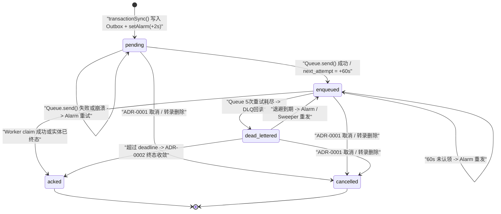
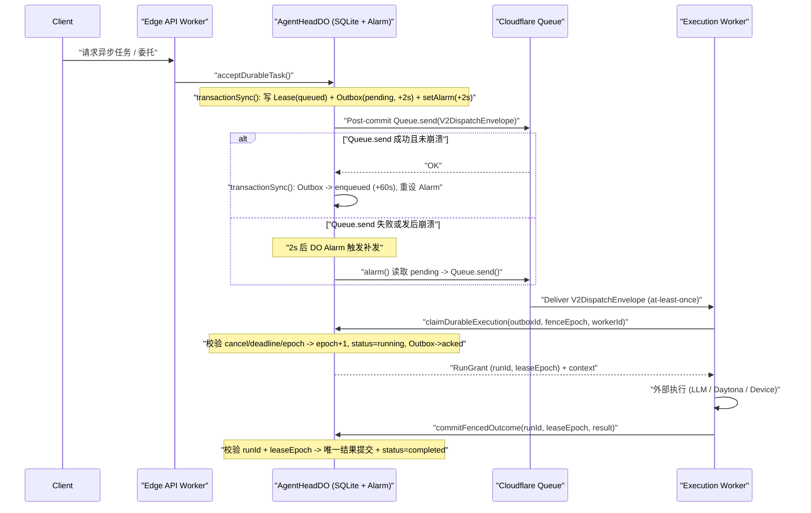
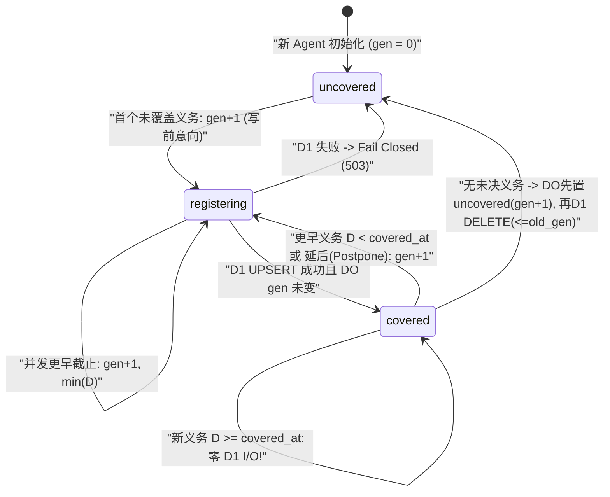
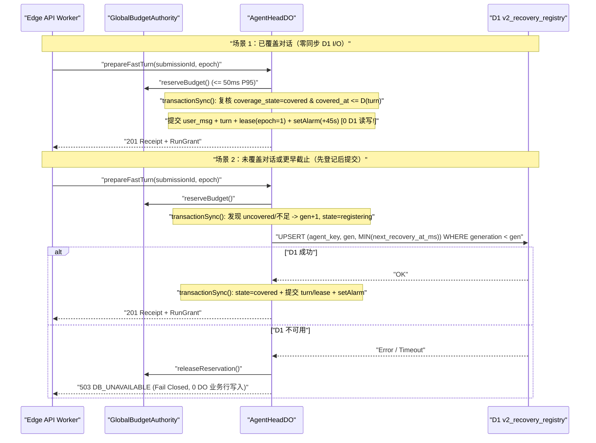
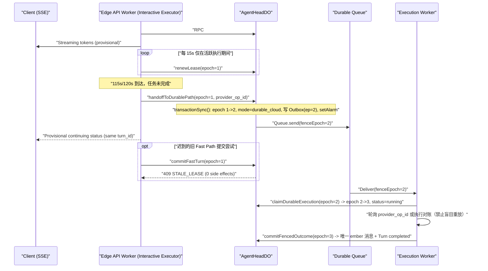

# Ember V2-M0-B — Event Runtime & Recovery Contract

- **Status:** M0 Contract Specification — Ready for Architect / CTO Review
- **Date:** 2026-11-19
- **Branch:** `feat/v2-m0-event-recovery-contract`
- **Owner:** V2 Work Package B (Event Runtime & Recovery)
- **Authoritative References:**
  - [ADR-0006 — Experience-first, Device-powered Runtime V2](../adr/0006-experience-first-device-powered-runtime-v2.md)
  - [ADR-0005 — Cloudflare-native Cloud Runtime V2](../adr/0005-cloudflare-native-runtime-v2.md)
  - [ADR-0001 — Cancellation and Retry Coordination](../adr/0001-cancellation-and-retry-coordination.md)
  - [ADR-0002 — Pre-claim Deadline Failure](../adr/0002-preclaim-deadline-failure.md)
  - [B1 Platform Contract (§6–§10, N-1–N-12)](../product/B1_PLATFORM_CONTRACT.md)
  - [V1 Architecture Baseline (§4–§10)](./v1-architecture-baseline.md)
  - [Durable Objects Migration Debt](./durable-objects-migration-debt.md)

> [!IMPORTANT]
> 本文档冻结 Ember V2 的事件驱动调度、DO Alarm + Queue 可靠派发、D1 独立恢复登记、Generation/Fencing 准入与退役、D1 降级边界、Fast Path 向 Durable Path 安全移交以及测量与故障注入验证契约。本文档**不授权**云资源创建、付费模型调用或生产数据迁移；M1 依赖性编码须待架构师/CTO 审核冻结本契约及 Agent A 公共契约后启动。

---

## 1. 验收目标与不变量总览

| 验收目标                                          | 协议强制不变量                                                                                                                                                                                                                                            | 测量/验证指标                                                                                                   |
| ------------------------------------------------- | --------------------------------------------------------------------------------------------------------------------------------------------------------------------------------------------------------------------------------------------------------- | --------------------------------------------------------------------------------------------------------------- |
| **不丢失已接受任务**                              | **Discoverability Invariant**: 任意义务 `O` 在 DO SQLite 提交前，D1 `v2_recovery_registry` 必须已存在 `next_recovery_at_ms <= D(O)` 且 `status IN ('armed', 'backoff')` 的有效记录；未覆盖路径遇 D1 不可用必须 Fail Closed（HTTP `503 DB_UNAVAILABLE`）。 | 故障注入矩阵 `FI-01..FI-16` 零丢失；客户端受保护 Outbox 保留原始 `client_submission_id` 与 `transcript_epoch`。 |
| **不重复提交任务结果**                            | 单调安全整数 `lease_epoch`（`<= 9007199254740991`）+ `active_run_id` 双重 Fencing；旧执行者/重复 Queue 投递在提交前被条件写拒绝并返回 `STALE_LEASE`；外部付费操作受 `provider_op_id` / `provider_outcome_state` 保护，禁止盲目重放。                      | `duplicate_commit_count = 0`；重复 Queue/Alarm 投递与 `> 120s` 移交后仅生成一条权威终态结果与消息。             |
| **不依赖用户重新打开 App**                        | 所有已接受工作（Fast Path 断连、Durable Path 派发、未来 Schedule）由 `AgentHeadDO` Alarm 与独立的 D1 + Scheduled Worker 驱动；客户端断连或离线不影响恢复闭环。                                                                                            | 离线故障注入测试中无任何客户端请求，仍完成派发与结果提交。                                                      |
| **Alarm 重试耗尽后 <= 2 分钟发现、<= 5 分钟恢复** | `next_recovery_at_ms = earliest_due_alarm_ms + D1_RECOVERY_GRACE_MS`（`45_000 ms`），Scheduled Worker 以 `* * * * *`（`60_000 ms`）有界扫描到期标记；首次 Alarm + 全部 6 次自动重试耗尽后，下一或下两轮 Cron 触发独立恢复并重装后续调度。                 | `t_alarm_exhaust_to_detect_ms <= 120_000 ms`；`t_alarm_exhaust_to_recover_ms <= 300_000 ms`。                   |
| **已获得恢复覆盖的对话零同步登记 I/O**            | **Zero-Sync-IO Covered Path**: 在同一次 `storage.transactionSync()` 提交内校验 `coverage_state === 'covered' AND covered_recovery_at_ms <= D(O)`；命中则跳过 D1 读写，仅靠两代 CAS 退役防止并发抹除。                                                     | 已覆盖轮次 `d1_reads = 0`、`d1_writes = 0`；10 轮连续会话突发写入摊销 `<= 0.2` D1 行写/事件。                   |
| **无全量 Agent 轮询，无空闲心跳**                 | 休眠 Agent 在本地完全无工作后经两阶段退役删除 D1 标记并清除 DO Alarm；Scheduled Worker 仅通过部分索引 `idx_v2_recovery_due` 查询 `next_recovery_at_ms <= now` 的到期条目。                                                                                | 休眠 Agent 在 `v2_recovery_registry` 为 0 行、DO Alarm 为 `null`、零周期唤醒。                                  |

---

## 2. 最小数据结构与 Agent A Schema 所有权协调

### 2.1 跨包所有权边界（Agent A × Agent B）

V2 采用单一逻辑权威对象 `AgentHeadDO`（按服务端解析的 `(tenant_id, agent_id)` 路由，绝不信任客户端传入的租户或代理 ID）。为消除与 Work Package A（Agent Core / Fast Path）的契约冲突，双方在 DO SQLite 与全局控制面按表与职责严格分区：

| 存储域                                  | Owner                    | 持有表 / 实体                                                                                                                                                                                             | 核心职责与不可侵犯边界                                                                                                                         |
| --------------------------------------- | ------------------------ | --------------------------------------------------------------------------------------------------------------------------------------------------------------------------------------------------------- | ---------------------------------------------------------------------------------------------------------------------------------------------- |
| **DO SQLite（业务与执行权威）**         | **Agent A**              | `agent_head_meta`, `conversations`, `conversation_messages`, `assistant_turns`, `tasks`, `runs`, `task_events`, `task_results`, `approvals`, `turn_attempts`, `workspace_manifests`, `artifacts`, `notes` | 拥有 B1 会话序号 `sequence`、`transcript_epoch` 删除栅栏、`client_submission_id` 租户级幂等、Task/Run FSM、预算预留与结算、消息-任务原子关联。 |
| **DO SQLite（调度、派发、租约与覆盖）** | **Agent B**              | `v2_schedules`, `v2_dispatch_outbox`, `v2_execution_leases`, `v2_recovery_coverage`                                                                                                                       | 拥有统一时间轮/Alarm 多路复用、Queue Outbox 状态机、Fast/Durable 统一租约/移交 Fencing、本地覆盖状态与 Generation 计数。                       |
| **D1（全局恢复控制面）**                | **Agent B**              | `v2_recovery_registry`                                                                                                                                                                                    | 独立于 DO Alarm 故障域的到期恢复索引；**严格零业务数据**（禁止存放 Prompt、消息文本、结果摘要、凭据或 Token）。                                |
| **全局预算 / 身份目录**                 | **Architect / 共享边界** | `GlobalBudgetAuthority`（V2 预算门禁）, D1 会话/设备路由目录                                                                                                                                              | 付费模型调用前必须取得权威预算预留；预算校验与认证边界不由 Agent B 单方面缓存绕过。                                                            |

#### 协同事务与端口契约（禁止双份状态机）

Agent A 与 Agent B **共享同一次 `AgentHeadDO` 的 `storage.transactionSync()` 事务**，绝不通过跨存储两阶段提交或异步事件补救本地一致性：

```ts
/** Agent B 向 Agent A 暴露的同步事务内端口（运行在 AgentHeadDO 内部） */
export interface RecoveryAdmissionPort {
  /**
   * 预检查当前义务所需的最早发现时间戳 requiredRecoveryAtMs 是否已被本地覆盖。
   * 必须在所有外部异步 RPC（如 GlobalBudget）之前/之后与提交同事务复核。
   */
  inspectCoverageSync(requiredRecoveryAtMs: number):
    | { readonly covered: true; readonly generation: number }
    | {
        readonly covered: false;
        readonly nextGeneration: number;
        readonly targetRecoveryAtMs: number;
      };

  /** 在 D1 确认写入后，若 generation 未被更新事务推进，则确认本地覆盖有效。 */
  confirmCoverageSync(generation: number, coveredRecoveryAtMs: number): void;
}

export interface EventRuntimeCoordinatorPort {
  /** 在 Agent A 的提交事务内原子登记 Lease / Outbox / Schedule 并重算最早 DO Alarm。 */
  registerFastLeaseSync(input: {
    readonly targetKind: 'turn' | 'task';
    readonly targetId: string;
    readonly runId: string;
    readonly ownerId: string;
    readonly leaseExpiresAtMs: number;
    readonly executionDeadlineAtMs: number;
  }): void;

  enqueueDurableOutboxSync(input: {
    readonly outboxId: string;
    readonly entityKind: 'turn' | 'task' | 'schedule_occurrence' | 'handoff';
    readonly entityId: string;
    readonly queueName: 'durable_turn' | 'agent_task';
    readonly fenceEpoch: number;
    readonly nextAttemptAtMs: number;
    readonly executionDeadlineAtMs: number;
  }): void;

  /** 取消请求提交时，按 ADR-0001 原子更新 Lease 并取消未完成 Outbox。 */
  applyCancellationSync(targetKind: 'turn' | 'task', targetId: string, nowMs: number): void;
}

/** Agent B 恢复与超时收敛时回调 Agent A 的业务状态收敛端口（运行在同一 transactionSync 内） */
export interface AuthoritativeStateConvergencePort {
  convergePreClaimExpiredSync(targetKind: 'turn' | 'task', targetId: string, nowMs: number): void;
  convergeCancelledSync(targetKind: 'turn' | 'task', targetId: string, nowMs: number): void;
  markRunLeaseExpiredForReconcileSync(
    targetKind: 'turn' | 'task',
    targetId: string,
    expiredRunId: string,
    bumpedEpoch: number,
    nowMs: number,
  ): void;
  materializeScheduleOccurrenceSync(
    scheduleId: string,
    occurrenceSeq: number,
    nowMs: number,
  ): {
    readonly entityKind: 'task';
    readonly entityId: string;
    readonly executionDeadlineAtMs: number;
  };
}
```

### 2.2 DO SQLite 表结构定义

#### (1) `v2_schedules` — 持久化一次性与周期调度表

```sql
CREATE TABLE IF NOT EXISTS v2_schedules (
  schedule_id       TEXT PRIMARY KEY,
  tenant_id         TEXT NOT NULL,
  agent_id          TEXT NOT NULL,
  source_kind       TEXT NOT NULL CHECK (source_kind IN ('commitment', 'reminder', 'deferred_task', 'cleanup')),
  source_id         TEXT NOT NULL,
  schedule_kind     TEXT NOT NULL CHECK (schedule_kind IN ('once', 'interval', 'cron_tz')),
  interval_seconds  INTEGER CHECK (interval_seconds IS NULL OR (interval_seconds BETWEEN 60 AND 2592000)),
  cron_expr         TEXT,
  timezone          TEXT NOT NULL DEFAULT 'UTC',
  next_fire_at_ms   INTEGER NOT NULL,
  last_fired_at_ms  INTEGER,
  occurrence_seq    INTEGER NOT NULL DEFAULT 0 CHECK (occurrence_seq >= 0),
  misfire_policy    TEXT NOT NULL DEFAULT 'coalesce_latest'
                    CHECK (misfire_policy IN ('coalesce_latest', 'fire_once', 'skip_missed')),
  status            TEXT NOT NULL CHECK (status IN ('active', 'paused', 'completed', 'cancelled')),
  version           INTEGER NOT NULL DEFAULT 1 CHECK (version >= 1),
  created_at_ms     INTEGER NOT NULL,
  updated_at_ms     INTEGER NOT NULL
);

CREATE INDEX IF NOT EXISTS idx_v2_schedules_due
  ON v2_schedules (next_fire_at_ms, schedule_id)
  WHERE status = 'active';

CREATE UNIQUE INDEX IF NOT EXISTS idx_v2_schedules_source
  ON v2_schedules (source_kind, source_id);
```

**Timezone / DST 与 Misfire 确定性规则：**

- **`interval`**：按固定 UTC 秒步进 `next_fire_at_ms + interval_seconds * 1000`，不受夏令时影响。
- **`cron_tz`**：基于 IANA 时区表（Worker 内置 `Intl.DateTimeFormat`）按墙钟日历计算下一有效触发 UTC 毫秒值：
  - **Spring-forward 跳变空洞**（例如 `02:30` 因 `02:00 -> 03:00` 不存在）：在跳变后的首个有效时刻（`03:00` 本地时间）触发一次，不静默跳过该日。
  - **Fall-back 重叠时段**（例如 `01:30` 出现两次）：记录 `last_fired_at_ms` 对应的本地日历日期，在同一本地壁钟日历槽位**仅触发一次**（首次出现时），下次调度推进到次日墙钟槽位，绝不重复触发。
- **Misfire 策略**：离线恢复或延迟跨越多个周期时，默认 `coalesce_latest` 仅补发**一次**当前实例，并将 `next_fire_at_ms` 严格推进至 `> now_ms` 的下一未来槽位，防止雪崩。
- **确定性顺序与故障隔离**：严格按 `(next_fire_at_ms ASC, schedule_id ASC)` 批量读取；单个 Schedule 校验或物化异常仅隔离记录该 Schedule 的错误状态，不阻塞同批次其他 Schedule 或 Outbox。

#### (2) `v2_dispatch_outbox` — 可靠 Queue 派发意向表

```sql
CREATE TABLE IF NOT EXISTS v2_dispatch_outbox (
  outbox_id            TEXT PRIMARY KEY, -- e.g. turn:{turnId} | task:{taskId}:ep:{epoch} | sched:{scheduleId}:{seq}
  entity_kind          TEXT NOT NULL CHECK (entity_kind IN ('turn', 'task', 'schedule_occurrence', 'handoff')),
  entity_id            TEXT NOT NULL,
  queue_name           TEXT NOT NULL CHECK (queue_name IN ('durable_turn', 'agent_task')),
  payload_ref          TEXT NOT NULL, -- 封闭无 Prompt 的 JSON 信封
  state                TEXT NOT NULL CHECK (state IN ('pending', 'enqueued', 'acked', 'dead_lettered', 'cancelled')),
  next_attempt_at_ms   INTEGER NOT NULL,
  publish_attempts     INTEGER NOT NULL DEFAULT 0 CHECK (publish_attempts >= 0),
  last_enqueued_at_ms  INTEGER,
  dlq_count            INTEGER NOT NULL DEFAULT 0 CHECK (dlq_count >= 0),
  last_error_code      TEXT,
  fence_epoch          INTEGER NOT NULL DEFAULT 0 CHECK (fence_epoch >= 0 AND fence_epoch <= 9007199254740991),
  created_at_ms        INTEGER NOT NULL,
  updated_at_ms        INTEGER NOT NULL
);

CREATE INDEX IF NOT EXISTS idx_v2_outbox_due
  ON v2_dispatch_outbox (next_attempt_at_ms, outbox_id)
  WHERE state IN ('pending', 'enqueued', 'dead_lettered');
```

**封闭 Queue 信封契约（`V2DispatchEnvelope`，严格无 Prompt/凭据）：**

```ts
export interface V2DispatchEnvelope {
  readonly schemaVersion: 2;
  readonly eventId: string; // 等于 outbox_id
  readonly tenantId: string; // 仅作路由提示；DO 必须按权威身份校验
  readonly agentId: string;
  readonly entityKind: 'turn' | 'task' | 'schedule_occurrence' | 'handoff';
  readonly entityId: string;
  readonly fenceEpoch: number; // 必须匹配当前 lease_epoch，过期信封直接 ACK 丢弃
}
```

#### (3) `v2_execution_leases` — Fast/Durable 统一租约与移交 Fencing 表

```sql
CREATE TABLE IF NOT EXISTS v2_execution_leases (
  target_kind             TEXT NOT NULL CHECK (target_kind IN ('turn', 'task')),
  target_id               TEXT NOT NULL,
  tenant_id               TEXT NOT NULL,
  agent_id                TEXT NOT NULL,
  execution_mode          TEXT NOT NULL CHECK (execution_mode IN ('fast_interactive', 'durable_cloud', 'durable_device')),
  status                  TEXT NOT NULL CHECK (status IN ('queued', 'running', 'waiting_approval', 'retryable_failed', 'completed', 'failed', 'cancelled')),
  active_run_id           TEXT,
  lease_epoch             INTEGER NOT NULL DEFAULT 0 CHECK (lease_epoch >= 0 AND lease_epoch <= 9007199254740991),
  lease_owner             TEXT,
  lease_acquired_at_ms    INTEGER,
  lease_expires_at_ms     INTEGER,
  last_renewed_at_ms      INTEGER,
  execution_deadline_at_ms INTEGER NOT NULL,
  handoff_state           TEXT NOT NULL DEFAULT 'none' CHECK (handoff_state IN ('none', 'pending_handoff', 'handed_off', 'reconciling')),
  provider_op_id          TEXT,
  provider_outcome_state  TEXT NOT NULL DEFAULT 'none' CHECK (provider_outcome_state IN ('none', 'in_flight', 'uncertain', 'settled')),
  cancel_requested_at_ms  INTEGER, -- 单调只写一次（ADR-0001）
  attempt_count           INTEGER NOT NULL DEFAULT 0 CHECK (attempt_count >= 0),
  max_attempts            INTEGER NOT NULL DEFAULT 2 CHECK (max_attempts >= 1),
  next_action_at_ms       INTEGER, -- min(lease_expires_at_ms, execution_deadline_at_ms, retry_at_ms)
  updated_at_ms           INTEGER NOT NULL,
  PRIMARY KEY (target_kind, target_id),
  CHECK ((lease_owner IS NULL) = (lease_expires_at_ms IS NULL)),
  CHECK (status <> 'running' OR (active_run_id IS NOT NULL AND lease_owner IS NOT NULL))
);

CREATE INDEX IF NOT EXISTS idx_v2_leases_next_action
  ON v2_execution_leases (next_action_at_ms, target_kind, target_id)
  WHERE status IN ('queued', 'running', 'retryable_failed') AND next_action_at_ms IS NOT NULL;
```

#### (4) `v2_recovery_coverage` — DO 本地准入与 Alarm 单行状态

```sql
CREATE TABLE IF NOT EXISTS v2_recovery_coverage (
  id                      INTEGER PRIMARY KEY CHECK (id = 1),
  tenant_id               TEXT NOT NULL,
  agent_id                TEXT NOT NULL,
  generation              INTEGER NOT NULL DEFAULT 0 CHECK (generation >= 0 AND generation <= 9007199254740991),
  coverage_state          TEXT NOT NULL CHECK (coverage_state IN ('uncovered', 'registering', 'covered')),
  covered_recovery_at_ms  INTEGER, -- NULL when uncovered; valid D1 next_recovery_at_ms when covered
  armed_alarm_at_ms       INTEGER, -- 缓存当前 setAlarm 时间，仅在更早或变化时重设以减少写入
  alarm_fail_count        INTEGER NOT NULL DEFAULT 0,
  last_d1_sync_at_ms      INTEGER,
  updated_at_ms           INTEGER NOT NULL
);
```

### 2.3 D1 控制面表结构（`v2_recovery_registry`）

```sql
CREATE TABLE IF NOT EXISTS v2_recovery_registry (
  agent_key                 TEXT PRIMARY KEY, -- "{tenant_id}:{agent_id}"
  tenant_id                 TEXT NOT NULL,
  agent_id                  TEXT NOT NULL,
  generation                INTEGER NOT NULL CHECK (generation >= 0 AND generation <= 9007199254740991),
  next_recovery_at_ms       INTEGER NOT NULL,
  status                    TEXT NOT NULL CHECK (status IN ('armed', 'backoff', 'quarantined')),
  sweep_lease_owner         TEXT,
  sweep_lease_expires_at_ms INTEGER,
  recovery_attempts         INTEGER NOT NULL DEFAULT 0 CHECK (recovery_attempts >= 0),
  last_error_code           TEXT,
  updated_at_ms             INTEGER NOT NULL
);

CREATE INDEX IF NOT EXISTS idx_v2_recovery_due
  ON v2_recovery_registry (next_recovery_at_ms, agent_key)
  WHERE status IN ('armed', 'backoff');
```

**DO SQLite 写放大控制（对齐 ADR-0006 每事件 20 行写预算）：**

- 已覆盖 Fast Path 轮次：
  - `prepareFastTurn` 写 `v2_execution_leases`（1 行 + 1 索引 = 2）+ 必要时更新 `v2_recovery_coverage.armed_alarm_at_ms` & `setAlarm`（仅当新截止更早或无 Alarm 时写入，通常 0–2 行）。
  - `commitFastTurn` 更新 `v2_execution_leases`（1 行 + 1 部分索引移除 = 2）+ 更新 `armed_alarm_at_ms`（0–1）。
  - Agent B 在已覆盖普通对话上仅消耗 **~4–7 DO 行写**，为 Agent A 业务消息/Turn/Attempts 留足 ADR-0006 `<= 20` 行写预算余量。

---

## 3. DO Alarm + Queue 可靠派发协议

### 3.1 单 Alarm 最早截止时间多路复用器

每个 `AgentHeadDO` 仅维护**唯一一个平台 Alarm**，指向本地三张表中的最早到期时间：

$$
T_{\text{alarm}} = \min\big(
  \min_{\text{outbox} \in \{\text{pending, enqueued, dead\_lettered}\}} \text{next\_attempt\_at\_ms},\;
  \min_{\text{lease} \in \{\text{queued, running, retryable\_failed}\}} \text{next\_action\_at\_ms},\;
  \min_{\text{sched} \in \{\text{active}\}} \text{next\_fire\_at\_ms}
\big)
$$

- **按需重设**：仅当 `T_alarm !== armed_alarm_at_ms`（新增更早截止时间，或当前到期事件处理完毕需指向下一截止时间）时调用 `storage.setAlarm(T_alarm)`；若 `T_alarm === null` 则调用 `deleteAlarm()`（或在 `alarm()` 退出时自然清空）。
- **批处理上限与故障隔离**：单次 `alarm()` 执行有界批次（默认 `10` Leases + `10` Schedules + `10` Outbox 项）。先更新 DO SQLite 并重算/重装下一 `T_alarm`，再在事务外异步发布 Queue，防止某条消息 `Queue.send` 抛出异常导致整个批次中断或阻塞后续任务。

### 3.2 发布前后崩溃与重复投递处理

| 故障点                                              | 持久化状态                                                                                                                       | 恢复动作与安全保证                                                                                                                                                                                                                |
| --------------------------------------------------- | -------------------------------------------------------------------------------------------------------------------------------- | --------------------------------------------------------------------------------------------------------------------------------------------------------------------------------------------------------------------------------- |
| **DO 事务提交后、`Queue.send()` 前崩溃 / 网络失败** | `v2_dispatch_outbox.state = 'pending'`，`next_attempt_at_ms = T_commit + 2_000 ms`，DO Alarm 已武装于 `<= T_commit + 2_000 ms`。 | 约 2 秒后 `alarm()` 触发，重新读取 `'pending'` 行并发布 Queue；零依赖外部定时轮询。                                                                                                                                               |
| **`Queue.send()` 成功后、更新 `'enqueued'` 前崩溃** | Queue 中已有一条在途消息；Outbox 仍为 `'pending'`。                                                                              | 2 秒后 `alarm()` 可能再发一条重复消息。Execution Worker 消费时由 `claimDurableExecution()` 检查 `lease_epoch` 与 `status`：已领取则直接 ACK 跳过，已终态则标记 Outbox `'acked'`。                                                 |
| **Queue 消息丢失或消费者静默崩溃**                  | Outbox 在成功发布时迁入 `state = 'enqueued'` 且 `next_attempt_at_ms = now + 60_000 ms`（Re-enqueue 宽限）。                      | 若 60 秒内消费者未认领/未完成，Alarm 到期重新投递；若消费者已认领但崩溃，45s/30s `lease_expires_at_ms` Alarm 先触发重领。                                                                                                         |
| **Queue 5 次重试耗尽进入 DLQ**                      | DLQ Consumer 回调 `AgentHeadDO.onDispatchDeadLetter(outboxId, fenceEpoch, errorCode)`。                                          | 若 `fenceEpoch === current_epoch` 且任务仍未终态：Outbox 迁入 `'dead_lettered'` 并设退避 `next_attempt_at_ms = now + min(60s, 5s * dlq_count)`，同时重装 Alarm；若 `execution_deadline_at_ms` 已过则按 ADR-0002 收敛为 `failed`。 |
| **恶意/损坏/跨租户 Queue 信封**                     | 信封仅为 hint；Worker 解析 `tenantId`/`agentId` 路由到 DO 后，DO 校验身份并比对 `outbox_id`。                                    | 不匹配直接记录安全日志并 ACK 丢弃，零状态读写。                                                                                                                                                                                   |

### 3.3 DO Alarm + Queue 状态转换与时序图





---

## 4. D1 Recovery Registry + Scheduled Worker 独立恢复机制

### 4.1 架构与无轮询/无心跳保障

Cloudflare DO Alarm 最多自动重试 **6 次**（含初次执行共 7 次）；若因平台瞬时故障、隔离区异常或代码缺陷导致全部 6 次重试耗尽，平台将永久丢弃该 Alarm。因此，必须在 DO Alarm 故障域之外维护独立的恢复索引：

1. **D1 `v2_recovery_registry`**：全局仅存 `(agent_key, tenant_id, agent_id, generation, next_recovery_at_ms, status, sweep_lease_owner, sweep_lease_expires_at_ms)`。
2. **Scheduled Worker（Cron Trigger `* * * * *`，每 60 秒）**：
   - 仅执行一条索引查询：`WHERE status IN ('armed', 'backoff') AND next_recovery_at_ms <= ?now AND (sweep_lease_expires_at_ms IS NULL OR sweep_lease_expires_at_ms <= ?now) ORDER BY next_recovery_at_ms ASC, agent_key ASC LIMIT 50`。
   - **空闲零开销**：当无活跃/待恢复 Agent 时，返回 0 行，**不唤醒任何 DO**。
   - **有界 Sweeper Lease**：对选中的每条标记加 30 秒 `sweep_lease_expires_at_ms`，防止 Cron 重叠执行踩踏同一 Agent；若 Sweeper Worker 崩溃，30 秒后自动释放。
3. **DO 侧统一恢复入口 `AgentHeadDO.reconcileFromRegistry(expectedGen)`**：
   - 触发与 `alarm()` 完全相同的 `processDueWork('registry_recovery')`（收敛超时租约、物化到期调度、重发 Outbox、重装 DO Alarm）。
   - 若恢复期间 DO RPC 临时不可用，Sweeper 将 D1 行标记为 `status = 'backoff'`、`recovery_attempts += 1`，`next_recovery_at_ms = now + min(60_000, 15_000 * attempts)`；若连续失败超阈值（例如 `>= 10` 次），进入 `'quarantined'` 并触发强告警（仍不静默删除，保留人工/修复后重扫能力）。

### 4.2 异常积压与延迟可观测指标

- `v2_recovery_due_backlog_count`：每次 Cron 观测到的到期未处理条目数。
- `v2_recovery_lag_ms`：`now_ms - MIN(next_recovery_at_ms)`（预警阈值 `> 60_000 ms`）。
- `v2_alarm_exhaustion_suspected_total`：当 Sweeper 发现 DO 的 `armed_alarm_at_ms` 早于当前时间且明显超过 6 次重试窗口仍未推进时递增并告警。

---

## 5. Generation / Fencing 准入与退役协议（零同步 D1 I/O）

### 5.1 形式化不变量

- **不变量 I-1（可发现性）**：任意时刻，若 `AgentHeadDO` 存在已提交的未终态义务 `O`（最早需发现时间 $D(O)$），则 D1 `v2_recovery_registry` 必存在该 `agent_key` 的有效行（`status IN ('armed', 'backoff')`）且满足 $\text{next\_recovery\_at\_ms} \le D(O)$。
- **不变量 I-2（已覆盖零同步 D1 I/O）**：在 `storage.transactionSync()` 内，若 `v2_recovery_coverage` 满足 `coverage_state === 'covered' AND covered_recovery_at_ms <= D(O)`，则在接受义务 `O` 的整个请求路径上 **D1 读 = 0，D1 写 = 0**。
- **不变量 I-3（单调 Generation CAS）**：`v2_recovery_coverage.generation` 严格单调递增；D1 中任何修改或删除必须携带世代条件（`WHERE generation < excluded.generation`、`WHERE generation = expectedPrevGen` 或 `WHERE generation <= retiredGen`）。

### 5.2 覆盖状态机与准入/退役四场景规则



#### 关键并发竞争证明

1. **竞争场景 A：Sweeper 退役（Retirement） vs 并发已覆盖新对话**
   - Sweeper 调用 `AgentHeadDO.reconcileFromRegistry(expectedGen)`。
   - **Phase 1（DO `transactionSync()` 本地先失效）**：DO 检查无任何未决 Lease/Outbox/Schedule（`earliestAlarm === null`），**在发送远程 D1 DELETE 之前**，原子将 `generation` 推进至 `gen_retire = max(cov.generation, expectedGen) + 1`，设 `coverage_state = 'uncovered'`、`covered_recovery_at_ms = NULL`，返回 `retireUpToGen = gen_retire - 1`。
   - **Phase 2（远程 D1 条件删除）**：执行 `DELETE FROM v2_recovery_registry WHERE agent_key = ? AND generation <= :retireUpToGen`。
   - **交错分析**：
     - 若新对话在 Phase 1 **之前**提交：DO 在 Phase 1 会看到该新对话（`earliestAlarm !== null`），根本**不会进入退役**，而是保持或延后覆盖。
     - 若新对话在 Phase 1 **之后**、Phase 2 **之前**到达：新对话在 `transactionSync()` 看到 `coverage_state = 'uncovered'`，**绝对不会跳过 D1**！它推进 `generation = gen_retire + 1` 并写入 D1（`UPSERT` 生效）。随后到达的 Phase 2 `DELETE WHERE generation <= retireUpToGen` 匹配 **0 行**，绝不会误删新对话标记！
     - 若 Phase 2 D1 删除崩溃或超时：D1 保留旧标记，仅作为**无害陈旧标记**在下一轮 Sweeper 扫描时幂等清理。

2. **竞争场景 B：Sweeper 延后（Postponement） vs 并发更早截止时间义务**
   - 当 DO 仅剩远期 Schedule（如 `t + 600s`）时，Phase 1 将 `coverage_state` 置为 `'registering'`、`generation` 推进至 `nextGen = prevGen + 1`，然后执行 D1 条件更新：
     `UPDATE v2_recovery_registry SET generation = :nextGen, next_recovery_at_ms = :laterMs ... WHERE agent_key = ? AND generation = :prevGen`。
   - 若期间有更早截止时间的新 Turn 到达，新 Turn 看到 `'registering'`，推进 `gen = nextGen + 1` 并用 `ON CONFLICT ... DO UPDATE SET next_recovery_at_ms = MIN(...) WHERE generation < excluded.generation` 抢占写入。
   - **结果**：若新 Turn 先写 D1，延后语句 `WHERE generation = :prevGen` 影响 0 行且无法把时间推迟；若延后先写 D1，新 Turn 随即以 `nextGen + 1` 覆盖为更早时间，且延后回调返回 DO 时因 `cov.generation !== nextGen` 不会误标记为 `'covered'`！

3. **竞争场景 C：延迟不明确（Uncertain D1 Postponement Timeout）**
   - 若延后 `UPDATE` 遇到网络超时/响应丢失（D1 可能已提交 `:laterMs`，也可能仍停留在 `:oldMs`），DO **严禁**回退 `coverage_state` 为旧 `'covered'`，必须保留 `'registering'` 状态，直至下一次明确成功的 D1 同步恢复 `'covered'`。

4. **竞争场景 D：D1 写入后、DO 本地提交前崩溃**
   - D1 已持有标记，DO 事务未提交。结果仅在 D1 留下一个无害陈旧标记，下轮 Sweeper 检查 DO 空闲后安全删除，绝无幽灵任务或漏恢复。

5. **准入时序图（首次未覆盖 vs 已覆盖零 I/O）**



---

## 6. D1 不可用时的降级与 Fail-Closed 处理策略

遵循 [ADR-0006](../adr/0006-experience-first-device-powered-runtime-v2.md) 与 [B1 Platform Contract §10.3](../product/B1_PLATFORM_CONTRACT.md)，D1 故障时不采取“全站阻断”，也不允许“静默接受未受保护义务”：

| 操作类别                                                                                                                        | D1 不可用时的行为                                                                                                                     | HTTP / B1 契约映射                                                                                                                                   | 客户端与后台保障                                                                                                          |
| ------------------------------------------------------------------------------------------------------------------------------- | ------------------------------------------------------------------------------------------------------------------------------------- | ---------------------------------------------------------------------------------------------------------------------------------------------------- | ------------------------------------------------------------------------------------------------------------------------- |
| **Direct Path 读写**（历史分页、`GET /v1/me`、状态查询、非异步设置）                                                            | **正常继续**（假设认证/会话校验仍有效；若认证本身强依赖失效 D1 且无有效有界本地凭证，则认证 Fail Closed 返回 `503 DB_UNAVAILABLE`）。 | `200 OK`（认证不可用时 `503 DB_UNAVAILABLE`）                                                                                                        | 本地缓存可继续渲染，不中断只读体验。                                                                                      |
| **已覆盖 Fast Path 对话**（`coverage_state = 'covered'` 且 `covered_recovery_at_ms <= D(turn)`，且 Auth + GlobalBudget 均健康） | **正常接受并执行**（全程 0 次 D1 读写）。                                                                                             | `201 Created`（标准 B1 Receipt）                                                                                                                     | 现存 D1 标记已保证后续恢复可发现性；若后续超 120s 移交至 Durable Path，初始标记时间仍早于等于移交所需恢复点，不新增阻塞。 |
| **未覆盖对话 / Durable 任务 / 新建 Schedule / 提前截止义务**                                                                    | **Commit 前 Fail Closed 拒绝**；释放已预留 `GlobalBudget`；DO SQLite **零写入**。                                                     | `503 DB_UNAVAILABLE`（严格沿用 B1 错误码与 `strictObject` 体，不新增字段）                                                                           | 客户端保留本地受保护 Outbox 中的原文、`client_submission_id` 与 `transcript_epoch`，按退避重试（B1 N-1, N-3）。           |
| **登记/提交期间连接断开（Unknown-ACK）**                                                                                        | 客户端不可凭超时推定已拒绝或已接受。                                                                                                  | 调用 `GET /v1/message-submissions/{id}`（B1 N-2）：`200` 采用已有回执并清理 Outbox；`404` 校验 `transcript_epoch`（N-11/N-12）后以原 ID/Epoch 重试。 | 杜绝重复消息或静默丢消息。                                                                                                |
| **已在途的 Fenced 执行与退役请求**                                                                                              | 在途 Fast/Durable Run **安全继续执行与提交**；D1 `DELETE/UPDATE` 失败时仅保留 D1 原记录（不视为退役成功）。                           | 内部降级记录 + 告警                                                                                                                                  | D1 恢复后由 Sweeper 自动清理陈旧标记或推进延后。                                                                          |
| **Scheduled Worker 恢复扫描**                                                                                                   | 本轮跳过并发出 `recovery_registry_unavailable` 告警；**不修改**任何 DO 状态。                                                         | —                                                                                                                                                    | D1 恢复后下一分钟 Cron 按 `next_recovery_at_ms ASC` 自动补扫。                                                            |

---

## 7. Alarm 全部 6 次重试失败后的离线恢复验证方案

### 7.1 规范化时间常量表（M0 冻结测试 Profile）

| 常量名称                     | M0 默认值            | 说明与对齐依据                                                                           |
| ---------------------------- | -------------------- | ---------------------------------------------------------------------------------------- |
| `FAST_LEASE_MS`              | `45_000 ms` (45 s)   | Interactive Fast Path 租约长度（ADR-0006 §Interactive Executor）。                       |
| `FAST_RENEW_INTERVAL_MS`     | `15_000 ms` (15 s)   | 仅在活跃执行期间每 15s 续租；观测断连后立即停止续租。                                    |
| `FAST_DEADLINE_MS`           | `120_000 ms` (120 s) | Interactive Path 总体移交截止时间（保留 `B1_TURN_DEADLINE_SECONDS = 60` 兼容配置开关）。 |
| `NORMAL_RECONCILE_TARGET_MS` | `60_000 ms` (60 s)   | 静默失联进入恢复对账目标（`45s 过期 + 15s 检测/派发宽限`）。                             |
| `OUTBOX_IMMEDIATE_GRACE_MS`  | `2_000 ms` (2 s)     | 提交后立即尝试 `Queue.send()`；Alarm 兜底定于 `+2s`，避免正常路径竞态。                  |
| `OUTBOX_REENQUEUE_GRACE_MS`  | `60_000 ms` (60 s)   | Queue 成功入队后的未认领重投窗口（对齐 V1 `TURN_OUTBOX_REENQUEUE_MS`）。                 |
| `D1_RECOVERY_GRACE_MS`       | `45_000 ms` (45 s)   | `next_recovery_at_ms = earliest_due_alarm_ms + 45_000`。                                 |
| `SWEEPER_CADENCE_MS`         | `60_000 ms` (60 s)   | Scheduled Worker Cron `* * * * *`。                                                      |

### 7.2 6 次重试耗尽后“2 分钟发现、5 分钟恢复”定量推导

设最早待处理 DO Alarm 触发时刻为 $T_{\text{due}}$，Cloudflare DO Alarm 初次执行及 6 次指数退避重试耗时为 $B_{\text{total}}$（实网约为 $2+4+8+16+32+64 = 126\text{ s}$，本地故障注入可为 $[0, 126\text{ s}]$ 任意值），全部 7 次调用失败并被平台丢弃的时刻为：

$$
T_{\text{exhaust}} = T_{\text{due}} + B_{\text{total}}
$$

D1 恢复时间点设在 $T_{\text{reg}} = T_{\text{due}} + 45\text{ s}$：

1. **发现延迟（Detection Latency）**：
   - 若 $B_{\text{total}} \ge 45\text{ s}$（如实网 ~126s）：$T_{\text{reg}} \le T_{\text{exhaust}}$，标记在耗尽时**已处于到期状态**，下一轮 60s Cron 必检出：
     $$\Delta_{\text{detect}} \le 60\text{ s} < 120\text{ s (2 min)}$$
   - 若 $B_{\text{total}} < 45\text{ s}$（如本地测试瞬间耗尽 $B_{\text{total}} = 0\text{ s}$）：标记在 $T_{\text{due}} + 45\text{ s}$ 到期，随后 60s Cron 检出：
     $$\Delta_{\text{detect}} \le (45 - B_{\text{total}}) + 60 \le 105\text{ s} < 120\text{ s (2 min)}$$
2. **恢复延迟（Dispatch & Re-arm Latency）**：
   - 发现后同一次 Sweeper 调用 `reconcileFromRegistry` 完成 Queue 派发并重装未来 `v2_schedules` 的 DO Alarm：健康路径 $\Delta_{\text{recover}} = \Delta_{\text{detect}} + \text{RPC} \le 106\text{ s}$。
   - 即便发生单次瞬时 RPC 故障退避（30s–60s 重扫），仍在 $\le 165\text{ s} \ll 300\text{ s (5 min)}$ 内完成。

### 7.3 离线验证场景闭环

在**所有客户端离线、无任何用户流量**条件下，同时预置：（1）一个即时入队失败且 Alarm 初次+6次均失败的 Pending Task；（2）一个未来 $T + 600\text{ s}$ 的 Schedule。验证断言：

1. Alarm 第 7 次失败后，DO `armed_alarm_at_ms` 确已丢失；
2. 无需客户端重连，Scheduled Worker 在 `<= 2 min` 内检出 D1 到期行，在 `<= 5 min` 内通过 `reconcileFromRegistry` 派发 Pending Task 至 Queue（产出**唯一**执行结果）并重新将 DO Alarm 武装至 $T + 600\text{ s}$；
3. 到达 $T + 600\text{ s}$ 时，未来 Schedule 正常触发执行。

---

## 8. Fast Path 向 Durable Path 安全移交与重复执行防护

### 8.1 三类移交与恢复触发器

Interactive Executor 运行在 Edge API Worker 的 HTTP 响应流处理中，**绝不在 DO 内长时间阻塞或持久化逐 Token 流状态**。普通简单对话目标仅需 **2 次核心 DO RPC**（`prepareFastTurn` 与 `commitFastTurn`）；以下三类情况触发向 Durable Path 的安全移交：

| 场景                      | 触发条件                                        | 移交协议与重复执行防护                                                                                                                                                                                        |
| ------------------------- | ----------------------------------------------- | ------------------------------------------------------------------------------------------------------------------------------------------------------------------------------------------------------------- |
| **1. 观测到客户端断连**   | SSE/HTTP 流关闭信号                             | 立即停止 15s 续租；若已有可恢复 `provider_op_id` 或尚未达到终态，调用 `handoffToDurablePath(runId, epoch, 'client_disconnect', providerOpId)`（必要时先请求 Provider 取消不可恢复流）。                       |
| **2. 推理/执行超过 120s** | 接近 `FAST_DEADLINE_MS`（如 `115s` 软移交阈值） | 若 Provider 支持后台作业/响应句柄，持久化 `provider_op_id` 与检查点，调用 `handoffToDurablePath`；向流客户端发出受版本控制的状态事件（如 `continuing_in_background`），保持**同一逻辑 `turn_id`/`task_id`**。 |
| **3. 执行者静默失联**     | Edge Worker Isolate 崩溃/OOM                    | 45s 租约到期后由 DO Alarm（`45s + <=15s = <=60s`）自动进入 `reconcileFromRegistry` / `processDueWork`，将旧 Run 标为 `lease_expired` 并经 Durable Outbox 触发对账。                                           |

### 8.2 防重复执行与不确定结果对账硬规则

1. **原子 Epoch 递增 Fencing**：`handoffToDurablePath` 与超时 Reaper 在 `transactionSync()` 内将 `lease_epoch` 严格加 1（如 `1 -> 2`），清除原 `lease_owner`。旧 Fast Path 进程即使随后恢复并尝试 `commitFastTurn(epoch = 1)`，必被拒绝并返回 `STALE_LEASE`（零写副作用）。
2. **`provider_op_id` 与 `provider_outcome_state` 门控**：
   - 在发起真实外部付费调用前，Agent A/B 必须先通过 Send-Start CAS 将 `provider_outcome_state` 设为 `'in_flight'`。
   - Durable Execution Worker 在 `epoch = 2` 认领后：
     - 若 `provider_op_id !== null`（Provider 支持结果轮询/恢复）：**只查询/轮询原 `provider_op_id`**，严禁发起第二次重复推理！
     - 若 `provider_op_id === null` 且 `provider_outcome_state === 'uncertain'`（外部调用可能已发出但结果未知）：进入显式对账（查询 Provider 账单/请求幂等记录或按 B2 规则收敛为显式不确定/可重试提示），**绝不盲目重放非幂等副作用或伪造成功**。
3. **客户端重连无重复**：流式输出在 `commitFastTurn` / `commitFencedOutcome` 前均为临时态；客户端重连后拉取 `GET /v1/conversations/{id}/messages` 与 `GET .../turns/{turnId}`，仅读取同一权威已提交消息。



---

## 9. 恢复登记延迟、写入成本与异常恢复测量定义

为在 M1 本地压测与后续（另行批准的）云端 Canary 中形成可复现基准，冻结以下测量口径（所有延迟按 **Cold / Warm** 与区域 RTT 分组报告 **P50 / P95 / P99 / Max**）：

| 指标 ID                            | 定义与采集点                                                                                   | M0/M1 验收门限                                                                  |
| ---------------------------------- | ---------------------------------------------------------------------------------------------- | ------------------------------------------------------------------------------- |
| `t_reg_d1_ms`                      | 未覆盖请求中 D1 `upsertCoverage` 往返耗时（区分 `ACK` 与 `Runtime` 链）。                      | 已覆盖对话强制 `= 0 ms`（零调用）；未覆盖仅发生于首轮或更早截止。               |
| `d1_billed_writes_per_event`       | `SUM(D1 meta.rows_written) / total_events`（含初始登记、延后、退役、Sweeper Lease）。          | 10 轮会话突发场景下登记/退役均值 `<= 0.2` D1 写入/事件（不含 Sweeper 读检查）。 |
| `d1_billed_reads_per_event`        | `SUM(D1 meta.rows_read) / total_events`（含空闲期 Cron 查询空结果基线）。                      | 已覆盖对话路径 `= 0`；全量空闲 Cron 不得随总用户数线性增长。                    |
| `do_sqlite_rows_written_per_event` | `DO SQLite` 每事件写入行数（含索引维护与 `setAlarm`）。                                        | 与 Agent A 合计控制在 ADR-0006 `<= 20` 行写/事件规划模型内。                    |
| `t_silent_loss_to_reconcile_ms`    | 从最后一次成功 `renewLease`（或无续租时 `prepareFastTurn`）至 DO 进入对账并入队的时间。        | 正常恢复 `<= 60_000 ms`（45s 租约 + 15s 检出/派发）。                           |
| `t_alarm_exhaust_to_detect_ms`     | 从第 6 次（最后一次）Alarm 重试失败时刻 $T_{\text{exhaust}}$ 到 Sweeper 认领 D1 标记时刻之差。 | `<= 120_000 ms`（2 分钟）。                                                     |
| `t_alarm_exhaust_to_recover_ms`    | 从 $T_{\text{exhaust}}$ 到 Pending Outbox 重新入队且未来 Schedule 重装 Alarm 完成之差。        | `<= 300_000 ms`（5 分钟）。                                                     |
| `duplicate_commit_count`           | 同一 `turn_id`/`task_id` 写入终态结果或重复 `ember` 消息的次数。                               | 严格 `= 0`。                                                                    |

### M0 本地隔离 Probe 实测结果（Fake / `node:sqlite`）

在隔离本地 Probe（[v2-m0-event-recovery-probe.test.ts](../../tests/unit/v2-m0-event-recovery-probe.test.ts)）中，使用两套独立内存 SQLite 数据库分别模拟 `AgentHeadDO` 与 `D1 v2_recovery_registry` 并配合虚拟时钟执行确定性验证，结果如下：

- **8 / 8 测试用例全部通过**（Vitest `34 ms`）。
- **已覆盖零 D1 I/O**：Turn 2–10 在覆盖期内实测 `d1Reads = 0`、`d1Writes = 0`；加上 Turn 1 登记（1 写）与空闲后延迟退役（1 写），10 轮会话登记生命周期共 2 次 D1 写入（**0.2 D1 writes/turn**）。
- **Alarm 6 次重试耗尽恢复**：7 次 Alarm 连续失败耗尽于 $T_{\text{exhaust}} = T_0 + 128\text{ s}$，Scheduled Worker 在 `52 s`（`<= 120 s`）后检出并在同轮完成 Queue 派发与未来 Schedule 重装，恢复延迟 `52 s`（`<= 300 s`），离线期间零客户端流量且仅提交 1 条终态结果。

---

## 10. 确定性故障注入测试矩阵

| 用例 ID   | 注入故障 / 竞态场景                                                                      | 预期状态转换与恢复结果                                                                                                                | 强制断言                                                   |
| --------- | ---------------------------------------------------------------------------------------- | ------------------------------------------------------------------------------------------------------------------------------------- | ---------------------------------------------------------- |
| **FI-01** | **D1 写入成功后、DO 提交前崩溃**                                                         | D1 保留陈旧标记，DO 无业务行；下轮 Sweeper 唤醒 DO 确认空闲后退役删除。                                                               | DO 业务表 0 残留行；D1 标记被安全回收。                    |
| **FI-02** | **DO 提交后、`Queue.send()` 前崩溃**                                                     | Outbox 保留 `'pending'`；2s 后 DO Alarm 自动补发 Queue。                                                                              | 任务不丢失，正常完成后进入唯一终态。                       |
| **FI-03** | **`Queue.send()` 成功后、Outbox 更新前崩溃**                                             | DO Alarm 补发重复消息；消费者凭 `lease_epoch` / 终态判重 ACK。                                                                        | `duplicate_commit_count = 0`。                             |
| **FI-04** | **Queue 重复投递同一消息（并发/乱序）**                                                  | 首条认领 `epoch+1` 为 `running`；重复投递见活跃租约或终态直接 ACK。                                                                   | 仅 1 个 Run 执行，仅 1 条终态记录。                        |
| **FI-05** | **Queue 消费失败 5 次进入 DLQ**                                                          | DLQ Consumer 回调 `onDispatchDeadLetter`，状态迁为 `'dead_lettered'` 并重装退避 Alarm（超时则收敛 `failed`）。                        | 零静默丢弃；恢复或明确终态收敛。                           |
| **FI-06** | **初次 Alarm + 全部 6 次重试失败（全客户端离线，含 Pending + 未来 Schedule）**           | D1 到期行由 Scheduled Worker 检出，调用 `reconcileFromRegistry` 派发 Pending 并重装未来 Schedule Alarm。                              | 发现 `<= 2 min`，恢复 `<= 5 min`，未来 Schedule 准时触发。 |
| **FI-07** | **并发 Sweeper 退役 vs 已覆盖新对话到达**                                                | DO 在删除 D1 前先将本地置为 `'uncovered'` + `gen+1`；新对话走 D1 `UPSERT(gen+2)`；旧 `DELETE WHERE gen <= old` 匹配 0 行。            | 新对话不被抹除；发现时间不丢失。                           |
| **FI-08** | **并发 Sweeper 延后 vs 更早截止义务到达**                                                | 延后先置 `'registering'` 并带 `WHERE generation = prevGen` 更新；更早义务抢占 `gen+2` 与 `MIN(...)`。                                 | D1 `next_recovery_at_ms` 保持更早时间。                    |
| **FI-09** | **延后 `UPDATE` 遇到 D1 不明确超时**                                                     | DO 保持 `'registering'`（**不回退**为旧 `'covered'`），待下次 D1 恢复后重同步。                                                       | 绝不误认为旧覆盖仍有效。                                   |
| **FI-10** | **D1 完全不可用（已覆盖对话 / Direct Path / 未覆盖对话）**                               | Direct Path 与已覆盖 Fast Path 正常完成（0 D1 I/O）；未覆盖提交返回 `503 DB_UNAVAILABLE` 且 DO 零写入；Unknown-ACK 经 B1 N-2 对账。   | B1 错误码兼容；未覆盖义务零提交。                          |
| **FI-11** | **Fast Path 观测到客户端断连**                                                           | 停止 15s 续租，安全移交 Durable Path（`epoch 1->2`），客户端重连可见单一终态回复。                                                    | 断连不撤销已接受工作。                                     |
| **FI-12** | **Fast Path 执行者静默崩溃**                                                             | 45s 租约到期后 DO Alarm 触发，递增 `epoch` 并入队进入对账。                                                                           | 静默失联到进入对账 `<= 60 s`。                             |
| **FI-13** | **Fast Path 推理超过 120s（含可恢复 `provider_op_id` 与不可恢复 `uncertain` 两子场景）** | `115s` 软移交：`epoch 1->2`，保留同一 `turn_id`；旧 `epoch=1` 迟到提交被 `STALE_LEASE` 拒绝；有句柄仅轮询不重算，无句柄进入显式对账。 | 仅 1 次推理计费，仅 1 条终态消息。                         |
| **FI-14** | **DST Spring-Forward / Fall-Back 周期调度**                                              | Spring-forward 在跳变后首有效时刻触发；Fall-back 同一本地日历槽仅触发一次。                                                           | 不漏触发、不双倍触发。                                     |
| **FI-15** | **ADR-0001 取消 vs 重试/认领竞争 & ADR-0002 未领超时**                                   | 已提交取消优先于重试与新 Run 创建；未认领已过期任务直接 `queued -> failed` 且 `attempt_count = 0`。                                   | 取消后零新 Run；不虚构 Run。                               |
| **FI-16** | **跨租户信封伪造 / 篡改攻击**                                                            | 消费者以服务端解析身份路由 DO，DO 校验 `tenant_id`/`agent_id` 不匹配立即拒绝并 ACK 丢弃。                                             | 跨租户零信息泄露、零状态变更。                             |

---

## 11. M1 实施计划（本地 Fake Provider 验证阶段）

> [!NOTE]
> 以下步骤仅在 M0 公共契约（Agent A + Agent B + Architect）经评审冻结后启动；M1 全程使用本地 Wrangler/Miniflare 与 Fake Provider，不创建云资源、不触发付费模型调用。

1. **M1-B1：DO SQLite 与 D1 迁移及 Repository 实现（包：`@ember/v2-runtime` / `@ember/contracts` 扩展）**
   - 落地 `v2_schedules`、`v2_dispatch_outbox`、`v2_execution_leases`、`v2_recovery_coverage` 的版本化事务性 DO 迁移，与 Agent A 业务表共用 `AgentHeadDO` 初始化/升级管线。
   - 落地 D1 `v2_recovery_registry` 迁移与强类型 CAS 存储适配器。
2. **M1-B2：AgentHeadDO Alarm 多路复用器与 Outbox Relay**
   - 实现 `RecoveryAdmissionPort`、`EventRuntimeCoordinatorPort`、`computeEarliestAlarmAtMs()` 及 `alarm()` 有界批处理。
   - 集成 Queue 消费者与 DLQ 处理器（`V2DispatchEnvelope` 封闭校验 + 租约 Fencing）。
3. **M1-B3：Scheduled Worker 独立恢复与 Generation/Fencing 集成**
   - 实现 `* * * * *` Sweeper Worker，串联 `claimDueMarkers`、`reconcileFromRegistry` 两阶段退役/延后及结构化延迟/积压观测指标。
4. **M1-B4：Fast Path ↔ Durable Path 移交与 B1 兼容适配**
   - 实现 `handoffToDurablePath`、`15s/45s/120s` 续租与超时移交、B1 Unknown-ACK（`GET /v1/message-submissions/{id}`）及 `transcript_epoch` 删除围栏测试。
5. **M1-B5：M1 确定性故障注入与基准门禁验收**
   - 在本地隔离测试环境中完整运行 `FI-01..FI-16`，并按第 9 节指标定义输出冷/热延迟（P50/P95/P99）、D1 读写计数与 DO SQLite 行写报告；**全部门禁通过后方可申请云端 PoC 审批**。
