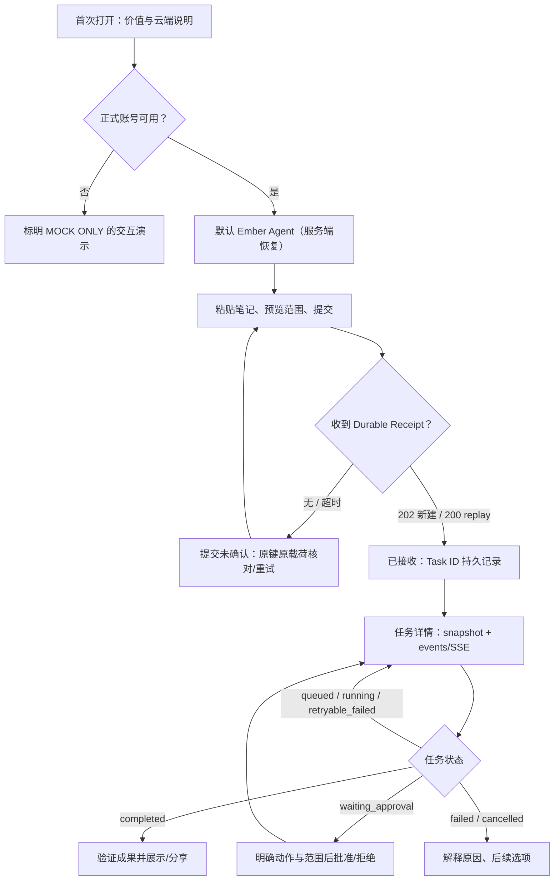

# Ember iOS — 最小用户旅程

> PROPOSED · 2026-11-01 · audit base `f02075b7d8139149efdb6bc28ac05d7f5d764ae5`
> Labels: [EXISTING] current server path; [MOCK ONLY] simulated execution; [PROPOSED] contract or client not yet implemented.

## 信息架构

- 主入口 **Ember / 我的承诺**：简短欢迎语 + 状态分组的 Task Inbox；只有真实列表契约生效后才渲染服务端完整历史。右上角“新任务”，底部轻量 Composer 可以直接发起。
- **任务详情**：Promise 卡（用户意图、已接收时间）→ 当前状态 → Activity 时间轴（真实事件）→ Outcome（交付物或异常）。有审批时单独固定操作区。
- **设置**：账号/隐私/通知偏好（通知只在能力存在时启用）。历史/搜索推迟到 server list 能力可用；本机已知 ID 快捷列表不可冒称完整历史。
- **伙伴形象**：低干扰的单一 Ember 头像/称呼，情绪表达不能覆盖事实状态；暂不配置多 Persona。

## 端到端流程

分支是 UI 意图，不表示 [PROPOSED] 的服务端接口已存在。

## 逐屏与文案契约

1. **欢迎**：标题“把事情交给 Ember，也能知道它进行到哪儿了。”副标题“你交代一件事，Ember 接收、推进，并告诉你结果。”说明任务材料会被云端处理；具体储存、训练用途与删除规则待批准。未登录可以看隔离且持续标记的 Demo，不生成“真实 AI 成果”。
2. **伙伴创建**：首次只有 Ember，不要求性格问卷；如果 `POST /v1/agents` 成功，保留 `agent_id`。重装、换设备靠 [PROPOSED] 的服务器 account→agent 恢复，绝不能自动新建多个并声称是同一个。
3. **新任务**：输入或选择“整理笔记成行动清单”模板；展示输入长度与安全说明。用户触发一次提交：分配 idempotency key（同一个逻辑操作保留同一 key + body），按钮进入“正在提交”；本地可保留草稿，但完整持久化敏感内容需隐私审查。
4. **Durable Ack**：[EXISTING] `POST /v1/tasks` 返回 202 + `task_id/status/accepted_at/replayed`，或 200 replay；此时 UI 文案“已接收，正在排队/准备”，不能写“已完成”“正在思考”。超时/断网归类 **unknown acceptance**，不可简单重发新 key；在原键重放可用前保持“尚未确认”。
5. **在途**：[EXISTING] `GET /v1/tasks/:id` 作权威快照；先回放 `GET .../events?after=seq`，然后 `GET .../stream` 携带 `Last-Event-ID: seq`。SSE 每条 `event: task` 的 `id=sequence`；`: keep-alive` 只是网络心跳，不显示为进度。网络错显示“连接中断，任务可能仍在进行”并重新加载；不要绘制虚假百分比。
6. **离开再进入**：App 退到后台停止依赖持续 SSE；服务端任务继续。回前台/重启先从账户恢复 Task 列表 [PROPOSED]、再按 ID 拉 snapshot 与回放 events。设备本机已知记录可作暂时入口，但清楚提示“仅本机记录”。通知权限在用户理解“结果可通知我”后解释并请求；APNs、订阅、投递确认均 [PROPOSED]，不能测试通知 Demo 时伪装推送已送达。
7. **结果**：只有服务器 `completed` 且经过权威提交的 Artifact 或 approved result API 可读取时，显示“已完成”和行动清单；若状态完成但产物暂不可用，显示“完成，正在获取结果/暂无法读取”，可重试读取，不凭假内容填充。可复制/Share Sheet；默认不做外部应用写入。
8. **取消**：确认“停止后续处理；已经执行的外部动作可能无法撤销”。`POST /v1/tasks/:id/cancel` 的 202 = “取消请求已收到，等待停止”；200 terminal 时根据真实状态区分已取消/已完成/已失败；防止竞态下把已完成渲染为已取消。
9. **审批**：[EXISTING MOCK] `GET /v1/tasks/:id/approvals` 与 `POST /v1/approvals/:id/decision`。当前 DTO 仅 `action_digest`，**没有可读的 action/target/scope**，正式审批卡必须禁用“批准”；仅 [MOCK ONLY] 操作演示且有醒目标识。未来生产审批 [PROPOSED] 要有可信 ActionIntent 摘要、影响范围、失效时间、拒绝/取消后果，并防陈旧操作/双击重复/过期冲突。
10. **失败/恢复**：`retryable_failed` = 服务端可能重试，不等于最终失败；`failed` 才为终态。使用事件 `payload.errorCode` 的受限语义，不显示内部堆栈。404 区分为“任务不可见/已失效”，不能推断另一租户存在；401 需要重认证；429 预算限额；503/504 可稍后重试状态读取，不能生成第二个逻辑任务。

## 状态与视觉映射

| 真正服务端状态 / 事实 | 首要 UI 文案 | 视觉/动作 |
| --- | --- | --- |
| 未收到 Receipt | 正在提交 / 尚未确认 | 禁止显示“已接收”；原键核对 |
| `queued` | 已接收 · 等待执行 | 中性状态，不用百分比 |
| `running` | 正在处理 | 时间轴只显示持久事件，不显示假步骤 |
| `waiting_approval` | 需要你的确认 | 生产需可解释动作，否则仅禁用演示 |
| `retryable_failed` | 暂时受阻 · 等待重试 | 提供最新事件时间 |
| `completed` | 处理已结束 | 有成果才显示 Outcome 内容 |
| `failed` | 本次未完成 | 解释已知原因与可行后续 |
| `cancelled` | 已取消 | 不暗示外部动作已回滚 |
| SSE/网络中断 | 正在重新连接 | 状态灰度保留，刷新服务端快照 |

屏幕须支持 VoiceOver 读出状态 + 更新时间、Dynamic Type，颜色之外有图标/文字，任务时间轴不要以动画频率冒充真实性。各态的 API 依据见 `IOS_API_DEPENDENCIES.md`。

## 体验异常测试脚本

- POST 刚落库即断网：同一 key/body 重放得到 200 replay，只有一个 Task；不能因重试生成重复成果。
- SSE 断流：保留最后确认序号，回放缺口、忽略重复/乱序并重新获取 snapshot。
- 在 `running` 时点 Cancel：显示“请求中”直到 terminal，期间服务端若完成则说明“已完成”。
- 审批同时在别端结束、已过期、或请求重复：重拉最新 Approval 状态，禁止已失效按钮。
- App 被系统杀掉、卸载后重装：云端 Task 应不受影响；账号恢复 [PROPOSED] 未到位前不得称“跨端恢复已通过”。
- 无结果 Artifact、服务端 503、无网、VoiceOver、大字体、Reduce Motion、长中文输入、深色、iPad 分屏均需单独走查。

本流程不是 Wire API 的替代说明，接口缺口必须由 CTO/Platform 批准。
