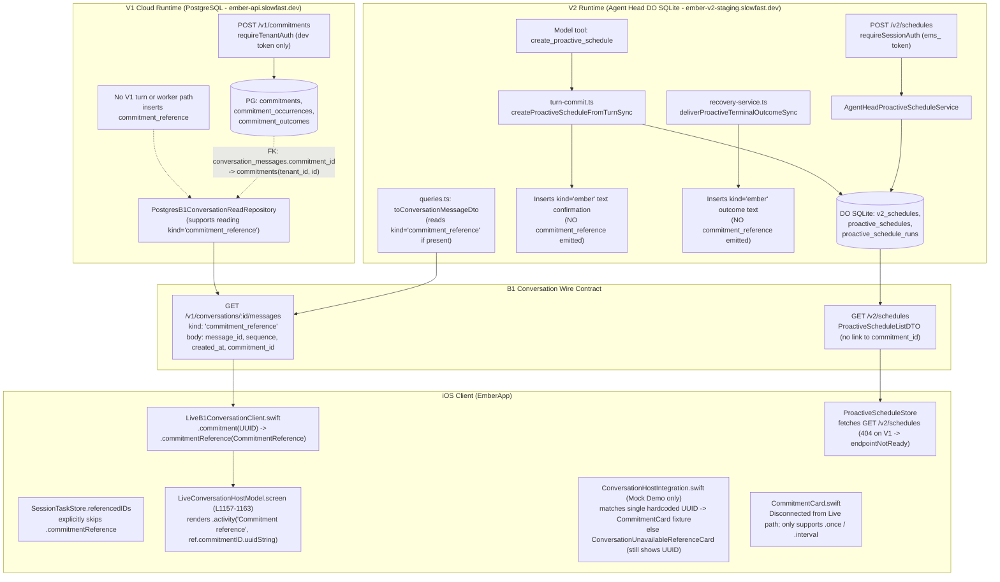

# UX-01 Research Report: Commitment Reference Data Mapping for Trustworthy Live Conversation UI

- **Author:** Agent C (Senior iOS / Agent Data Contract Research Engineer)
- **Reports to:** Ember UI/UX Lead, CTO, and iOS Lead
- **Date:** 2026-11-22
- **Baseline:** `main` @ `16bb09ec00e4110474746c37506ad710528a4cf8`
- **Scope:** Static codebase & contract audit only. No Swift, Cloud Runtime, database schema, or API code was modified or deployed; no Xcode build or simulator run was performed.

---

## Executive Conclusion

**Primary Determination:**

- **C. Must use a neutral fallback until authoritative data exists** (for immediate UX-01 implementation without API/contract changes).
- **B. Requires a narrow contract change** (to hydrate `CommitmentCard` with verified server state in live conversations).
- **A. Can implement with existing data** is **ruled out**.

### Why `A` is not possible today

1. **The live `commitment_reference` message carries only a UUID and has no live producer.**
   `B1CommitmentReferenceMessageSchema` ([`packages/contracts/src/b1-live-schemas.ts#L91-L95`](../../../packages/contracts/src/b1-live-schemas.ts#L91-L95)) is a strict object carrying only `commitment_id`. Across both V1 (`packages/postgres`) and V2 (`packages/runtime-v2`), **no server code path currently inserts a `commitment_reference` row** into `conversation_messages`.
2. **V1 `/v1/commitments` cannot be called by the iOS consumer app.**
   In V1 ([`apps/api/src/app.ts#L221-L227`](../../../apps/api/src/app.ts#L221-L227)), `/v1/commitments` is mounted behind `requireTenantAuth` (static dev-token auth in [`apps/api/src/auth/auth-middleware.ts#L23-L43`](../../../apps/api/src/auth/auth-middleware.ts#L23-L43)), not consumer session auth (`requireSessionAuth`, `ems_...` tokens). There is no iOS Commitment repository or store, and V2's edge worker ([`apps/api/src/local-v2/edge-worker.ts`](../../../apps/api/src/local-v2/edge-worker.ts)) does not mount `/v1/commitments` at all.
3. **V2 Proactive Schedules (`/v2/schedules`) uses a distinct entity (`schedule_id`), is not linked to `commitment_reference`, and does not match `CommitmentCard.Schedule`.**
   When V2's `create_proactive_schedule` tool succeeds during a turn ([`packages/runtime-v2/src/agent-head/turn-commit.ts#L1117-L1158`](../../../packages/runtime-v2/src/agent-head/turn-commit.ts#L1117-L1158)), it commits an `ember` text confirmation message—not a `commitment_reference` row. Furthermore, V2 `ProactiveScheduleDTO` supports `cron_tz` + IANA `timezone` (used by daily briefs/reminders), which `CommitmentCard.Schedule` ([`apps/ios/EmberApp/Features/Conversation/Cards/CommitmentCard.swift#L41-L44`](../../../apps/ios/EmberApp/Features/Conversation/Cards/CommitmentCard.swift#L41-L44)) cannot represent.

**Practical consequence for UX-01:**
- **Phase 1 (unblocked immediately):** Replace the raw `"Commitment reference"` + UUID row in [`LiveConversationHost.swift#L1157-L1163`](../../../apps/ios/EmberApp/Features/Conversation/Screen/LiveConversationHost.swift#L1157-L1163) with a **localized, non-technical neutral fallback** that hides the UUID, avoids fabricating any status/schedule/progress, and offers an action to open `ProactiveSchedulesSheetView` only when V2 Schedules is confirmed available.
- **Phase 2 (blocked on CTO / Agent E / iOS Lead decision):** Adopt a narrow contract change linking live proactive commitments/schedules to a consumer-session-readable DTO, extend `CommitmentCard.Schedule` for `cron_tz` + timezone-aware formatting, and add a dedicated detail destination.

---

## 1. Current Data-Flow Diagram



---

## 2. Data Provenance & Authoritative Source / DTO Mapping

### 2.1 End-to-End Provenance Trace

| Stage | V1 Path (PostgreSQL) | V2 Path (Agent Head DO SQLite) | Client / UI Observation |
| --- | --- | --- | --- |
| **1. Creation / Tool** | Created only via HTTP `POST /v1/commitments` ([`apps/api/src/commitments/routes.ts#L46-L89`](../../../apps/api/src/commitments/routes.ts#L46-L89)). No LLM tool creates a V1 Commitment. | Created via LLM tool `create_proactive_schedule` ([`packages/model-gateway/src/providers/shared.ts#L29`](../../../packages/model-gateway/src/providers/shared.ts#L29), [`apps/api/src/local-v2/interactive-executor.ts#L464-L466`](../../../apps/api/src/local-v2/interactive-executor.ts#L464-L466)) or HTTP `POST /v2/schedules` ([`apps/api/src/local-v2/proactive-schedule-routes.ts#L51-L55`](../../../apps/api/src/local-v2/proactive-schedule-routes.ts#L51-L55)). | iOS `ProactiveSchedulesSheetView` creates schedules via `POST /v2/schedules` (`LiveProactiveScheduleRepository.createSchedule`, [`LiveProactiveScheduleRepository.swift#L25-L46`](../../../apps/ios/EmberApp/Networking/LiveProactiveScheduleRepository.swift#L25-L46)). |
| **2. Server Persistence** | Tables `commitments`, `commitment_occurrences`, `commitment_outcomes` ([`migrations/0008_p0c3_commitments.sql#L7-L110`](../../../migrations/0008_p0c3_commitments.sql#L7-L110)); repository `PostgresCommitmentRepository` ([`packages/postgres/src/repositories/commitment-repository.ts#L364-L447`](../../../packages/postgres/src/repositories/commitment-repository.ts#L364-L447)). | Tables `v2_schedules` ([`packages/runtime-v2/src/recovery/schema.ts#L101-L120`](../../../packages/runtime-v2/src/recovery/schema.ts#L101-L120)), `proactive_schedules` and `proactive_schedule_runs` ([`packages/runtime-v2/src/agent-head/schema.ts#L778-L799`](../../../packages/runtime-v2/src/agent-head/schema.ts#L778-L799)). `v2_schedules.source_kind` maps `'brief' -> 'commitment'`, `'reminder' -> 'reminder'`, `'follow_up' -> 'deferred_task'` ([`proactive-schedule-service.ts#L79-L88`](../../../packages/runtime-v2/src/agent-head/proactive-schedule-service.ts#L79-L88)). | Two separate domain models exist: V1 `CommitmentDto` (`commitment_id`) vs. V2 `ProactiveScheduleSnapshot` (`scheduleId`). |
| **3. Message Emission** | `migrations/0012_conversation.sql` ([`L65-L66`](../../../migrations/0012_conversation.sql#L65-L66), [`L96-L99`](../../../migrations/0012_conversation.sql#L96-L99)) allows `kind = 'commitment_reference'` with `commitment_id` referencing `commitments(tenant_id, id)`. However, **no V1 turn or worker (`apps/worker/src/commitment-handler.ts`) inserts `commitment_reference`**. | `conversation_messages` schema allows `kind = 'commitment_reference'` with `commitment_id TEXT` and no FK ([`packages/runtime-v2/src/agent-head/schema.ts#L262-L296`](../../../packages/runtime-v2/src/agent-head/schema.ts#L262-L296)). However, **`turn-commit.ts#L1128-L1158` only inserts an `ember` message** (`created.confirmationText`) and never emits `commitment_reference`. | Per [`B1_PLATFORM_CONTRACT.md#L320`](../../../docs/product/B1_PLATFORM_CONTRACT.md#L320), `commitment_reference` was explicitly marked **"Produced in B1: no (B3)"**. |
| **4. Reference DTO** | `PostgresB1ConversationReadRepository` projects `commitment_id` into `B1CommitmentReferenceMessageSchema` ([`b1-conversation-read.ts#L235-L236`](../../../packages/postgres/src/repositories/b1-conversation-read.ts#L235-L236)). | `toConversationMessageDto` projects `commitment_id` into `B1CommitmentReferenceMessageSchema` ([`queries.ts#L132-L138`](../../../packages/runtime-v2/src/agent-head/queries.ts#L132-L138)). | `B1CommitmentReferenceMessageSchema` ([`b1-live-schemas.ts#L91-L95`](../../../packages/contracts/src/b1-live-schemas.ts#L91-L95)) is `z.strictObject`: only `message_id`, `sequence`, `created_at`, `kind`, `commitment_id`. |
| **5. Client Decoding** | Same B1 wire decoder. | Same B1 wire decoder. | [`LiveB1ConversationClient.swift#L83`](../../../apps/ios/EmberApp/Networking/LiveB1ConversationClient.swift#L83), [`L114`](../../../apps/ios/EmberApp/Networking/LiveB1ConversationClient.swift#L114), [`L146-L147`](../../../apps/ios/EmberApp/Networking/LiveB1ConversationClient.swift#L146-L147) strictly validates allowed keys and maps to `ConversationMessageKind.commitmentReference(CommitmentReference(commitmentID: id))` ([`ConversationModels.swift#L53-L59`](../../../apps/ios/EmberApp/Domain/Conversation/ConversationModels.swift#L53-L59)). Note: `outcome_reference` decoding at [`LiveB1ConversationClient.swift#L148`](../../../apps/ios/EmberApp/Networking/LiveB1ConversationClient.swift#L148) currently drops `commitmentID` when mapping to `.outcomeReference(.taskResult(taskID:))`. |
| **6. Hydration & Refresh** | No iOS Commitment client exists. `/v1/commitments/:id` rejects consumer `ems_` tokens (`requireTenantAuth`). | `ProactiveScheduleStore` ([`ProactiveScheduleStore.swift#L41-L68`](../../../apps/ios/EmberApp/Features/Schedules/ProactiveScheduleStore.swift#L41-L68)) polls `GET /v2/schedules` on start/sign-in/refresh/sheet-dismissal/arrival-timer ([`LiveConversationHost.swift#L962-L1035`](../../../apps/ios/EmberApp/Features/Conversation/Screen/LiveConversationHost.swift#L962-L1035)). `LiveProactiveScheduleRepository` does not implement `GET /v2/schedules/:id`. | `SessionTaskStore.referencedIDs` ignores `.commitmentReference` ([`SessionTaskStore.swift#L659`](../../../apps/ios/EmberApp/Features/Conversation/Screen/SessionTaskStore.swift#L659)). There is no lookup connecting `CommitmentReference.commitmentID` to `ProactiveScheduleStore.schedules`. |
| **7. Live Timeline UI** | Same UI path. | Same UI path. | [`LiveConversationHost.swift#L1157-L1163`](../../../apps/ios/EmberApp/Features/Conversation/Screen/LiveConversationHost.swift#L1157-L1163) renders `.activity(ConversationActivityPresentation(id: stableID, title: "Commitment reference", detail: ref.commitmentID.uuidString, timestamp: message.createdAt))`. |

### 2.2 Authoritative Field Capability Matrix

Classification rubric:
- **Available and authoritative**
- **Available but incomplete**
- **Not available**
- **Unclear; requires contract clarification**

| Required UI Field | `commitment_reference` Wire DTO (`B1ConversationMessage`) | V1 `/v1/commitments/:id` (`CommitmentDto`) | V2 `/v2/schedules` (`ProactiveScheduleDTO`) | Overall Assessment for `LiveConversationHost` |
| --- | --- | --- | --- | --- |
| **Entity Identity Linkage** | `commitment_id` (UUID) | `commitment_id` (UUID), `agent_id`, `tenant_id` | `scheduleId` (UUID); `source_kind` internal only | **Unclear; requires contract clarification.** No contract links `commitment_reference.commitment_id` to `ProactiveScheduleDTO.scheduleId`, and V1 `/v1/commitments` is unreachable with consumer auth. |
| **Human-readable title or purpose** | **Not available** (strictly ID-only per M-3) | **Available but incomplete** (`title` 1..140 chars exists in schema, unreachable to consumer auth) | **Available and authoritative** (`title` 1..140 chars, `prompt` 1..2000 chars, `kind`: `reminder`/`brief`/`follow_up`) | **Not available** via `commitment_reference`; **Unclear; requires contract clarification** whether `scheduleId` resolves `commitment_id`. |
| **Current status** | **Not available** | **Available but incomplete** (`active \| paused \| completed \| cancelled`, unreachable to consumer auth) | **Available and authoritative** (`active \| paused \| completed \| cancelled`) | **Not available** for `commitment_reference` without entity linkage. |
| **Schedule definition** | **Not available** | **Available but incomplete** (`schedule_kind`: `once \| interval`, `interval_seconds`, no `cron` or IANA `timezone`) | **Available and authoritative** (`scheduleKind`: `once \| interval \| cron_tz`, `intervalSeconds`, `cronExpr`, `timezone`, `misfirePolicy`) | **Available but incomplete** for `CommitmentCard` because `CommitmentCard.Schedule` lacks `.cronTZ` and `timezone`. |
| **Next execution time** | **Not available** | **Available but incomplete** (`next_due_at`, unreachable to consumer auth) | **Available and authoritative** (`nextFireAt` UTC ISO-8601 when `status == 'active'`, else `null`) | **Not available** for `commitment_reference` without entity linkage. |
| **Most recent execution** | **Not available** | **Available but incomplete** (requires separate `GET /v1/commitments/:id/outcomes`, unreachable to consumer auth) | **Available and authoritative** (`lastFiredAt`, `occurrenceCount`, `latestRun`: `occurrenceSeq`, `taskId`, `status`, `scheduledFor`, `completedAt`) | **Not available** via `commitment_reference`; in V2 `GET /v2/schedules` includes `latestRun` (detail endpoint `GET /v2/schedules/:id` adds `recentRuns` up to 10, not implemented in iOS repo). |
| **Result or task reference** | **Not available** | **Available but incomplete** (`CommitmentOutcomeDto.task_id`, `summary`, `result_status`) | **Available but incomplete** (`latestRun.taskId` as `String`, `summaryText`, `detailText`, `reasonCode`, `resultMessageId`; `null` before first execution) | **Not available** before first run; `latestRun.taskId` is untyped `String` and `SessionTaskStore` does not auto-sync schedule run tasks unless referenced in chat. |
| **Valid navigation destination** | **Not available** | **Not available** (no iOS Commitment detail view or route) | **Available but incomplete** (`ProactiveSchedulesSheetView` exists as a list/composer sheet, with no `scheduleId` selection/deep-link; `chatNavigationPath` only accepts `TaskDetailView(taskID:)`) | **Available but incomplete** on V2 (can open Schedules sheet as a list); **Not available** on V1 (endpoint returns 404/405/501 -> `.endpointNotReady`). |

---

## 3. Compatibility Assessment for `CommitmentCard`

[`CommitmentCard`](../../../apps/ios/EmberApp/Features/Conversation/Cards/CommitmentCard.swift#L5-L194) is currently a display-only SwiftUI view wired **only** to [`ConversationCardRenderer.Commitment`](../../../apps/ios/EmberApp/Features/Conversation/Cards/ConversationCardRenderer.swift#L53-L71) and a single hardcoded demo fixture (`ConversationFixtures.commitmentID`, [`ConversationCardRenderer.swift#L109-L115`](../../../apps/ios/EmberApp/Features/Conversation/Cards/ConversationCardRenderer.swift#L109-L115)) inside the Mock Demo host ([`ConversationHostIntegration.swift#L468-L482`](../../../apps/ios/EmberApp/Features/Conversation/Screen/ConversationHostIntegration.swift#L468-L482)).

### 3.1 Status Enum Compatibility
- `CommitmentCard.Status` ([`CommitmentCard.swift#L6-L38`](../../../apps/ios/EmberApp/Features/Conversation/Cards/CommitmentCard.swift#L6-L38)): `active`, `paused`, `completed`, `cancelled`.
- V1 `CommitmentStatus` ([`commitment-schemas.ts#L9`](../../../packages/contracts/src/commitment-schemas.ts#L9)): `active`, `paused`, `completed`, `cancelled` — **1:1 match**.
- V2 `ProactiveScheduleStatus` ([`ProactiveScheduleContracts.swift#L14-L23`](../../../apps/ios/EmberApp/Domain/Schedules/ProactiveScheduleContracts.swift#L14-L23)): `active`, `paused`, `completed`, `cancelled` — **1:1 match**.
- **Nuance in V2 `once` schedules:** When a one-time V2 schedule fires, `v2_schedules.status` transitions to `'completed'` upon materializing the task, while its linked task in `proactive_schedule_runs` may still be `queued` or `running` ([`proactive-schedule-service.ts#L817-L819`](../../../packages/runtime-v2/src/agent-head/proactive-schedule-service.ts#L817-L819)). Showing `"Completed"` on a card while the underlying run is still executing would mislead the user unless `latestRun.status` is also checked or surfaced.

### 3.2 Schedule Enum Compatibility (Incompatible for V2)
- `CommitmentCard.Schedule` ([`CommitmentCard.swift#L41-L44`](../../../apps/ios/EmberApp/Features/Conversation/Cards/CommitmentCard.swift#L41-L44)):
  ```swift
  public enum Schedule: Equatable, Sendable {
      case once(nextDueAt: String?)
      case interval(seconds: Int?, nextDueAt: String?)
  }
  ```
- This mirrors V1's `schedule_kind: 'once' | 'interval'` (`0008_p0c3_commitments.sql#L32-L34`), **not** V2's `ProactiveScheduleRecurrenceKind`: `'once' | 'interval' | 'cron_tz'` ([`ProactiveScheduleContracts.swift#L25-L29`](../../../apps/ios/EmberApp/Domain/Schedules/ProactiveScheduleContracts.swift#L25-L29)).
- In `ProactiveSchedulesSheetView`, all recurring schedules created by the UI use `cron_tz` (e.g., `"0 8 * * *"`) and `timezone` ([`ProactiveSchedulesSheetView.swift#L352-L357`](../../../apps/ios/EmberApp/Features/Schedules/ProactiveSchedulesSheetView.swift#L352-L357)). `CommitmentCard.Schedule` has **no `.cronTZ` / `.daily` case** and **no `timezone` property**. Mapping a `cron_tz` schedule into `.once` or `.interval` would silently distort or omit the schedule cadence.

### 3.3 Missing, Stale, or Deleted References
- **Missing / inaccessible:** Any `commitment_reference` row from V1 PostgreSQL or a test fixture has no client-accessible read endpoint, so any client lookup would find nothing.
- **Deleted / purged:** Neither `GET /v2/schedules` nor `GET /v1/commitments` distinguishes "never existed" from "deleted/purged" vs. "belongs to another tenant" (HTTP 404). The card must never show a raw UUID or crash when lookup returns `nil`. (Note that [`ConversationHostIntegration.swift#L470-L476`](../../../apps/ios/EmberApp/Features/Conversation/Screen/ConversationHostIntegration.swift#L470-L476) currently passes `reference.commitmentID.uuidString` to `ConversationUnavailableReferenceCard`, which renders the raw UUID and a hardcoded `MOCK ONLY` tag.)
- **Stale snapshot:** On chat load, `LiveConversationHostModel` refreshes `snapshot` and `scheduleStore` sequentially (`syncTasksFromCloud` -> `refreshSchedulesAndArmArrival`, [`LiveConversationHost.swift#L172-L174`](../../../apps/ios/EmberApp/Features/Conversation/Screen/LiveConversationHost.swift#L172-L174)). If `scheduleStore.refresh()` fails transiently, `scheduleStore.schedules` retains stale data or remains empty while `errorMessage` is set only inside `ProactiveScheduleStore` (not surfaced in Chat).

### 3.4 Authorization & Tenant Isolation
- **V1 `/v1/commitments`:** Protected by `requireTenantAuth` ([`apps/api/src/app.ts#L221-L227`](../../../apps/api/src/app.ts#L221-L227)), which only accepts static dev bearer tokens (`DevAuthenticator`), **not** B1 consumer session tokens (`ems_...`). Using `/v1/commitments` from iOS is blocked by auth architecture and would violate V1 consumer isolation rules.
- **V2 `/v2/schedules`:** Protected by `requireSessionAuth` ([`edge-worker.ts#L384-L385`](../../../apps/api/src/local-v2/edge-worker.ts#L384-L385)) and scoped by `(tenant_id, agent_id, principal_id)` inside Agent Head DO SQLite (`proactive_schedules.principal_id = ?`, [`proactive-schedule-service.ts#L503`](../../../packages/runtime-v2/src/agent-head/proactive-schedule-service.ts#L503)).
- **Shared-agent multi-principal caveat:** In V2, a `commitment_reference` stored in `conversation_messages` does not carry `principal_id`, whereas `proactive_schedules` is strictly principal-scoped. Any lookup must rely strictly on server-enforced `(tenant_id, principal_id)` scope from the verified session and gracefully treat 404 / absent matches as unavailable.

### 3.5 Timezone and Scheduling Semantics
- `CommitmentCard.swift#L154` formats `nextDueAt` via SwiftUI `Text(nextDueAt, format: .dateTime.month(.abbreviated).day().hour().minute())`, which implicitly uses the **device's current `TimeZone`**.
- By contrast, V2 `ProactiveScheduleDTO` explicitly stores an authoritative IANA `timezone` string (`"America/New_York"`, `"Asia/Shanghai"`, etc.), and `ProactiveSchedulesSheetView.formatNextFireAt` ([`ProactiveSchedulesSheetView.swift#L319-L332`](../../../apps/ios/EmberApp/Features/Schedules/ProactiveSchedulesSheetView.swift#L319-L332), [`L423-L424`](../../../apps/ios/EmberApp/Features/Schedules/ProactiveSchedulesSheetView.swift#L423-L424)) formats fire times in `schedule.timezone` and prints the IANA zone label alongside it.
- Using `CommitmentCard` directly for a V2 schedule created in a different timezone (e.g., traveling user or server-default `"UTC"`) could display a local time that disagrees with the schedule's configured timezone (`08:00` vs `16:00`) without showing which timezone is meant.

### 3.6 Offline and Unavailable-Service Behavior
- On V1 (`ember-api.slowfast.dev`, which is still the iOS default target in [`AppCompositionRoot.swift#L23`](../../../apps/ios/EmberApp/App/AppCompositionRoot.swift#L23)), `GET /v2/schedules` returns 404/405/501, which `LiveProactiveScheduleRepository` maps to `.endpointNotReady` and `ProactiveScheduleStore` records as `isEndpointUnavailable = true` ([`LiveProactiveScheduleRepository.swift#L16-L18`](../../../apps/ios/EmberApp/Networking/LiveProactiveScheduleRepository.swift#L16-L18), [`ProactiveScheduleStore.swift#L60-L63`](../../../apps/ios/EmberApp/Features/Schedules/ProactiveScheduleStore.swift#L60-L63)).
- When offline or on 5xx, `ProactiveScheduleStore.errorMessage` is set, `schedules` remains empty on cold start, and `LiveConversationHostModel` shows `refreshErrorMessage` only if conversation load itself failed.
- Therefore, any UI for `commitmentReference` must never assume `ProactiveScheduleStore` has populated data or even a working endpoint.

### 3.7 V1 / V2 Differences Summary

| Dimension | V1 (`ember-api.slowfast.dev`) | V2 (`ember-v2-staging.slowfast.dev`) |
| --- | --- | --- |
| Default iOS target? | Yes ([`AppCompositionRoot.swift#L23`](../../../apps/ios/EmberApp/App/AppCompositionRoot.swift#L23)) | Opt-in via QA toggle / launch arg |
| Commitments table / API | `commitments` in PG; `/v1/commitments` (dev-token auth only) | Not mounted in `edge-worker.ts` |
| Proactive Schedules API | Not mounted (`404` -> `.endpointNotReady`) | `/v2/schedules` (`requireSessionAuth`) |
| LLM tool creates commitment/schedule? | No | `create_proactive_schedule` -> `proactive_schedules` + `ember` prose reply |
| Emits `commitment_reference`? | Never | Never |

---

## 4. Safe Fallback Proposal (English & Chinese)

Because `LiveConversationHost` currently has **no authoritative DTO** to resolve a `commitmentReference`, any incoming `commitment_reference` message must render a **neutral, non-technical fallback** that obeys all trust rules:
1. **No raw UUIDs** shown anywhere in user-facing UI (including subtitle/detail text; `commitmentID` may remain only in internal SwiftUI `.id(...)` or non-user-facing accessibility identifiers if needed, or omitted from visual text entirely).
2. **No fabricated title, status, schedule, or execution outcome** (do not infer from surrounding `ember` prose).
3. **No implied progress or completion** (do not say "Active", "Scheduled", "Running", or "Completed").
4. **Actionable navigation only when a valid destination exists:**
   - **Variant A (Schedules capability available — e.g. V2 where `scheduleStore.hasRepository && !scheduleStore.isEndpointUnavailable`):** Provide a valid button/disclosure opening `ProactiveSchedulesSheetView` (`isShowingSchedulesSheet = true`) so the user can inspect active/past schedules directly.
   - **Variant B (Schedules unavailable / V1 / no repository):** Render a non-interactive, honest neutral notice without a chevron or tap action (preventing dead taps or opening an unavailable sheet).

### Proposed Localized Copy (`Conversation.xcstrings` / `ConversationCards.xcstrings`)

| Key | English (`en`) | Simplified Chinese (`zh-Hans`) | Usage |
| --- | --- | --- | --- |
| `conversation.commitment.fallback_title` | `Scheduled item` | `定时安排` | Neutral card header / title (replaces hardcoded `"Commitment reference"`) |
| `conversation.commitment.fallback_body_with_schedules` | `Details can’t be shown in this message. Check Schedules for the latest status.` | `此消息暂无法显示详情，请在“定时任务”中查看最新状态。` | Variant A body (when V2 Schedules is available) |
| `conversation.commitment.fallback_action_open_schedules` | `Open Schedules` | `查看定时任务` | Variant A action button (`minHeight: 44`) |
| `conversation.commitment.fallback_body_unavailable` | `Details aren’t available in this environment.` | `当前环境暂不支持查看此安排详情。` | Variant B body (when `/v2/schedules` is unavailable, e.g. V1, or `hasRepository == false`) |
| `conversation.commitment.fallback_a11y_label` | `Scheduled item, details unavailable in chat` | `定时安排，聊天中暂无法显示详情` | Accessibility label |

> **Copy verification against trust rules:**
> - Contains zero UUIDs, technical terms (`commitmentReference`, `UUID`, `DTO`, `V1/V2`), or `MOCK ONLY` tags.
> - Does not claim the item was created, active, paused, running, or completed.
> - Does not attach a tap action when the destination (`/v2/schedules`) is known to be unavailable.

---

## 5. Recommended Minimal UI Design

### 5.1 Immediate Neutral Fallback (UX-01 Phase 1)

Use the existing [`ConversationCardSurface`](../../../apps/ios/EmberApp/Features/Conversation/Cards/ConversationCardFormatting.swift#L238-L251) visual container so inline timeline cards share consistent corner radius (`16pt`), padding (`14pt`), border (`EmberDesignTokens.separator`), Dynamic Type scaling, and 320pt/375pt/393pt responsiveness:

```text
+-------------------------------------------------------+
| [calendar.badge.clock]  Scheduled item                |  <- .body.weight(.semibold), .primary
|                                                       |
| Details can't be shown in this message.               |  <- .footnote, .secondary,
| Check Schedules for the latest status.                |     fixedSize(horizontal: false, vertical: true)
|                                                       |
| [ Open Schedules ]  (bordered button, minHeight: 44)  |  <- Shown ONLY when V2 Schedules is available
+-------------------------------------------------------+
```

- **When V2 Schedules is unavailable (V1 or no `scheduleStore`):** Omit the `Open Schedules` button and show `conversation.commitment.fallback_body_unavailable`. Do **not** wrap the surface in a `Button` and do **not** show a `chevron.right`.
- **Timestamp / placement:** Keep in timeline sequence order where `.commitmentReference` appears, without fabricating a status pill.
- **No `MOCK ONLY` badge** in live mode (`LiveConversationHost` when `!model.isMockMode`).

### 5.2 Target Structured Card Design (UX-01 Phase 2 — After Option B Contract)

Once a narrow contract change provides authoritative `ProactiveScheduleDTO` (or `CommitmentDto`) linkage:
1. Reuse `CommitmentCard` structure ([`CommitmentCard.swift`](../../../apps/ios/EmberApp/Features/Conversation/Cards/CommitmentCard.swift)) with two targeted additions:
   - Extend `CommitmentCard.Schedule` with `.cronTZ(cronExpr: String, timezone: String, nextDueAt: String?)` (or display localized cadence via `ProactiveSchedulesSheetView.formattedCadence(for:)` + `formatNextFireAt(_:timezoneID:)` with explicit timezone label).
   - Optionally display a concise **last run status** line from `latestRun` (`completed` / `failed` / `running`) only when `latestRun != nil`, and route `onOpenDetails` to a dedicated `ScheduleDetailView(scheduleID:)` (or `ProactiveSchedulesSheetView(highlightedScheduleID:)`).
2. If the referenced ID fails to resolve (404 / deleted / offline), fall back cleanly to the **Section 4 Safe Fallback** rather than exposing the UUID.

---

## 6. Minimum Contract Proposal (Option B — Not Implemented Here)

To connect a live chat reference to a trustworthy `CommitmentCard` without breaking B1 invariants (M-1, M-3, tenant/principal isolation), the **smallest viable contract change** is:

### Recommended Path (V2 Alpha Alignment): Bind V2 Proactive Schedules to Timeline References

1. **Contract & Producer (`packages/contracts` + `packages/runtime-v2`):**
   - **Decision required:** Either:
     - **(B1-reuse)** Define that in V2, `kind: "commitment_reference"` (`commitment_id`) emitted by `create_proactive_schedule` references `proactive_schedules.schedule_id` (and document `GET /v2/schedules/:schedule_id` as the authoritative resolution endpoint), **OR**
     - **(B2-explicit, cleaner semantics)** Add `kind: "schedule_reference"` with `schedule_id: IdSchema` to `B1ConversationMessageSchema` (`packages/contracts/src/b1-live-schemas.ts`) and DO SQLite `conversation_messages` CHECK constraints, while keeping `commitment_reference` strictly for V1 `commitments.id` (falling back safely on consumer clients).
   - Emit the reference row inside the same authoritative transaction in `turn-commit.ts#L1128-L1158` when `createProactiveScheduleFromTurnSync` returns `outcome: 'created' | 'replayed'` (idempotently, once per schedule).
2. **Existing Read API Reuse (`GET /v2/schedules` + `GET /v2/schedules/:scheduleId`):**
   - `GET /v2/schedules` and `GET /v2/schedules/:scheduleId` already exist in `apps/api/src/local-v2/proactive-schedule-routes.ts` and enforce `requireSessionAuth` + `(tenant_id, principal_id)` isolation. No new schedule DTO fields are strictly required (`ProactiveScheduleSnapshot` already contains `title`, `status`, `scheduleKind`, `intervalSeconds`, `cronExpr`, `timezone`, `nextFireAt`, `lastFiredAt`, `latestRun`).
   - Add `getSchedule(id: UUID) -> ProactiveScheduleDetailDTO` (wrapping existing `GET /v2/schedules/:scheduleId`) to `LiveProactiveScheduleRepository` only if per-item refresh or `recentRuns` detail view is needed.
3. **Note on V1:**
   - Do **not** expose `/v1/commitments` over consumer session auth unless Product Alpha explicitly revives V1 Commitments; V1 remains in maintenance mode per [`PRODUCT-ALPHA-ROADMAP.md`](../PRODUCT-ALPHA-ROADMAP.md).

---

## 7. Implementation Plan for UX-01

### Phase 1 — Immediate Safe Fallback (Unblocked Today, Low Risk, iOS-only)
1. **Add localized strings** in [`Conversation.xcstrings`](../../../apps/ios/EmberApp/Features/Conversation/Conversation.xcstrings) (`en` + `zh-Hans`) for the neutral fallback title, body (with/without schedules), button label, and accessibility label.
2. **Replace raw UUID rendering in `LiveConversationHost.swift`:**
   - Update [`LiveConversationHost.swift#L1157-L1163`](../../../apps/ios/EmberApp/Features/Conversation/Screen/LiveConversationHost.swift#L1157-L1163) so `.commitmentReference` returns `.inlineCard(...)` using a small view `CommitmentUnavailableFallbackCard` (inside `LiveConversationHost.swift` or `Cards/`).
   - Determine action availability strictly from `scheduleStore.hasRepository && !scheduleStore.isEndpointUnavailable`; when available, button sets `isShowingSchedulesSheet = true`.
3. **(Optional cleanup check with iOS Lead):** Check `ConversationUnavailableReferenceCard` in [`ConversationHostIntegration.swift#L515-L546`](../../../apps/ios/EmberApp/Features/Conversation/Screen/ConversationHostIntegration.swift#L515-L546) so the Mock Demo path also avoids displaying raw UUIDs for `.commitmentReference` (while preserving `task_reference` tests if any UI tests assert on `SessionTaskPendingReferenceCard`).
4. **Focused L1/L2 Validation:**
   - Unit tests in `LiveConversationHostTasksTests` verifying:
     - `.commitmentReference` never renders raw `UUID` string in the view/accessibility tree;
     - `.commitmentReference` does not fabricate `active`/`paused`/`completed`/`cancelled` or `MOCK ONLY` in live mode;
     - `Open Schedules` action is present when V2 schedules repository is available and omitted when `.endpointNotReady` (V1) or `scheduleRepository == nil`.

### Phase 2 — Live Card Hydration (Blocked on Option B Contract Decision)
1. Coordinate schema/contract update with Agent E, Agent A, and CTO (see §6).
2. Extend `CommitmentCard.Schedule` to support `.cronTZ` + `timezone` and pass `schedule.timezone` into date formatting.
3. Add schedule-by-ID lookup / `ScheduleDetailView(scheduleID:)` (or `ProactiveSchedulesSheetView(initialScheduleID:)`) and wire `.commitmentReference` / `.scheduleReference` to `ProactiveScheduleStore` with automatic fallback to Phase 1 when missing/404/offline.

---

## 8. Risks, Unknowns, and Decisions Required

### Identified Risks & Unknowns
1. **Dual-ID ambiguity:** `commitment_reference` uses `commitment_id` (UUID), whereas V2 schedules use `schedule_id` (UUID). Overloading `commitment_id` with `schedule_id` without a frozen contract risks colliding with V1 `commitments` semantics or future multi-entity references.
2. **V1 default environment trap:** Because `AppCompositionRoot` still defaults to V1 `ember-api.slowfast.dev` (where `/v2/schedules` returns 404 -> `.endpointNotReady`), Phase 1 must verify that `scheduleStore.isEndpointUnavailable` suppresses the `Open Schedules` CTA on V1 rather than opening an unavailable sheet.
3. **Mock Demo vs. Live divergence:** `ConversationHostIntegration.swift` + `ConversationCardRenderer.Commitment` still contain a hardcoded `commitmentFixture`. Future UX-01 PRs must not accidentally wire `LiveConversationHost` to `ConversationCardRenderer.Commitment` (which ignores passed DTOs and renders `"Review the weekly plan"`!).
4. **`once` schedule status vs. task run status:** In V2, a `once` schedule transitions `v2_schedules.status` to `completed` as soon as it enqueues the task, before the task itself finishes. Any future Phase 2 card must account for `latestRun?.status` so it does not prematurely label an in-flight run as completed.
5. **`outcome_reference` drops `commitment_id` on decode:** [`LiveB1ConversationClient.swift#L148`](../../../apps/ios/EmberApp/Networking/LiveB1ConversationClient.swift#L148) discards `commitmentID` when building `OutcomeReference.taskResult(taskID:)`. If Phase 2 introduces commitment outcomes in chat, this mapping must be revisited.

### Decisions Required from CTO / iOS Lead / Agent E

1. **CTO + iOS Lead:** Approve **UX-01 Phase 1 (Neutral Fallback, Conclusion C)** for immediate implementation in a small iOS-only PR to remove the raw UUID and `"Commitment reference"` leak in [`LiveConversationHost.swift#L1157-L1163`](../../../apps/ios/EmberApp/Features/Conversation/Screen/LiveConversationHost.swift#L1157-L1163).
2. **CTO + Agent E + iOS Lead:** For Phase 2 (Conclusion B), decide whether V2 conversational scheduling should:
   - **(a)** introduce a clean `schedule_reference` (`schedule_id`) B1/V2 message variant pointing to `GET /v2/schedules/:scheduleId`, **or**
   - **(b)** formally alias V2 `commitment_reference.commitment_id` to `proactive_schedules.schedule_id` (and retire V1 `commitments` from consumer UI).
3. **iOS Lead:** Confirm whether tapping a future hydrated card should open a new `ScheduleDetailView(scheduleID:)` pushed on `chatNavigationPath` or open `ProactiveSchedulesSheetView` scrolled/filtered to that schedule.
