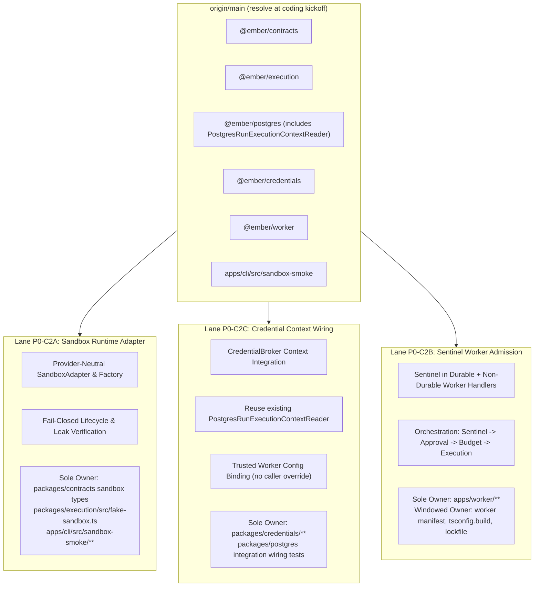
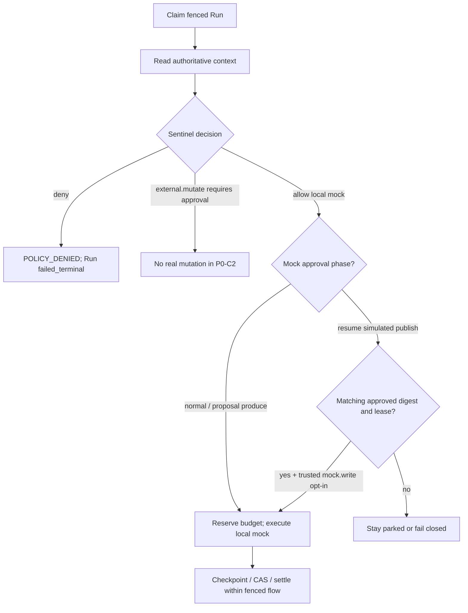

# Ember — P0-C2 Three-Lane Parallel Kickoff Proposal (v3)

> **Revision:** v3.0 (CTO Round 2 security/contract reconciliation)  
> **Status:** `READY FOR CTO KICKOFF REVIEW` (Development **NOT** started)  
> **Pre-Prompt Reference SHA:** `7057bcfcce84e46d70f5cfc6b6b3bd641de5f642` (main before the docs-only PR; **not** the implementation checkout SHA)  
> **Coding Baseline Rule:** After the docs PR merges, fetch `origin/main`, create the worktree from its then-current HEAD, and record the actual full SHA.  
> **Authority:** RFC v0.2 ADR-005, P0-C1 Integration Report, P0-C1 Architecture Gaps, CTO Review Directives  
> **Execution Gate:** **Requires explicit CTO approval before branch creation, PR opening, or coding begins.**

---

## 1. Executive Summary & Review Revisions

Following CTO review of the initial P0-C2 kickoff proposals, the architecture has been revised to eliminate regression risks, prevent duplicate implementations, and preserve hard-won fail-closed security invariants:

1. **Sentinel Admission & Approval Coordination (Lane B):**
   - Corrected fatal flaw where `enforceSentinelGate()` threw `POLICY_DENIED` on `require_approval`.
   - Worker pre-execution gate now uses `evaluateSentinelPolicy()` to distinguish `allow`, `require_approval`, and `deny`.
   - Preserves the established P0-B `mock.approval` lifecycle: the preparation phase (`produce` step) safely generates the artifact, step checkpoint, and pending approval row; the mutation phase strictly requires committed operator approval before execution.
   - Removed non-existent `policy_denied` terminal state; aligns with existing domain state machines (`completed`, `failed`, `cancelled`).
   - Defined complete task kind mappings across all four durable kinds (`mock.chat`, `mock.compute`, `mock.file`, `mock.approval`).
2. **Reusing Existing PostgreSQL Execution Context Reader (Lane C):**
   - Eliminated redundant reimplementation of context reader. Lane C will directly reuse the production-grade `PostgresRunExecutionContextReader` from `packages/postgres/src/repositories/run-execution-context-reader.ts`.
   - Clarified worker identity vs lease claim: `LeasedRun` does not contain `workerId`; the caller must supply its trusted operational identity, which the Broker re-authenticates against the authoritative `worker_id` recorded in PostgreSQL.
3. **Fail-Closed Sandbox Cleanup & Tri-State Leak Status (Lane A):**
   - Corrected false guarantee that cleanup always yields `resourcesLeaked: false`.
   - Enforces strict fail-closed leak assessment: `VERIFIED_CLEAN` (only when independently verified as 0), `CONFIRMED_LEAK`, and `UNKNOWN` (must fail closed as `FAIL`).
4. **Shared File Ownership, Change Windows & Worktree Rules:**
   - Established strict chronological change windows and sole file owners for shared files (`packages/execution/src/index.ts`, `apps/worker/package.json`, `apps/worker/tsconfig.build.json`, `pnpm-lock.yaml`).
   - Mandated dedicated independent Git worktrees for all agents; zero branches created in main checkout.
5. **Round 2 security corrections (v3):**
   - **Caller-submitted `workerId` is not authentication.** Lane C binds operational identity from trusted Worker composition/config only; no per-operation `callerWorkerId` override. Remote Worker authentication remains `NOT IMPLEMENTED`.
   - **EgressPolicy is trusted server state.** Lane C must not accept a per-operation `policy` override or import a concrete PostgreSQL implementation into `@ember/credentials`.
   - **Both Worker handlers are guarded.** Lane B covers `createRunHandler()` and `createDurableRunHandler()`, existing Run terminal state `failed_terminal`, and exact `TaskKind × phase` category mapping. A local `mock.file` write never masquerades as `mock.read`.
   - **Approval is not permission for a real external mutation.** Only existing simulated local proposal preparation and approved simulated publication are in P0-C2. `external.mutate`, real egress, host exec and credential use remain non-executable.

---

## 2. Three-Lane Scope & Responsibility Matrix



| Lane                                 | Core Deliverable                                                                                                                                                             | Exclusive Write Allowlist                                                                                                                                                                                                                                                                                                                                                                                                          | Forbidden Paths                                                                                                                          |
| :----------------------------------- | :--------------------------------------------------------------------------------------------------------------------------------------------------------------------------- | :--------------------------------------------------------------------------------------------------------------------------------------------------------------------------------------------------------------------------------------------------------------------------------------------------------------------------------------------------------------------------------------------------------------------------------- | :--------------------------------------------------------------------------------------------------------------------------------------- |
| **Lane P0-C2A** (Sandbox Adapter)    | Provider-neutral adapter/factory; abort propagation and lifecycle; independent cleanup verification with explicit `UNKNOWN` (never false zero-leak guarantee).               | `packages/contracts/src/interfaces.ts` (sandbox only)<br>`packages/execution/src/sandbox-adapter.ts` (new)<br>`packages/execution/src/fake-sandbox.ts`<br>`packages/execution/src/deterministic-executor.ts`<br>`packages/execution/src/index.ts` (Step 1 window)<br>`apps/cli/src/sandbox-smoke/**`<br>`tests/unit/p0c-sandbox-*.test.ts`                                                                                         | `apps/worker/**`<br>`packages/credentials/**`<br>`packages/postgres/**`<br>root manifests/lockfile                                       |
| **Lane P0-C2C** (Credential Context) | Reuse existing DB Reader by interface injection; **server-owned** EgressPolicy; locally trusted Worker ID binding (not cryptographic authentication); simulated result only. | `packages/credentials/src/**`<br>`tests/unit/p0c-credential-*.test.ts`<br>`tests/integration/credential-broker-postgres.test.ts` (new)<br>`docs/P0-C2C-CREDENTIAL-CONTEXT-WIRING.md`                                                                                                                                                                                                                                               | `apps/worker/**`<br>`packages/contracts/**`<br>`packages/postgres/src/**`<br>`packages/execution/**`<br>all manifests/lockfile           |
| **Lane P0-C2B** (Sentinel Admission) | Wire Sentinel to **both** `createRunHandler` and `createDurableRunHandler`; preserve approval/checkpoint/fencing and map `mock.file` to write only.                          | `apps/worker/src/**`<br>`apps/worker/package.json` (Step 3 window)<br>`apps/worker/tsconfig.build.json` (Step 3 window)<br>`packages/execution/src/sentinel-lite.ts`<br>`packages/execution/src/index.ts` (Step 3 window)<br>`pnpm-lock.yaml` (Step 3 window)<br>`apps/cli/src/cluster.ts` and `tests/e2e/support/e2e-cluster.ts` (**trusted local policy fixture only**)<br>Worker-related tests, with no A/C ownership collision | `packages/credentials/**`<br>`packages/contracts/**`<br>`packages/postgres/src/**`<br>`apps/cli/src/sandbox-smoke/**`<br>`migrations/**` |

---

## 3. Shared File Ownership & Sequential Change Windows

To eliminate merge conflicts and accidental overwrites across parallel agents:

```text
Chronological Change Sequence:
┌───────────────────────────┐      ┌───────────────────────────┐      ┌───────────────────────────┐
│     Step 1: Merge PR-C2A  │ ───> │     Step 2: Merge PR-C2C  │ ───> │     Step 3: Merge PR-C2B  │
│  (Sandbox Runtime Adapter)│      │ (Credential Context Reader│      │ (Sentinel Worker Wiring)  │
└───────────────────────────┘      └───────────────────────────┘      └───────────────────────────┘
```

1. **`packages/execution/src/index.ts` Change Window:**
   - **Step 1 (PR-C2A):** Lane A is the sole writer. Adds exports for `SandboxAdapter` and `SandboxProviderFactory`.
   - **Step 3 (PR-C2B):** Lane B rebases on updated `main` and adds any required Sentinel admission helper exports.
2. **`apps/worker/package.json` & `pnpm-lock.yaml` Change Window:**
   - **Lanes A and C are strictly forbidden from modifying manifests or lockfiles.**
   - **Step 3 (PR-C2B):** Lane B is the sole owner. After PR-C2C merges, Lane B adds `"@ember/credentials": "workspace:*"` to `apps/worker/package.json`, updates **`apps/worker/tsconfig.build.json`** project references if needed, and executes `pnpm install` to update `pnpm-lock.yaml`.
3. **`packages/postgres/src/repositories/run-execution-context-reader.ts`:**
   - **FROZEN & REUSED AS-IS.** Lane C must consume this reader without modifying its implementation or duplicating it into another file.
4. **`@ember/credentials` layering:** `packages/credentials/src/**` may depend only on the `RunExecutionContextReader` contract; it **must not import `@ember/postgres`**. Lane C tests (and later Lane B's trusted Worker composition root) instantiate the existing concrete Reader and supply it by interface. The Broker's Policy and trusted Worker identity are fixed at server composition, not passed as untrusted per-call options.
5. **Cross-lane contract freeze:** Lane C must publish the exact Broker constructor options and unchanged `executeWithCredential(...)` signature in its Draft PR. Lane B may develop against the frozen P0-C1 API in parallel, but cannot finalize the Credential integration until C has merged and the interface has been checked. Lane A's factory must accept a trusted `AbortSignal`; Lane B consumes it only after A lands.
6. **Harness ownership:** Because existing Demo/E2E fixtures construct Worker handlers, Lane B alone may update `apps/cli/src/cluster.ts` and `tests/e2e/support/e2e-cluster.ts` to inject **trusted local policy fixtures**, without touching Lane A's `apps/cli/src/sandbox-smoke/**`. Existing Worker-related test files may be adjusted only if B documents them and no A/C overlap exists. No permissive runtime fallback for an absent/invalid policy.

---

## 4. End-to-End Governance Orchestration Sequence

**Both** Worker handlers (`apps/worker/src/run-handler.ts` and `durable-run-handler.ts`) must derive a trusted `RunExecutionContext`, classify the **logical local action** deterministically, and evaluate a **trusted tenant/version-bound** Sentinel policy before any new task action or budget reservation. Durable path also validates approval, checkpoint, CAS and fencing on resume:



### Safety Invariants:

1. **No new budget on denial:** If Sentinel denies a _new action_, `budget.reserve` and its action callback are not called. Previously committed `produce` work is **not** retrospectively refunded when policy changes on resume.
2. **Exact mapping:** `mock.chat` and `mock.compute` are local `mock.compute`; `mock.file` is **`mock.write` (explicit trusted opt-in)**; `mock.approval`'s local proposal is `mock.compute`, its approved simulated publication is `mock.write` (also opt-in). Never alias a write to a read.
3. **Deadlock-free Approval:** `mock.approval` first commits the proposal/checkpoint/pending Approval, then parks. On a later Run, verify tenant/task, action digest, approval status and active fencing before simulated publish. Reject cancelled, expired, denied or mismatched approvals. No duplicate `produce` execution or charge.
4. **Real effects stay blocked:** `external.mutate` remains `require_approval` at the pure policy layer and no live external action is dispatched even when an approval exists. `network.egress`, `host.exec`, `credential.use` remain hard-denied.
5. **No path escape:** Both Durable and non-Durable Worker modes run Sentinel admission; existing committed Checkpoints are not erased by subsequent denial. Run terminal states use `failed_terminal`, not invented `failed`.
6. **Server-owned trust:** Neither policy nor worker identity can come from an untrusted request; local Worker-ID equality is not cryptographic authentication and no production Vault/network security is claimed.

---

## 5. Non-Negotiable Safety & Cost Boundaries

1. **Zero Outbound Network Traffic:** In-process simulated network only. Candidate cloud providers (`cloudflare`, `e2b`, `daytona`, `boat`) remain `NOT_MEASURED` (exit code 1 on attempt).
2. **Zero Paid Cloud Spend:** No vendor SDKs, API keys, or cloud spend authorized in P0-C2.
3. **Zero Plaintext Secrets:** Credential Registry stores synthetic metadata only (`credentialRef`). No production Vault or KMS.
4. **Mandatory Independent Git Worktrees:** All three agents must work in dedicated, isolated Git worktrees outside the main checkout.
5. **Draft PRs Only:** Target `main` via Draft PRs; auto-merge and unreviewed deployments are strictly forbidden.
6. **Post-merge verification gate:** Merge sequence A → C → B after individual review. B must rebase on both actual merge commits, update its lockfile/project references as needed, and rerun full static, unit, integration, chaos, E2E, 4-scenario Demo and local Sandbox smoke checks. After all three merges, an independent validation agent repeats the entire merged-main gate and 1,000-agent/100-concurrency benchmark; no premature P0-C2 acceptance.
7. **Scope:** Remote Worker authentication, container/microVM isolation, production credential storage and network egress enforcement remain `NOT IMPLEMENTED` and require future CTO-approved designs.

---

## 6. Prompt Manifest

1. `P0-C2A-SANDBOX-CODING-AGENT-PROMPT.md` (Agent C2A — Sandbox Runtime Adapter)
2. `P0-C2B-SENTINEL-CODING-AGENT-PROMPT.md` (Agent C2B — Sentinel Worker Admission)
3. `P0-C2C-CREDENTIAL-EGRESS-CODING-AGENT-PROMPT.md` (Agent C2C — Credential Context Wiring)
