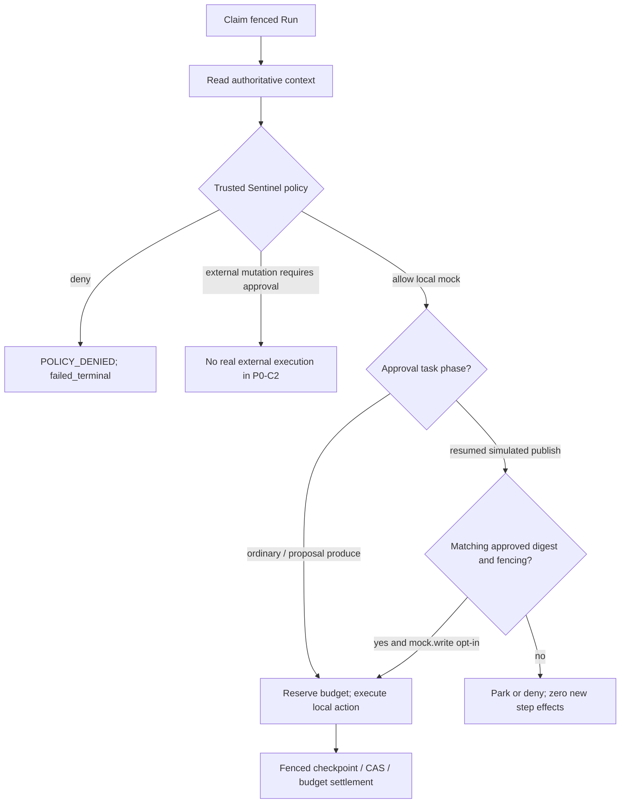

# Coding Agent Task Prompt — Lane P0-C2B: Sentinel Runtime Admission (v3)

> **Revision:** v3.0 (CTO Round 2 architecture hardening)  
> **Status:** `READY FOR CTO KICKOFF REVIEW; NO CODING UNTIL APPROVED`  
> **Role:** Execution Worker & Governance Security Engineer (Agent C2B)  
> **Repository:** `https://github.com/basicv8vc/Ember`  
> **Pre-Prompt Reference SHA:** `7057bcfcce84e46d70f5cfc6b6b3bd641de5f642` (main before the docs-only PR; **not** the implementation checkout SHA)  
> **Coding Baseline Rule:** After the docs PR merges, fetch `origin/main`, create the worktree from its then-current HEAD, and record the actual full SHA.  
> **Target Branch:** `feature/p0c-2b-sentinel-runtime-admission`  
> **PR Target:** `main` (Draft PR only; no auto-merge, no deployment)  
> **Priority:** P0 Foundation Integration  
> **Execution Rule:** **Do NOT create branches or edit files in main checkout. Create a dedicated Git worktree.**

---

## 1. Objective & Boundaries

### 1.1 Objective
Wire the **Sentinel-lite deterministic action admission gate** (`packages/execution/src/sentinel-lite.ts`) into **both** Worker execution boundaries (`apps/worker/src/run-handler.ts` and `apps/worker/src/durable-run-handler.ts`). Every claimed mock action must be checked against an authoritative, trusted server-side policy **before task effects / budget reservations**. Preserve existing Budget Guard, Lease Fencing, CAS, Checkpoint, Retry, Cancellation and Durable Approval semantics.

### 1.2 In-Scope
1. **Admission Gate Evaluation (`evaluateSentinelPolicy`):**
   - Use `evaluateSentinelPolicy(policy, intent)` rather than `enforceSentinelGate(...)` (which unconditionally throws on `require_approval`).
   - Evaluate the tri-state verdict (`allow` | `require_approval` | `deny`):
     - **`deny`:** Fail closed immediately with `DomainError('POLICY_DENIED', ...)`. Zero budget deducted (`budget.reserve` is NOT called), zero step callbacks executed. Existing `classifyFailure()` maps this to Run **`failed_terminal`**; the existing queue/committer converges the Task to **`failed`**. Do not write terminal states directly.
     - **`require_approval`:** Coordinate with persistent approval lifecycle (see §3).
     - **`allow`:** Proceed to `reserveBudget(...)` and step execution.
2. **Closed and exact Task Kind / phase classification (no ambiguous `A / B` aliases):**

   | Kind / phase | Sentinel category | Additional invariant |
   | --- | --- | --- |
   | `mock.chat` logical action | `mock.compute` | Local FakeLLM only; Fast Path stays zero Sandbox |
   | `mock.compute` logical action | `mock.compute` | Local deterministic compute only |
   | `mock.file` logical action | `mock.write` | Local logical Workspace write; requires **explicit trusted opt-in** to `mock.write`, never misclassify as `mock.read` |
   | `mock.approval` proposal/`produce` | `mock.compute` | Only creates a local simulated proposal, artifact, checkpoint and pending Approval; no external mutation |
   | `mock.approval` resumed simulated `publish` | `mock.write` | Requires a committed, matching Approval **and** trusted local `mock.write` opt-in; publication is local CAS bookkeeping, not external API mutation |
   | Actual `external.mutate`, `network.egress`, `host.exec`, `credential.use`, unknown action | `require_approval` or `deny` per Sentinel | **Never dispatch any real side-effect callback in P0-C2**, even if an Approval is marked approved |

   Internal checkpoint/event/lease bookkeeping is not to be relabeled as an untrusted `mock.read` to bypass `mock.write`. Verify the policy **again on checkpoint resume**; preserve the committed action digest and fencing checks before `publish`. A policy rejection may stop a run without deleting previously committed side effects. Default `createDefaultSentinelPolicy()` still excludes `mock.write`; enable it only through a **trusted local/test policy fixture or explicit trusted configuration** for legitimate P0-B mock scenarios. Do not silently loosen the global default.
3. **Existing Domain State Machine Alignment:**
   - Use existing domain states from `@ember/domain`. Do NOT invent non-existent statuses like `policy_denied`.
   - On denial: Run status **`failed_terminal`**; Task terminal status **`failed`** via the existing queue/committer. Never invent Run status `failed`, never invent Task status `policy_denied`.
4. **Policy Authority and Dual Handler Coverage:**
   - Policy ID, allowed actions and version must come from a **trusted server-side Worker composition root/config**, not Task input, LLM prompt, HTTP body, or arbitrary `LeasedRun` fields. Validate the policy's tenant/version against the authoritative `RunExecutionContext`. Absent/malformed/mismatched policy is Fail-Closed; specify local/test opt-ins explicitly.
   - Apply the same admission semantics to non-durable `createRunHandler()` and durable `createDurableRunHandler()`. If a mode cannot safely implement the gate, disable task claiming in that mode until fixed. Guard initial execution, resumed runs, and relevant publish boundaries; `mock.file` must not bypass the gate merely because it does not call `executor.execute()`.
   - The existing Demo and E2E harnesses directly construct Worker handlers. Add **explicit trusted local/test policies** in their composition/fixtures as needed; do not silently add an insecure handler default or weaken `createDefaultSentinelPolicy()` for the sake of keeping green tests.
5. **Integration with Landed Modules (Step 3 Change Window):**
   - Add `"@ember/credentials": "workspace:*"` to `apps/worker/package.json`.
   - Update `apps/worker/tsconfig.build.json` to reference `packages/credentials/tsconfig.build.json` as required, and refresh `pnpm-lock.yaml` only during the B-owned integration window after C merges.
   - Wire Lane C's simulated Broker facade in the **trusted Worker composition root** only. Pass no raw credentials, caller-supplied policy or untrusted worker ID. A live egress/credential action remains blocked; only synthetic `SIMULATED` responses are allowed. Keep the Worker fully operational when no simulated credential action is requested.

### 1.3 Out-of-Scope (Strict Non-Goals)
- **NO Bypassing Sentinel for External Mutate:** `external.mutate` must NEVER evaluate directly to `allow`.
- **NO Direct Edits to Sandbox Contracts:** Do NOT modify `packages/contracts/src/interfaces.ts` (owned by Agent C2A).
- **NO Direct Edits to Credential Internals:** Do NOT modify `packages/credentials/src/**` (owned by Agent C2C).
- **NO Real External Mutations:** An approved `mock.approval` resumes only a simulated local publication; approved status does not convert `external.mutate` to Sentinel `allow`.

---

## 2. File Ownership & Change Windows

### 2.1 Allowed Write Paths
- `apps/worker/src/durable-run-handler.ts`
- `apps/worker/src/run-handler.ts` (**non-durable simulated path must not bypass admission**)
- `apps/worker/src/poll-loop.ts`
- `apps/worker/src/config.ts`
- `apps/worker/src/index.ts`
- `apps/worker/package.json` (**Sole owner during Step 3 integration window**)
- `apps/worker/tsconfig.build.json` (**Sole owner during Step 3 integration window**)
- `apps/cli/src/cluster.ts` (**only for trusted local Demo policy injection; do not touch sandbox-smoke/***)
- `tests/e2e/support/e2e-cluster.ts` (**only for trusted local E2E policy injection**)
- `pnpm-lock.yaml` (**Sole owner during Step 3 integration window**)
- `packages/execution/src/sentinel-lite.ts` (context mapping helpers)
- `packages/execution/src/index.ts` (**Step 3 window only**)
- `tests/unit/worker-poll-loop.test.ts`
- Existing unit/integration/chaos tests directly instantiating `createRunHandler`/`createDurableRunHandler`, **only where required to supply trusted policies and assert denial**; enumerate exact touched filenames in the PR and obtain CTO approval before any ownership overlap with A/C.
- `tests/integration/worker-sentinel-admission.test.ts` (new)
- `tests/integration/worker-sentinel-nondurable.test.ts` (new)
- `tests/chaos/b-t28-sentinel-worker-fencing.test.ts` (new)
- `docs/P0-C2B-SENTINEL-WORKER-ADMISSION.md` (new)

### 2.2 Forbidden Paths (STRICT)
- `packages/credentials/src/**`
- `packages/contracts/**`
- `packages/postgres/src/**`
- `migrations/**`

---

## 3. Trust Boundary & Governance Sequence



### Critical Security Invariants:
1. **Pre-Execution Denial:** If Sentinel evaluates to `deny`, neither `reserveBudget` nor `executor.execute` is ever called.
2. **Deadlock-Free Approval Creation:** The preparation phase (`produce` step of `mock.approval`) is treated as a local simulation that creates the approval entity. It is not blocked by requiring prior approval.
3. **Mutation Gate:** Real `external.mutate` is **never executable in P0-C2**, with or without approval. Existing `mock.approval` approval status only authorizes a local **simulated publish** after matching action digest, task/tenant, fencing and explicit `mock.write` policy allowance.
4. **Policy source:** Policy is trusted and tenant/version-bound. No missing/invalid policy fallback to permissive mock actions.
5. **No path bypass:** The non-durable handler and resumed/publish path receive equal enforcement; no hidden callback or Workspace write escapes via `mock.file` or a checkpoint replay.

---

## 4. Implementation Steps (Ground in Merged Code)

1. **Create Dedicated Worktree:**
   ```bash
   git fetch origin main
   git rev-parse origin/main # record actual post-docs-merge SHA
   git worktree add -b feature/p0c-2b-sentinel-runtime-admission ~/Downloads/worktrees/ember-p0c-2b-sentinel origin/main
   cd ~/Downloads/worktrees/ember-p0c-2b-sentinel
   pnpm install --frozen-lockfile
   pnpm test:unit
   ```
2. **Implement Sentinel Pre-Execution Gate in both Worker handlers:**
   ```typescript
   import { evaluateSentinelPolicy, createDefaultSentinelPolicy, toSentinelDeniedError } from '@ember/execution';

   // Before runBudgetedStep(...) in durable-run-handler.ts; the actual
   // existing helper is named runBudgetedStep, NOT executeStepWithBudget.
   const intent = {
     tenantId: context.tenantId,
     runId: context.runId,
     taskId: context.taskId,
     actionCategory: resolveSentinelCategory(context.kind, stepId),
     policyVersion: context.policyVersion,
   };
   const decision = evaluateSentinelPolicy(policy, intent);

   if (decision.verdict === 'deny') {
     throw toSentinelDeniedError(decision); // Zero budget reserved!
   }
   ```
3. **Map Task Kinds to Action Categories:**
   Implement `resolveSentinelCategory(kind: TaskKind, phase: 'produce' | 'publish'): SentinelActionCategory` using the exact matrix in §1.2. Make local policy fixtures opt in to `mock.write` for the expected P0-B scenarios without changing the global default. Internal bookkeeping is not an excuse for an unsupported action kind.
4. **Preserve Approval Preparation & Resume:**
   Ensure `context.kind === 'mock.approval'` executes `produce` to register `pending` Approval without premature approval checks. On new Run/resume, validate the **same task/tenant and action digest** via existing `listForGrant`, reject denied/expired/missing/mismatched approvals, and only then publish the simulated result. No double-charge/re-execution of a completed `produce` checkpoint.
5. **Add Comprehensive Unit, Integration, and Chaos Tests:**
   - Verify 0 budget consumed on policy denial.
   - Verify task transitions to `waiting_approval` when awaiting approval.
   - Verify chaos SIGKILL recovery preserves Sentinel policy enforcement on resume; new policy denial prevents publish and does not erase prior checkpoint.
   - Explicitly cover non-durable handler, `mock.file` without `mock.write` opt-in, fake high-risk action categories, wrong policy version/tenant, cancellation during approval, and no double billing on resume.

---

## 5. Acceptance Criteria & Definition of Done (DoD)

- [ ] `pnpm format:check`, `pnpm lint`, `pnpm typecheck`, `pnpm build` pass with exit code 0.
- [ ] Unit tests pass: `pnpm test:unit`.
- [ ] Integration regression passes: `pnpm test:integration`.
- [ ] Chaos tests pass: `pnpm test:chaos` (including Worker process SIGKILL recovery).
- [ ] HTTP E2E suite passes: `pnpm test:e2e` (all relevant tenant and approval assertions).
- [ ] Existing Demo/E2E harnesses use explicitly trusted local policy fixtures where needed; no API-level or Task-supplied policy override is introduced to avoid changing fixtures.
- [ ] Product demos pass: `pnpm demo` (all 4 scenarios).
- [ ] Asserted invariant: Denied Sentinel intent results in 0 **new** budget consumed, 0 executor calls, Run terminal `failed_terminal` and Task terminal `failed` via existing state machine. A previously committed step remains accounted for, not retroactively refunded.
- [ ] Asserted invariant: `mock.approval` produce step creates checkpoint and parks in `waiting_approval` without deadlock.
- [ ] Asserted invariant: Resumed `mock.approval` with `approved` status completes successfully without re-running produce step.
- [ ] Asserted invariant: `mock.file` is never admitted as read; both durable and non-durable Worker paths enforce policy and policy version/tenant match.
- [ ] Asserted invariant: Approved `external.mutate` still cannot invoke any real tool or network call in P0-C2.

---

## 6. PR Delivery Instructions

1. Open Draft PR titled: `feat(worker): P0-C2B Sentinel-lite runtime admission gate`.
2. Target branch: `main`. Starting reference SHA: `7057bcfcce84e46d70f5cfc6b6b3bd641de5f642`; **wait for A and C PR merge, fetch/rebase onto their actual merge HEAD**, resolve conflicts with no force-push to main, and rerun all tests before requesting review. Record true base/head SHAs.
3. Include local/CI commands and actual results, test counts, changed-file list, worker-mode coverage matrix, remaining security boundaries, and rollback plan.
4. Do NOT merge or trigger production workflows.
